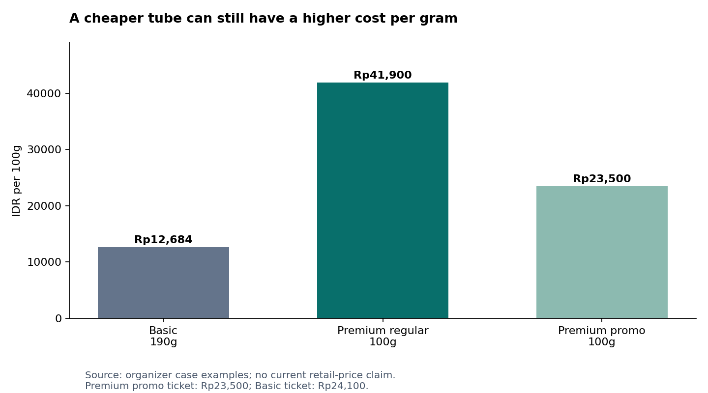

# Pepsodent Premium: what the evidence changes about the replenishment decision

**Research release:** 3 November 2026, Asia/Jakarta.  
**Purpose:** Diagnosis, teaching, and conditional strategic directions for the E-Fest case. No final solution selected.  
**Scope:** Indonesia; Jakarta as the intended reference for later local verification. Current public catalogue observations do not verify Jakarta branch stock.  
**Methods:** Six parallel investigations, direct public-page/API collection, primary-source document review, structured literature discovery, source-specific consumer-text collection, and reproducible analysis of the existing keyword dataset and case economics. No Apify jobs or paid services were run. No interviews or physical store checks were conducted.

## 1. The answer I would carry forward

Your notes point toward a more useful question than “How do we convince young people Premium is better?” Ask: **What has to survive from first trial to the next real purchase for the extra benefit to remain worth funding?**

A sustainable Premium purchase requires a relevant need, an understandable offer, an acceptable experience, a person with purchase authority, a tolerable replacement cost, and an accessible variant. These conditions interact. Improving awareness cannot repair every failure in that chain.

The most important findings from this run are:

1. **The broad minimarket-absence hypothesis is too strong.** An official Indomaret flyer explicitly promoted Sensitive Expert Original/Whitening 100g in June–July 2025. The remaining availability question concerns exact variants, branches, dates, visibility and replenishment trips. [R1]
2. **Pepsodent already uses differentiated Premium marketing.** Ultra White has a fashion/beauty route, while Expert and the wider brand have health/consultation routes. Its current site already links a ShadeScan AI visualization. A generic awareness campaign or AI scanner is therefore not automatically a new answer. [R2–R4; brand annex]
3. **The price problem has at least three components.** The initial tube payment, ongoing cost per gram, and uncertainty about paying extra for a benefit are different frictions. A deep discount can change the first while leaving the others unresolved. [Case economics; Section 7]
4. **Sensory value is real as an experience, but cannot substitute for measured efficacy.** A retrieved toothpaste trial found formulation differences in sensory ratings without significant between-group differences in its measured plaque/gingival outcomes. It does not establish that all toothpastes are equivalent. [L1]
5. **The household is a plausible decision unit, but we still cannot estimate who pays among the target.** Public text includes experience reported on behalf of another household member. That helps frame interviews; it does not reveal national payer prevalence or prove an age-specific switching mechanism. [Consumer annex]
6. **Several attractive explanations have important counterexamples.** More choices do not universally reduce choice; deeper discounts do not universally destroy later purchasing; and stopping/restarting a sensitivity formulation cannot be reduced to an assumed universal symptom-recurrence story. [L2–L5; literature annex]

The defensible diagnosis remains provisional: **Pepsodent may retain trusted default status while some specialist benefits fail to become a durable, funded choice at replenishment.** The evidence supports investigating the conditions behind that failure. It does not yet allocate the case’s seven-point mix decline to specific causes.

## 2. What was actually collected — completed large-scale extension

The final expansion **screened 26,125,466 Amazon review rows** and retained a separate international candidate corpus. The integrated written-text database contains **298,846 canonical source records/fingerprints**, with demographics and relevance explicitly qualified. This is substantially larger than the initial snapshot below, but it is not 298,846 Indonesian young buyers.

| Final canonical written layer | Records | What the count means |
|---|---:|---|
| Amazon external title-matched candidates, all retained product scopes | 286,706 | International historical context; includes separately flagged accessories/children/alternatives/unresolved types |
| **Adult-toothpaste-title subset within Amazon** | **196,872** | Written rule-screened candidates, not manually verified adult users or an additional independent sample |
| Lazada | 681 | Selected toothpaste-listing reviews |
| Watsons | 7,419 | Written records from 10,191 review/rating records;2,772 ratings-only excluded from text layer |
| ORESA, four campaigns | 2,228 | Original 298 plus 1,930 new; incentives/sampling strata explicit |
| TryandReview | 1,423 | Complete source-displayed histories for selected Basic, Complete8, Closeup products; replaces earlier 100 |
| Reddit archive | 389 | Selected relevant/context comments; replaces overlapping earlier 75 reader excerpts |
| **Integrated written records/fingerprints** | **298,846** | Not people; contains weak/templated/adjacent context with explicit flags |
| Additional X posts, separate table | 6 | Five brand posts and one consumer purchase account; not added to the integrated review/comment count |

The separate international adult-title subset plus the 12,140 source-specific non-Amazon written records would be 209,012 records, but their populations and methods differ and should not be pooled into an Indonesian estimate. The integrated store keeps all retained scope classes for transparent exclusions. **2,970 nontext records are excluded** from its written layer: 2,772 Watsons and 198 Amazon. 2,680 repeated derived-identity observations remain in provenance rather than inflating canonical counts.

The larger source work adds full history coverage for selected review listings, 389 archive comments and a working bounded public-X route. It also exposes stronger incentive and text-repetition bias. Use the [expanded synthesis](synthesis/SCALE_SYNTHESIS.md), [international methods](scale_amazon/README.md), and [store statistics](scale_pipeline/clean/collection_stats.json) alongside the narrative.

### Other collected evidence

| Evidence layer | Actual retained count | Interpretation |
|---|---:|---|
| Retail seller/product contexts | 96 | Oral-care contexts: 95 toothpaste + one whitening serum; no verified Jakarta checkout stock |
| Usable brand/source artifacts | 53 | From 62 attempted URLs; 5 HTTP-success templates excluded |
| Canonical product-page subset | 28 | Subset of brand artifacts, not added as new sources |
| Curated campaign observations | 18 | Derived source observations, not 18 independent campaigns |
| Historical promotion events | 12 | 10 price offers and 2 conditional programmes; incomplete history |
| Published health indicators | 8 | Aggregate indicator/year rows, not respondents |
| BPS variable definition | 1 | Metadata, not consumer microdata |
| Literature discovery records | 148 | Metadata candidates, not all read |
| Retained literature evidence | 25 | 21 abstract-level; 4 relevant full-text-section appraisals |
| Existing supplied keywords | 300 | Reanalyzed, not newly collected |
| Proposed Apify inputs | 12 | Schema-validated, unexecuted configurations; $0 spent |

The earlier phase1 consumer snapshot had 1,154 IDs and is retained for provenance; its overlapping rows are not added again. Its nine encoding warnings prompted the corrected UTF-8 reparse in the expanded TryandReview data. Manual evidence annotations are selected examples, not a complete thematic audit of every retained record.

These are different units. Catalogue entries are not buyers; reviews are not necessarily unique people; comments from one discussion are not independent interviews; bibliographic candidates are not fully appraised studies. Existing keyword rows are not new collection. The package retains raw, cleaned and derived material separately, with scripts and access logs.

The free collection materially exceeded a search-only desk review. Public server-rendered commerce data and APIs were more productive than installing a universal scraper wrapper. A tool returning an HTTP-success status or a nominal item was not accepted without checking whether it contained the requested data.

The corpus remains selected. Search engines, listing choices, default review ordering, platform history, sampling campaigns, and accessible endpoints all shape what appears. This is useful mechanism evidence and source-specific description, not a nationally representative survey.

## 3. The case's accounting problem comes before its causal explanation

The organizer reports Premium’s sales share falling from 27% in 2022 to 20% in H1 2026. That establishes a seven-percentage-point share decline. It is approximately a 25.9% relative decline in the share itself. It does not establish a 25.9% fall in Premium revenue.

Suppose the measures refer to comparable revenue periods. Premium revenue would be `total brand revenue × Premium revenue share`. A brand whose comparable revenue rose 35% could hold absolute Premium revenue unchanged while its share moved from 27% to 20%. The case does not supply the necessary comparable totals or clearly resolve every sales-share definition. This is an arithmetic boundary, not an assertion that Premium revenue was unchanged.

A more useful revenue bridge is:

`purchasing households × purchase occasions per purchasing household × grams per occasion × realized manufacturer revenue per gram`.

Each factor can change for different reasons. Reduced purchases can reflect fewer purchasers, stockpiling, a larger pack, lower usage, channel switching, or actual abandonment. A single Basic purchase can be for another household member while Premium remains in use. Those possibilities qualify interpretation; they do not negate the organizer’s stated downtrading premise.

The official Unilever FY2025 and H1 2026 sources corroborate the corporate figures in the handoff. Their scope is the company, including continuing-operations definitions. They do not identify Pepsodent Premium's margin, age profile or switching rate. In particular, a corporate gross-margin change cannot be causally attributed to this tier shift from these sources. [R5–R6]

**What would settle the business magnitude:** Consistent Premium tier definitions; value and volume by SKU/channel/time; household penetration and purchase frequency; realized net prices; promotion funding; repeat windows and inventory; and incremental contribution. Public evidence does not replace those internal measures.

## 4. Is Premium actually easy to access?

Your personal observation is a good starting signal. It is weak evidence for national distribution. The historical Indomaret document is stronger evidence for channel participation: page 18 of the PDF, printed page 16, lists Sensitive Expert Original/Whitening 100g at a displayed promotional Rp19,900 against Rp39,900 for 26 June–9 July 2025. It also shows a points offer. The flyer covers a specified regional edition; it is not a guarantee of stock in every store. [R1]

The retail investigation separately collected current online catalogues, including direct Watsons structured product data. The useful distinction is:

| Observation | Supports | Does not establish |
|---|---|---|
| Official flyer includes exact variant | Retailer planned/promoted the offer in that edition/time | Every branch stocked it, or the shopper saw it |
| Catalogue product exists | A digital listing with identified product/pack | Physical shelf availability or completed purchase |
| Catalogue stock field says in stock | That field's returned value | Fulfilment from a Jakarta branch if location/loading state is unresolved |
| Product can be added after location selection | Observed purchasability for that location/time | Long-run service level |
| Team sees product on shelf | Local physical presence at that moment | National weighted distribution |
| Search finds no product | This search failed to find it | Product absent from the retailer |

The current data expose a useful warning: catalogue stock flags can coexist with a false purchasability flag or an unloaded-stock state. Reporting a precise “available in Jakarta” claim from such combinations would be false precision. The dataset preserves those distinctions.

One particularly useful actual account combines satisfaction with friction: `LZD-1574262094522499` (11 April 2025) describes buying a bundle for savings because the variant suits the buyer, while reporting frequent unavailability. This is a single stated experience, not a stockout rate or confirmed downtrading. The current listing name is Active Remin 105g×2; continuity between that title and older reviews is not established. It shows why price, perceived benefit and access should be allowed to coexist in the diagnosis.

**Better hypothesis:** A shopper may fail to find the particular benefit/variant they learned to prefer at their normal replenishment trip, despite broad masterbrand availability. That can generate a Basic fallback. It remains to be verified through actual trips and exact-SKU checks.

**What to do with this insight:** In later primary research, reconstruct the store and alternatives from the last replacement. Do not ask only “Is Pepsodent easy to find?” That question would miss the difference between seeing Basic and finding Sensitive Expert Complete Care in the intended size.

## 5. Does this make D2C the likely business model?

No reliable inference of D2C dominance follows from the retailer-turnover hypothesis. Retailers can carry specialist lines through different assortments and promotions; the Indomaret evidence demonstrates at least one such route. Official product websites can direct demand to third-party stores rather than operate a brand-owned transaction.

Use the following channel taxonomy:

- Brand-owned checkout with a known selling entity.
- Brand-branded marketplace store, with the actual operator identified where possible.
- Authorized retail/pharmacy chain.
- Independent marketplace seller.
- Offline general trade, supermarket, minimarket, or health-and-beauty store.
- Service/education partner that generates demand but does not sell the tube.

On the inspected Expert page, the “Beli Sekarang” link points to an internal product-list anchor, not a verified brand-owned checkout. This is one inspected route, not a statement about every brand page. A marketplace listing with the word “official” is evidence about the storefront label, not complete evidence about inventory ownership, invoicing, customer-data ownership or contractual economics. The research does not establish D2C’s sales share.

The retailer incentive question remains commercially valuable. A high-margin slow-moving SKU can still generate worse shelf productivity than a fast-moving lower-margin SKU. Conversely, supplier funding, basket effects and strategic assortment can justify stocking it. Relevant measures would include contribution per facing, inventory turns, stockouts, promotional lift and replenishment reliability. Those measures were not disclosed in our public catalogue collection.

## 6. What is Pepsodent, and what does its Premium tier stand for?

A careful single-sentence synthesis of the brand's **observed intended positioning** is: **Pepsodent presents accessible, trusted care that helps households protect teeth and feel confident about their smiles, with specialist offers for particular needs.**

This sentence is an interpretation of brand material, not a measured statement of what all Indonesians believe. Three layers should remain separate: what management wants the brand to mean; what communications and offers actually express; and what consumers take away.

The product/campaign inventory shows that Premium is not one uniform proposition. Sensitive Expert speaks to sensitivity and specialist care. Ultra White uses appearance, brightness and confidence. Herbal and Complete-related offers bring their own benefit language. The case's tier examples do not supply an exhaustive SKU-by-SKU segmentation for every current catalogue product.

A dated example is Ultra White's “Be the Brightest of Them All” event at Jakarta Fashion Week on 30 October 2025. The organizer connects the smile proposition with fashion/beauty expression. The edition name and web footer must not be confused with the actual event date. [R2]

The Pepsodent/Halodoc material shows a consultation-access route across participating marked packs, with specified conditions. The documented period is August 2024–July 2025. The terms and FAQ must be read together: a currently visible page is not proof that every voucher remains redeemable now. This route already connects product purchase, digital interaction and care access; it should be benchmarked before proposing the same mechanism as novel. [R4; historical annex]

The current ShadeScan AI page offers a visualization of five-shade-whiter appearance and links to a third-party tool. We observed the page, not validated diagnostic accuracy, sustained use, conversion or health outcomes. Its presence means “create an AI smile scanner” alone is weak novelty. [R3]

The brand annex compares competitor language. Of particular interest, Enzim's detergent-free differentiation and Sensodyne Deep Clean's foam/freshness route show that premium sensory positioning can differ. There is no universal premium taste or mouthfeel that every shopper must prefer.

A need-matched comparison is more useful than treating every expensive tube as the same category:

| Brand/line | Observed intended differentiation | What this makes worth testing |
|---|---|---|
| Pepsodent Sensitive/Gum Expert | Specialist need and care/repair cues, with variant-specific extras | Need fit, trust transfer and appropriate continuing value |
| Pepsodent Ultra White | Smile appearance, science cues and beauty confidence | Expected visual result, evaluation period and cosmetic competition |
| Sensodyne | Sensitivity-led portfolio, additional need filters and routine-use language | How a specialized masterbrand reduces selection and continued-use uncertainty |
| Enzim | Enzyme/no-detergent proposition | Whether low-foam comfort and product identity matter to actual users; manufacturer claims require independent appraisal |
| Closeup whitening offers | Appearance/color or stain-related propositions alongside sensory freshness | Benefit-matched competition, with corporate cannibalization considered separately |

This table summarizes intended positioning from the archived official pages, not a measured perceptual map. The brand annex provides page URLs and exact locators. Enzim's FAQ contained unrelated spam links, so its source-quality issue and unverified clinical claims remain flagged.

One way to understand the existing marketing is through five handoffs: attention, need recognition, correct variant, acceptable experience, and funded replacement. Fashion activity can create interest; science content can explain proof; self-checks can support selection; consultation and sampling can help initial access or trial. None by itself establishes the final handoff to a sustained paid replacement. Good execution at one stage can coexist with weakness at another.

**Implication:** The relevant message may differ by need and occasion. The open question is which current promise fails to become a compelling choice at replacement, not whether the brand has ever communicated specialist benefits.

## 7. Affordable to acquire, expensive to keep using

This is one of your strongest distinctions. It becomes sharper when separated into three problems.

**Cash-flow affordability:** Can the shopper pay for the tube today? A smaller pack or promotion can reduce the initial payment.

**Sustained affordability:** What does continued use cost at the actual consumption rate and replacement price? A small tube may run out faster, while a high per-gram cost persists.

**Risk-adjusted value:** Is the shopper confident that the additional benefit will matter enough to justify the difference? Someone with sufficient cash may still reject the purchase as poor value.

Using only the organizer's example prices:

| Offer | Tube price | Size | Exact cost per 100g | Relative to Basic per gram |
|---|---:|---:|---:|---:|
| Basic | Rp24,100 | 190g | Rp12,684 | 1.00× |
| Premium regular | Rp41,900 | 100g | Rp41,900 | 3.30× |
| Premium promotion | Rp23,500 | 100g | Rp23,500 | 1.85× |

The promoted Premium tube has a slightly lower ticket than Basic but still costs about 85% more per gram. The ordinary Premium tube has about 47% fewer grams. Those are case arithmetic, not current market-wide prices.

For illustration, assume two users, two brushing occasions daily, and one gram each occasion. This is a financial scenario, not dosing advice. At four grams/day, the Basic 190g tube lasts 47.5 days and a 100g tube lasts 25 days. Modeled 30-day costs are approximately Rp15,221 for Basic, Rp50,280 for regular Premium, and Rp28,200 at the case promotional unit price. Change the assumed amount or users and the costs change; the observed price-per-gram ratio remains.

The package contains 27 scenarios varying users and assumed grams/occasion. They illustrate why the household payer may experience “small pack” as a recurring cost rather than merely an entry-price benefit. They do not estimate actual toothpaste use in Indonesian homes.

**Current pack correction:** The live Watsons capture already includes Sensitive Expert Whitening 100g at Rp23,500 and 160g at Rp29,900. Those correspond to Rp23,500 and Rp18,687.50 per 100g: the larger offer is about 20.5% cheaper per gram, with a higher ticket. The same capture has Basic 190g at Rp21,100. These are current catalogue offers with unresolved branch purchasability, not replacements for historical case facts. Retail record IDs are `WATAPI-PEPSODENT-005`, `-031`, and `-046`.

This separates three possible interventions: create a genuinely missing pack; make an existing pack accessible in habitual channels; or make its unit value understandable. Only the first requires inventing a new pack. A current indexed 60g minimarket listing similarly means a small-trial idea must establish what is missing before claiming novelty.

**Important rival:** Small packs can also signal higher quality, reduce waste risk, improve portability, or provide specialist personal use. Research on package size and perceived quality supports conditional effects rather than “small always looks bad.” [L6] What matters is the customer's comparison and use situation.

## 8. What can we actually say about discount history?

We recovered dated promotion events, not a continuous historical panel. One verified Indomaret offer shows roughly half-off a displayed reference price. The historical annex also includes dated pharmacy/retailer evidence and explains conditions. A visible reference price does not prove that shoppers previously paid it, how often the offer occurred, or who funded it.

A promotion can create at least five different transaction types:

1. An appropriate new user discovers a valuable specialist product and repeats.
2. A deal-seeker tries it but normally prefers Basic at regular prices.
3. An established Premium user buys early and postpones their next purchase.
4. A current Premium buyer receives a subsidy without changing behavior.
5. A shopper shifts from another brand, or from another Unilever product.

Only some of those are incremental and profitable. “Discounts do not ensure sustained use” is correct. “Discounts inherently prevent sustained use” is not supported.

Anderson and Simester's three field experiments found different longer-run effects for new versus established customers. The setting was durable goods sold through a mail-order catalogue, not Indonesian toothpaste. It is an important counterexample to an absolute claim, not a transferable uplift estimate. [L4]

The right comparison is not simply promo buyers versus loyal buyers. New promotion buyers and established loyal buyers differ in tenure, need, selection and channel. Prefer cohorts of comparable first-time buyers with actual first-paid price, subsequent purchase, SKU/need and observation period. Even matching does not automatically prove a causal promotion effect.

**What is still missing:** Non-promo paid repeat, pack inventory at home, first-purchase conditions, realized manufacturer revenue and costs. Review comments about promotions can describe shopping experiences but do not identify a retention curve.

## 9. How to understand “clean,” “change,” and “impact”

These words hide different outcomes:

| Dimension | What a user may notice | Evidence needed for the claim |
|---|---|---|
| Immediate sensation | Mint intensity, foam, smoothness, burn, aftertaste, cooling | Described experience or sensory testing |
| Perceived cleanliness | A fresh or “kesat” mouthfeel | User interpretation; separate from clinical measurement |
| Visible appearance | Stain removal or perceived whiteness | Appropriate standardized assessment for an objective claim |
| Symptom experience | Changes in reported sensitivity/discomfort | Relevant repeated symptom measure and clinical context |
| Preventive health | Caries/gingival or other outcomes | Suitable clinical evidence with population, duration and formulation |
| Commercial result | Paid repeat at acceptable contribution | Purchase and economic evidence |
| Social impact | Improved behavior or a relevant health outcome | A defined outcome and credible measurement pathway |

Sälzer and colleagues compared two formulations in an eight-week randomized study involving non-dental students. Sensory evaluations favored the SLS-containing formulation on taste/freshness/foam while reported between-group plaque and gingival-bleeding differences were not significant. The formulations differed in more than one ingredient, and funding/conflict details matter. The study supports separating sensory response from measured endpoints; it cannot isolate a universal SLS effect or prove all products equivalent. [L1; full-text appraisal in literature annex]

In our collected public text, people describe comfort, freshness, taste and sensitivity in overlapping ways. Some records contain platform-style benefit phrases mixed with personal writing. The analysis therefore flags lexical cues rather than interpreting every phrase as an independently expressed motivation.

For Enzim, an official detergent-free proposition does not prove what your mouth will feel, nor that every consumer values low foam. For Pepsodent, a clinical mechanism does not guarantee that a new user perceives a visible change within two weeks. A commercial promise can fail because the benefit is irrelevant, expectations are mismatched, the experience disappoints, or the wrong formulation was chosen. These are distinct possibilities.

**Practical teaching point:** Ask “What difference were you looking for?” before “Did you feel a difference?” The former reveals the evaluation rule. Someone using a sensitivity variant while judging visible whitening could be disappointed for a reason that more generic evidence cannot fix.

## 10. The household hypothesis and the meaning of “who paid”

It is useful to model six roles: user, chooser, payer, person placing the order, replenishment manager, and beneficiary. One person can occupy several roles. A public reviewer discussing a spouse's experience does not reveal who funded the purchase.

A review on a listing currently titled Sensitive Complete Care explicitly reports the husband's sensory/need experience (`LZD-2032630484394818`, 22 November 2025). That is concrete evidence that the speaker and described user can differ. It is not an interview, a prevalence estimate, or proof the household traded down. Other records describe family suitability or buying for a parent, providing additional prompts for later questioning. [Consumer corpus and annotation table]

For a student using toothpaste supplied by parents, the perceived alternative may have no extra personal cash payment. Comparing Premium against the full Basic shelf price can therefore miss the actual decision: paying personally versus continuing an already supplied shared tube.

If that mechanism dominates, four conditional routes become worth investigating:

- Make the relevant benefit understandable to the household chooser/payer.
- Let a genuinely specialist user make an appropriate personal purchase alongside household Basic.
- Demonstrate household relevance where several members actually benefit.
- Accept that this household is not currently an economical Premium-return target.

None follows automatically from age. We cannot assume parental provision across the 18–30 range, and it would be wrong to shame a rational Basic purchase. Shared consumption could also support Premium if multiple users value the benefit enough.

“Entering independent purchasing” is better described here as a change in payment responsibility and reference point. The consumer may discover a cost they did not previously face. That differs from conventional switching costs such as learning, search effort, accumulated benefits or exit penalties.

## 11. Is sensitivity toothpaste an episodic purchase?

It can be treated episodically by a consumer, but the reason must be reconstructed. Candidate mechanisms include perceived need resolution, financial trade-offs, professional advice, irritation, misfit, competing household purchases, availability, or continued use of existing stock.

A useful public record says the writer experienced less sensitivity and intended to keep trying until the discomfort resolved (`LZD-1200640450822499`, 1 July 2023). This supports the existence of a symptom-resolution expectation. It does **not** document subsequent stopping, switching to Basic or recurrence.

The literature investigation also retrieved an episodic-use trial that did not show the simple universal regimen difference one might expect. Mason et al.’s exploratory trial followed 76 adults over 24 weeks using 5% CSPS, with an eight-week withdrawal in the episodic group. Small treatment improvements limited interpretation of the undetected regimen difference, and the study had GSK-linked funding/authorship. [L5] That prevents us from treating “felt better, stopped, got worse” as an established sequence.

Historical review wording cannot guarantee that the current listing title, formula or pack was the one originally purchased. The next interview must therefore ask what actually happened after improvement. A respondent's experience is not clinical advice about discontinuation or an argument for indefinite use. Any care recommendation must follow the relevant formulation evidence, label and professional context.

**Strategy implication if the hypothesis survives:** Clarify the appropriate ongoing value and expectations for the relevant need. Do not create fear of stopping or invent a lifelong dependence narrative to sell Premium.

## 12. Choice overload, variant fit, and the comfortable default

Your intuition is plausible: Basic may be a low-effort familiar default while Premium asks the shopper to diagnose a need, compare claims and accept a higher price. But having more options does not by itself prove overload.

Scheibehenne and colleagues' meta-analysis found an average effect near zero with substantial variation across the experiments. Chernev and colleagues' later review emphasizes conditions such as difficulty and uncertainty. [L2–L3] The useful question is whether shoppers cannot select a suitable variant **under their actual shopping conditions**.

Distinguish:

- Missing knowledge: the shopper does not understand a benefit.
- Comparison difficulty: each claim is understandable, but the alternatives are hard to rank.
- Need uncertainty: the shopper does not know which problem matters for them.
- Low motivation: the shopper will not invest attention for a small expected gain.
- Clear rejection: the shopper knows the right option and considers it too expensive.

A quiz may help the first three, do little for low motivation, and fail on clear economic rejection. The current brand already has digital self-check/visualization tools, so adding another interface without demonstrating which decision it improves is weak problem–solution fit.

The availability hypothesis can interact with defaulting. A shopper learns to choose a particular specialist product, cannot find it at replacement, and repeatedly falls back to familiar Basic. That is a plausible habit pathway. The present public collection does not establish its frequency or causal contribution.

## 13. What the consumer corpus can and cannot teach us

The consumer annex retains separate marketplace, discussion and incentivized-review layers. It also documents irrelevant listings, duplicate removal, source context and automated cue rules.

For reading these data, five rules are essential:

1. A five-star review can be about successful delivery before the product was tried.
2. A repeated platform benefit phrase may be templated; it is weaker evidence of spontaneous motivation than a specific purchase/use episode.
3. “Will buy again” is intention. “Bought for the second time” is a stated past purchase. Neither reveals regular-price contribution without transaction context.
4. A post about a parent or spouse establishes a described relationship, not the respondent's age, payer status or buyer identity.
5. An incentivized campaign corpus can reveal product language and managed experience, but should not be pooled with ordinary reviews as organic brand sentiment.

We retrieved an ORESA Ultra White review corpus through its public endpoint; the expansion subsequently recovered its sampling dates of 11 March–28 April 2026 from the campaign API. The campaign context includes incentives/cashback. Its separation is analytically important: it illustrates an existing trial/review mechanism and can supply experience descriptions, but high satisfaction there does not independently establish successful unprompted Premium adoption.

No collected public record, including the expanded datasets, has been authenticated as the entire target sequence: confirmed 18–30-year-old former Pepsodent Premium buyer, actual replacement with Basic, and a verified explanation with paid prices. That is the principal gap for the subsequent primary wave.

### What the expansion contributes beyond more rows

The full selected TryandReview histories include an actual high-scoring whitening review that reports no visible change after more than a month (`TAR-117079`), a user prioritizing taste/freshness/tube over whitening (`TAR-160280`), and a positive two-week result as a rival (`TAR-161537`). These subjective reports come with source-specific incentive and date limits; they are not clinical comparisons.

The archive adds explicit household rivals: one shared specialist product is chosen partly for the mother's sensitivity, while another speaker dislikes a taste their spouse chooses. A public X post describes changing from imported toothpaste to Pepsodent. That is category trade-down language with an unknown exactSKU and age, not a verified Pepsodent Premium-to-Basic event. Exact links and calibrated readings appear in the expanded synthesis.

Watsons' larger history exposes 335 normalized-text repeat groups covering 4,321 written records. Distinct record IDs do not make generic repeated praise independent evidence. The endpoint did not expose reviewer residence, language, incentive or syndication fields. Indonesia is the catalogue source context, not a verified respondent location.

## 14. What public datasets and search data add

Public data are useful when they answer the right level of question. The historical/public-data annex records actual indicator scope and acquisition status.

BPS expenditure metadata can group toothpaste with other personal-care items. Such a group cannot be turned into household toothpaste spend or Premium affordability without additional assumptions and appropriate variables. Survey availability does not imply that relevant respondent-level microdata are freely accessible.

The local Greater Jakarta herbal-toothpaste study offers relevant context, but its convenience online sample is not a national panel or a verified Premium-switcher cohort. The literature investigation checked the tables rather than accepting an abstract-level channel summary: younger groups in that sample still had more offline than online purchases. A larger female respondent share is not direct measurement that women make or fund most household toothpaste decisions. [L7]

SKI/Riskesdas measures provide public-health context. Correct brushing timing, daily brushing and observed technique are different outcomes. Poor oral health does not demonstrate that everyone needs a Premium formulation, or that Premium growth itself would improve health.

The existing keyword data remain useful for vocabulary and follow-up terms. The 300 rows include 138 positive estimates, 11 explicit zeros, 107 blanks and 44 unavailable volumes. The labels span sensitivity, whitening, usage, comparisons, reviews and other needs. Tags overlap. No total across related phrases should be treated as a market size.

Examples such as the supplied “pepsodent whitening” and “pepsodent sensitive expert” estimates can motivate benefit-specific searches. The unverified location and inferred headers remain limitations. No new search-volume series was invented or substituted for the missing source.

## 15. How much growth would actually be incremental?

A Premium sale is not automatically an incremental sale for every stakeholder. Ask what would have happened without the activity.

| Counterfactual | Pepsodent effect | Unilever/category interpretation |
|---|---|---|
| Basic buyer genuinely trades up | Incremental price/mix minus cannibalized Basic contribution and intervention cost | Category volume may not change |
| Existing Premium buyer receives discount | Possible subsidy of an unchanged choice | Little incremental demand; lower realization possible |
| Competitor buyer switches | Potential brand gain | Category consumption may be unchanged |
| Buyer switches from another Unilever brand | Pepsodent gain can overstate corporate gain | Evaluate portfolio cannibalization |
| Shopper buys earlier and stockpiles | Timing shift | Later purchases may fall without usage decline |
| Activity changes appropriate care behavior | Possible health benefit | Needs an outcome measure, not an assumed sales-to-health conversion |

A useful contribution identity is:

`incremental net manufacturer revenue − incremental product/logistics costs − displaced baseline contribution − intervention costs`,

with promotion funding and commercial deductions allocated consistently. Do not subtract the same cost twice. Do not apply the case's gross-margin percentage directly to a retail shelf price and claim actual manufacturer profit.

A simple sensitivity model can show which unknown matters most. It cannot estimate a credible ROI without actual net prices, variable costs, incremental repeat and cannibalization. The case's conditional two-tier margin illustration is retained as teaching only.

## 16. Answers to the twelve questions in the attached image

| # | Answer now | Confidence and what remains |
|---|---|---|
| 1. What deteriorated? | The case's Premium share of sales; seven percentage points. | High for the case statement; absolute volume, revenue, repeat and contribution unresolved. |
| 2. Which variants/channels/cohorts/occasions? | We now have observed product/channel/offer breadth and plausible replenishment mechanisms. | No defensible allocation of the decline without longitudinal tier/SKU/customer data. |
| 3. What did former Premium users choose next? | The organizer says Basic; public text supplies experience and purchase clues. | The target's actual sequenced replacements need eligible purchase reconstructions. |
| 4. How much demand survives without deep discounts? | Not identified. Promotion events and review mentions do not answer this quantity. | Need actual paid-price cohorts, replenishment windows and a credible counterfactual. |
| 5. What does Basic do sufficiently well? | It can supply familiar, accepted routine care at the case's lower unit price. | Exact benefit fit varies; clinical superiority/inferiority cannot be inferred from price tier. |
| 6. Who uses/chooses/pays? | Those roles can differ; collected accounts describe another household member's use. | Their prevalence and linkage to switching remain unknown. |
| 7. Which failure mechanism? | Value justification, selection, experience, payment authority, availability and measurement remain interacting candidates. | Avoid declaring one root cause from accessible reviews alone. |
| 8. Which explanation most changes the decision? | Payer/beneficiary mismatch, exact-SKU access, or appropriate benefit/expectation each implies a materially different lever. | Prioritize the next evidence by decision consequence and uncertainty, not a decorative score. |
| 9. What would falsify the favorite? | Clear fit and understood benefit but persistent budget rejection weakens an information-only story; easy access weakens an availability story. | Collect the disconfirming cases deliberately. |
| 10. How incremental? | Must subtract cannibalization, subsidy and purchase acceleration. | No actual uplift or contribution estimate established. |
| 11. What social outcome? | A defined care behavior or relevant health/access outcome may improve. | Views, scans, coupons and sales are intermediate measures. |
| 12. What must be true? | Product fit, workable channels, supported claims, tolerable ongoing economics and implementable partners/operations. | Manufacturer costs, branch service levels and partner commitments remain unverified. |

## 17. Three conditional strategy directions, deliberately not selected

### Direction A: make the specialist choice easier to sustain

**Evidence trigger:** Former buyers have a relevant need but cannot select/evaluate the appropriate variant or misjudge its benefit timeline.

**Possible mechanism:** Better need-specific decision support and expectation-setting, tied to the actual next purchase and existing brand tools. Use current self-check capabilities where suitable rather than rebuilding a generic AI quiz.

**Six-P connections:** Product/positioning clarify the relevant promise; promotion explains the experience; place links to the correct purchasable variant; pack and price address appropriate trial and replacement.

**Commercial test:** Correct variant selection, relevant experience, actual paid replacement and incremental contribution. **Social test:** A supported care behavior or appropriate consultation outcome. **Disconfirmation:** People understand and select correctly but reject the ongoing economics.

### Direction B: design around the user–payer–household decision

**Evidence trigger:** An individually valuable benefit is rejected because another person pays or because a shared household tube makes the cost unattractive.

**Possible mechanism:** Household-relevant communication where justified, or an appropriate specialist personal offer alongside routine shared care. Small packs are one option to test, not an automatic answer.

**Six-P connections:** Pack and price reflect real usage/payment; positioning distinguishes household and individual value; place and promotion reach the actual chooser/payer.

**Commercial test:** Actual purchase authority, sustained cost acceptance, household consumption and paid repeat. **Social test:** Appropriate care for the relevant user without implying everyone should upgrade. **Disconfirmation:** Independent choosers/payers with clear need reject Premium for the same reason, or shared households already value the specialist benefit.

### Direction C: make replenishment reliable at the normal shopping occasion

**Evidence trigger:** Former buyers seek a known preferred variant but substitute because they cannot find or purchase it during ordinary trips.

**Possible mechanism:** Selected-channel assortment/availability execution and a reliable route to replacement, using observed local demand rather than indiscriminate distribution expansion.

**Six-P connections:** Place, pack, price and promotion around the actual replenishment occasion. Product identity and consistent positioning reduce accidental substitution between benefit lines.

**Commercial test:** Exact-SKU findability, intended-purchase completion, non-subsidized repeat, fill rate and contribution per channel. **Social test:** Access to appropriate care, measured separately. **Disconfirmation:** Products are readily accessible and shoppers intentionally prefer Basic despite availability.

These directions are alternatives to investigate and could interact. The public evidence is not sufficient to score them with precise numerical weights or select a winning competition concept.

### Execution boundary for expert proof

Interest in expert evidence does not automatically justify a branded dentist endorsement format. BPOM's published cosmetic-advertising guidance distinguishes education from product advertising and restricts healthcare-professional appearances in the latter. Actual execution depends on product classification, supported claims and the applicable content. This is a design constraint to check when developing an option, not a finding that the observed Pepsodent programmes violate rules. The [official BPOM release](https://www.pom.go.id/siaran-pers/bpom-tegaskan-aturan-penandaan-promosi-dan-iklan-kosmetik-wajib-dilaksanakan-pelaku-usaha) and [published Q&A](https://standar-otskk.pom.go.id/publikasi/q-and-a-sosialisasi-perbpom-no-18-tahun-2024) were rechecked; the discovery capture is retained in `synthesis/regulatory_discovery.json`.

## 18. What the next primary wave should answer

Do the secondary analysis first, as you requested. Then use it to recruit and question people more precisely.

Recruit confirmed former Premium purchasers aged 18–30, plus current repeat Premium users and household-supplied users as contrasts. Distinguish Pepsodent-tier switching from switching to another premium brand. Record how people were recruited and why they qualify. A small convenience sample cannot estimate national shares.

Ask for the last three purchases: exact SKU/grams, paid price and conditions, place, user/chooser/payer, remaining stock, expected benefit, observed experience, alternatives present, and next purchase. Where voluntarily available, a receipt or tube photo can reduce memory ambiguity. Do not fabricate proof if it is absent.

Use short discriminating probes:

- “You said expensive—was the problem paying today, replacing it often, or not seeing enough extra value?”
- “When you felt better, what did you actually buy next?”
- “Who decided the replacement, and who paid?”
- “Did you try to find that exact variant in the store, or choose from what you saw?”
- “What difference did you expect to notice?”
- “Was Premium still at home when Basic was bought?”

Do not begin by pitching the three strategy directions. Reconstruct behavior before testing concepts. Keep people who contradict the favored story in the analysis.

## 19. Tools, obstacles, and why we did not need Apify for the core run

The expansion also assessed PRAW, asyncpraw, twscrape, ntscraper, snscrape, Crawl4AI and Scrapling. Two clients were actually installed/tested in isolation: one failed on the current Python importer and one returned no tweets from a notice page. Known public X profile/post HTML did yield six records, while keyword search remained login-gated. The tool matrix separates inspection from execution. The access investigation inspected Agent-Reach's official code and tested a relevant public backend. The attempted Reddit route returned blocked content as a nominal result, so it was rejected as usable comment retrieval. A wrapper cannot turn a block page into evidence. The retained tool log records what was and was not installed/executed.

Direct public routes were productive elsewhere: server-rendered marketplace review data, retailer product APIs, public campaign-review pagination, brand pages and scholarly metadata/full-text endpoints. No private browser sessions or credentials were imported. The technical work and logs are included so another session can distinguish successful collection from advertised capability.

Some pages returned shells or HTTP errors. Some pagination parameters were ignored and repeated page zero. Those failures were detected and duplicates preserved or removed in the appropriate layer. The corrected collection route is documented in the retail annex.

The later Apify handoff is intentionally smaller and more specific than the original brainstorming list. It includes current actor metadata and exact input schemas, separating console spending controls from actor inputs. No JSON configuration should be interpreted as an executed job.

A significant planning correction came from the public actor metadata: the older Xquik Free-tier pricing concern was historical and later superseded. The handoff records current pricing rather than perpetuating the stale warning. Other actors' headline rates apply to different plan tiers, and platform costs can be separate. The $15 is a stated total available budget, not a recommendation to spend it all.

## 20. What would be misleading to claim after this run

- That we surveyed a thousand young switchers because the package contains many review texts.
- That every review is a substantive product-use account or independent spontaneous wording.
- That Pepsodent Premium is absent from minimarkets, or that a current catalogue proves every branch has stock.
- That Pepsodent has no specialist/digital promotion or lacks an AI visualization.
- That the actual cause of the seven-point decline has been established.
- That the public data estimate parental payment prevalence, regular-price repeat, elasticity, ROI or national sentiment.
- That foam, freshness, whitening, symptom relief, measured health and societal impact are interchangeable.
- That current prices or newly observed pages explain 2022–H1 2026 without a dated link.
- That all three team members' Apify balances/limits have been verified, or that unrun jobs generated data.

The research strengthens the questions and eliminates several overbroad assumptions. Its value is a better grounded diagnosis and a narrower primary-research agenda, not manufactured certainty.

## 21. Read the evidence, reproduce the calculations, continue the work

Start with the release README and machine-generated inventory. The expanded plan and accepted scope are in `plan/`. Each specialist directory contains its own source register, collection scripts/logs, datasets and findings. The original 300-keyword handoff remains outside this new research tree in the repository's original directories.

- [Consumer/tool findings](access_reviews/findings.md)
- [Retail findings](retail/findings.md)
- [Brand/campaign findings](brand_campaigns/findings.md)
- [Literature findings](literature/findings.md)
- [Historical/public-data findings](history_publicdata/findings.md)
- [Later user-run Apify handoff](apify_handoff/apify_handoff.md)
- [Expanded research plan](plan/PLAN_v2.md)
- [Case economics](synthesis/case_economics.json)
- [Household financial scenarios](synthesis/case_household_cost_scenarios.csv)

The annexes form part of this report's evidence trail. Reading levels, access failures and sample construction matter as much as the headline findings.

### Audit of the repository you supplied

I cloned and inspected [reverse-api-engineer](https://github.com/kalil0321/reverse-api-engineer), pinned its source version and parsed its Python files without executing its model/browser application. Its useful idea is to inspect the website’s actual request flow and generate a reusable client—the same technique that unlocked our retailer pagination. It is not an extra data source or automatic access grant. Adding a separate SDK/browser stack was unnecessary for the working public endpoints, so no user setup was needed. The [audit](scale_tools/reverse_api_engineer_audit.md) distinguishes the inspected features from unexecuted capabilities. No collected records are attributed to that application.

## 22. Core references

[R1] Indomaret. Regional promotion flyer, 26 June–9 July 2025, PDF page 18 / printed page 16. [Original PDF](https://www.indomaret.co.id/wp-content/uploads/2025/06/PDF-SH-26-Juni-2025-JawaBaliLombok-Compressed.pdfFF_.pdf). Visual verification retained in historical data.

[R2] Jakarta Fashion Week. Pepsodent Ultra White presents “Be the Brightest of Them All,” event 30 October 2025. [Organizer page](https://www.jakartafashionweek.co.id/events/be-the-brightest-of-them-all/).

[R3] Pepsodent Indonesia. ShadeScan AI, undated current page retrieved 3 November 2026. [Brand page](https://www.tanyapepsodent.com/shadescanai.html).

[R4] Pepsodent Indonesia. Halodoc programme terms and FAQ. [Terms](https://www.tanyapepsodent.com/pepsodent-halodoc-terms-conditions.html). Dates and conditions are compared in the historical/brand annexes.

[R5] Unilever Indonesia. H1 2026 financial press release. [Official source](https://www.unilever.co.id/news/press-releases/2026/kinerja-semester-i-2026-unvr-penjualan-bersih-rp169-triliun-fundamental-semakin-kuat-dan-pertumbuhan-berkelanjutan/).

[R6] Unilever Indonesia. FY2025 company overview. [Official source](https://www.unilever.co.id/investor/lihat-hasil-dan-presentasi-perusahaan/ikhtisar-perusahaan-fy-2025/).

[L1] Sälzer et al. The effectiveness of dentifrices without and with sodium lauryl sulfate on plaque, gingivitis and gingival abrasion—a randomized clinical trial. [DOI](https://doi.org/10.1007/s00784-015-1535-z). See literature extraction for sample, reading level and conflicts.

[L2] Scheibehenne, Greifeneder, & Todd (2010). Can there ever be too many options? A meta-analytic review of choice overload. [DOI](https://doi.org/10.1086/651235).

[L3] Chernev, Böckenholt, & Goodman (2015). Choice overload: A conceptual review and meta-analysis. [DOI](https://doi.org/10.1016/j.jcps.2014.08.002).

[L4] Anderson & Simester (2004). Long-run effects of promotion depth on new versus established customers: Three field studies. [DOI](https://doi.org/10.1287/mksc.1030.0040).

[L5] Mason et al. Clinical study to monitor dentinal hypersensitivity with episodic use of a desensitising dentifrice. [DOI](https://doi.org/10.1038/bdjopen.2017.11). Exact bibliographic metadata and full-text appraisal are in the literature evidence table.

[L6] Yan, Sengupta, & Wyer. Package size and perceived quality: The intervening role of unit price perceptions. [DOI](https://doi.org/10.1016/j.jcps.2013.08.001). Transfer to Indonesian toothpaste remains a hypothesis.

[L7] Septiani et al. (2022). Choosing herbal toothpaste: Study on consumer behavior and preferences in Greater Jakarta area. [DOI](https://doi.org/10.17358/jabm.8.3.758). Convenience online survey; field dates and cross-tabs checked separately from the abstract.

Additional original source URLs, article metadata, product pages, review IDs and artifact locators are supplied in the specialist registers. This reference list highlights the central evidence; it does not substitute for those registers.
