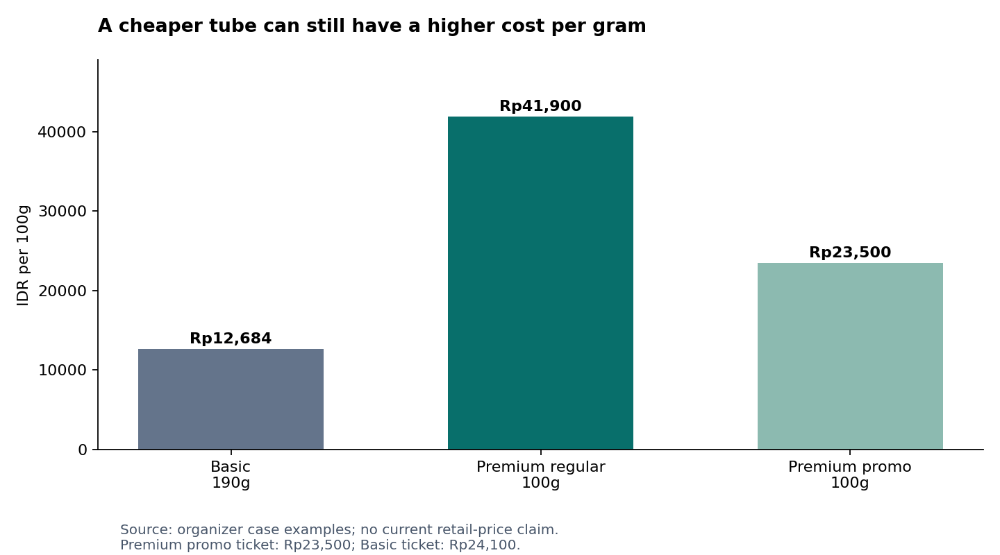

# Pepsodent Premium: what the evidence changes about the replenishment decision

**Research release:** 3 November 2026, Asia/Jakarta.  
**Purpose:** Diagnosis, teaching, and conditional strategic directions for the E-Fest case. No final solution selected.  
**Scope:** Indonesia; Jakarta as the intended reference for later local verification. Current public catalogue observations do not verify Jakarta branch stock.  
**Methods:** Six parallel investigations, direct public-page/API collection, primary-source document review, structured literature discovery, source-specific consumer-text collection, and reproducible analysis of the existing keyword dataset and case economics. No Apify jobs or paid services were run. No interviews or physical store checks were conducted.

## 1. The answer I would carry forward

Your notes point toward a more useful question than “How do we convince young people Premium is better?” Ask: **What has to survive from first trial to the next real purchase for the extra benefit to remain worth funding?**

A sustainable Premium purchase requires a relevant need, an understandable offer, an acceptable experience, a person with purchase authority, a tolerable replacement cost, and an accessible variant. These conditions interact. Improving awareness cannot repair every failure in that chain.

The most important findings from this run are:

1. **The broad minimarket-absence hypothesis is too strong.** An official Indomaret flyer explicitly promoted Sensitive Expert Original/Whitening 100g in June–July 2025. The remaining availability question concerns exact variants, branches, dates, visibility and replenishment trips. [R1]
2. **Pepsodent already uses differentiated Premium marketing.** Ultra White has a fashion/beauty route, while Expert and the wider brand have health/consultation routes. Its current site already links a ShadeScan AI visualization. A generic awareness campaign or AI scanner is therefore not automatically a new answer. [R2–R4; brand annex]
3. **The price problem has at least three components.** The initial tube payment, ongoing cost per gram, and uncertainty about paying extra for a benefit are different frictions. A deep discount can change the first while leaving the others unresolved. [Case economics; Section 7]
4. **Sensory value is real as an experience, but cannot substitute for measured efficacy.** A retrieved toothpaste trial found formulation differences in sensory ratings without significant between-group differences in its measured plaque/gingival outcomes. It does not establish that all toothpastes are equivalent. [L1]
5. **The household is a plausible decision unit, but we still cannot estimate who pays among the target.** Public text includes experience reported on behalf of another household member. That helps frame interviews; it does not reveal national payer prevalence or prove an age-specific switching mechanism. [Consumer annex]
6. **Several attractive explanations have important counterexamples.** More choices do not universally reduce choice; deeper discounts do not universally destroy later purchasing; and stopping/restarting a sensitivity formulation cannot be reduced to an assumed universal symptom-recurrence story. [L2–L5; literature annex]

The defensible diagnosis remains provisional: **Pepsodent may retain trusted default status while some specialist benefits fail to become a durable, funded choice at replenishment.** The evidence supports investigating the conditions behind that failure. It does not yet allocate the case’s seven-point mix decline to specific causes.

## 2. What was actually collected — completed large-scale extension

The final expansion **screened 26,125,466 Amazon review rows** and retained a separate international candidate corpus. The integrated written-text database contains **298,846 canonical source records/fingerprints**, with demographics and relevance explicitly qualified. This is substantially larger than the initial snapshot below, but it is not 298,846 Indonesian young buyers.

| Final canonical written layer | Records | What the count means |
|---|---:|---|
| Amazon external title-matched candidates, all retained product scopes | 286,706 | International historical context; includes separately flagged accessories/children/alternatives/unresolved types |
| **Adult-toothpaste-title subset within Amazon** | **196,872** | Written rule-screened candidates, not manually verified adult users or an additional independent sample |
| Lazada | 681 | Selected toothpaste-listing reviews |
| Watsons | 7,419 | Written records from 10,191 review/rating records;2,772 ratings-only excluded from text layer |
| ORESA, four campaigns | 2,228 | Original 298 plus 1,930 new; incentives/sampling strata explicit |
| TryandReview | 1,423 | Complete source-displayed histories for selected Basic, Complete8, Closeup products; replaces earlier 100 |
| Reddit archive | 389 | Selected relevant/context comments; replaces overlapping earlier 75 reader excerpts |
| **Integrated written records/fingerprints** | **298,846** | Not people; contains weak/templated/adjacent context with explicit flags |
| Additional X posts, separate table | 6 | Five brand posts and one consumer purchase account; not added to the integrated review/comment count |

The separate international adult-title subset plus the 12,140 source-specific non-Amazon written records would be 209,012 records, but their populations and methods differ and should not be pooled into an Indonesian estimate. The integrated store keeps all retained scope classes for transparent exclusions. **2,970 nontext records are excluded** from its written layer: 2,772 Watsons and 198 Amazon. 2,680 repeated derived-identity observations remain in provenance rather than inflating canonical counts.

The larger source work adds full history coverage for selected review listings, 389 archive comments and a working bounded public-X route. It also exposes stronger incentive and text-repetition bias. Use the [expanded synthesis](synthesis/SCALE_SYNTHESIS.md), [international methods](scale_amazon/README.md), and [store statistics](scale_pipeline/clean/collection_stats.json) alongside the narrative.

### Other collected evidence

| Evidence layer | Actual retained count | Interpretation |
|---|---:|---|
| Retail seller/product contexts | 96 | Oral-care contexts: 95 toothpaste + one whitening serum; no verified Jakarta checkout stock |
| Usable brand/source artifacts | 53 | From 62 attempted URLs; 5 HTTP-success templates excluded |
| Canonical product-page subset | 28 | Subset of brand artifacts, not added as new sources |
| Curated campaign observations | 18 | Derived source observations, not 18 independent campaigns |
| Historical promotion events | 12 | 10 price offers and 2 conditional programmes; incomplete history |
| Published health indicators | 8 | Aggregate indicator/year rows, not respondents |
| BPS variable definition | 1 | Metadata, not consumer microdata |
| Literature discovery records | 148 | Metadata candidates, not all read |
| Retained literature evidence | 25 | 21 abstract-level; 4 relevant full-text-section appraisals |
| Existing supplied keywords | 300 | Reanalyzed, not newly collected |
| Proposed Apify inputs | 12 | Schema-validated, unexecuted configurations; $0 spent |

The earlier phase1 consumer snapshot had 1,154 IDs and is retained for provenance; its overlapping rows are not added again. Its nine encoding warnings prompted the corrected UTF-8 reparse in the expanded TryandReview data. Manual evidence annotations are selected examples, not a complete thematic audit of every retained record.

These are different units. Catalogue entries are not buyers; reviews are not necessarily unique people; comments from one discussion are not independent interviews; bibliographic candidates are not fully appraised studies. Existing keyword rows are not new collection. The package retains raw, cleaned and derived material separately, with scripts and access logs.

The free collection materially exceeded a search-only desk review. Public server-rendered commerce data and APIs were more productive than installing a universal scraper wrapper. A tool returning an HTTP-success status or a nominal item was not accepted without checking whether it contained the requested data.

The corpus remains selected. Search engines, listing choices, default review ordering, platform history, sampling campaigns, and accessible endpoints all shape what appears. This is useful mechanism evidence and source-specific description, not a nationally representative survey.

## 3. The case's accounting problem comes before its causal explanation

The organizer reports Premium’s sales share falling from 27% in 2022 to 20% in H1 2026. That establishes a seven-percentage-point share decline. It is approximately a 25.9% relative decline in the share itself. It does not establish a 25.9% fall in Premium revenue.

Suppose the measures refer to comparable revenue periods. Premium revenue would be `total brand revenue × Premium revenue share`. A brand whose comparable revenue rose 35% could hold absolute Premium revenue unchanged while its share moved from 27% to 20%. The case does not supply the necessary comparable totals or clearly resolve every sales-share definition. This is an arithmetic boundary, not an assertion that Premium revenue was unchanged.

A more useful revenue bridge is:

`purchasing households × purchase occasions per purchasing household × grams per occasion × realized manufacturer revenue per gram`.

Each factor can change for different reasons. Reduced purchases can reflect fewer purchasers, stockpiling, a larger pack, lower usage, channel switching, or actual abandonment. A single Basic purchase can be for another household member while Premium remains in use. Those possibilities qualify interpretation; they do not negate the organizer’s stated downtrading premise.

The official Unilever FY2025 and H1 2026 sources corroborate the corporate figures in the handoff. Their scope is the company, including continuing-operations definitions. They do not identify Pepsodent Premium's margin, age profile or switching rate. In particular, a corporate gross-margin change cannot be causally attributed to this tier shift from these sources. [R5–R6]

**What would settle the business magnitude:** Consistent Premium tier definitions; value and volume by SKU/channel/time; household penetration and purchase frequency; realized net prices; promotion funding; repeat windows and inventory; and incremental contribution. Public evidence does not replace those internal measures.

## 4. Is Premium actually easy to access?

Your personal observation is a good starting signal. It is weak evidence for national distribution. The historical Indomaret document is stronger evidence for channel participation: page 18 of the PDF, printed page 16, lists Sensitive Expert Original/Whitening 100g at a displayed promotional Rp19,900 against Rp39,900 for 26 June–9 July 2025. It also shows a points offer. The flyer covers a specified regional edition; it is not a guarantee of stock in every store. [R1]

The retail investigation separately collected current online catalogues, including direct Watsons structured product data. The useful distinction is:

| Observation | Supports | Does not establish |
|---|---|---|
| Official flyer includes exact variant | Retailer planned/promoted the offer in that edition/time | Every branch stocked it, or the shopper saw it |
| Catalogue product exists | A digital listing with identified product/pack | Physical shelf availability or completed purchase |
| Catalogue stock field says in stock | That field's returned value | Fulfilment from a Jakarta branch if location/loading state is unresolved |
| Product can be added after location selection | Observed purchasability for that location/time | Long-run service level |
| Team sees product on shelf | Local physical presence at that moment | National weighted distribution |
| Search finds no product | This search failed to find it | Product absent from the retailer |

The current data expose a useful warning: catalogue stock flags can coexist with a false purchasability flag or an unloaded-stock state. Reporting a precise “available in Jakarta” claim from such combinations would be false precision. The dataset preserves those distinctions.

One particularly useful actual account combines satisfaction with friction: `LZD-1574262094522499` (11 April 2025) describes buying a bundle for savings because the variant suits the buyer, while reporting frequent unavailability. This is a single stated experience, not a stockout rate or confirmed downtrading. The current listing name is Active Remin 105g×2; continuity between that title and older reviews is not established. It shows why price, perceived benefit and access should be allowed to coexist in the diagnosis.

**Better hypothesis:** A shopper may fail to find the particular benefit/variant they learned to prefer at their normal replenishment trip, despite broad masterbrand availability. That can generate a Basic fallback. It remains to be verified through actual trips and exact-SKU checks.

**What to do with this insight:** In later primary research, reconstruct the store and alternatives from the last replacement. Do not ask only “Is Pepsodent easy to find?” That question would miss the difference between seeing Basic and finding Sensitive Expert Complete Care in the intended size.

## 5. Does this make D2C the likely business model?

No reliable inference of D2C dominance follows from the retailer-turnover hypothesis. Retailers can carry specialist lines through different assortments and promotions; the Indomaret evidence demonstrates at least one such route. Official product websites can direct demand to third-party stores rather than operate a brand-owned transaction.

Use the following channel taxonomy:

- Brand-owned checkout with a known selling entity.
- Brand-branded marketplace store, with the actual operator identified where possible.
- Authorized retail/pharmacy chain.
- Independent marketplace seller.
- Offline general trade, supermarket, minimarket, or health-and-beauty store.
- Service/education partner that generates demand but does not sell the tube.

On the inspected Expert page, the “Beli Sekarang” link points to an internal product-list anchor, not a verified brand-owned checkout. This is one inspected route, not a statement about every brand page. A marketplace listing with the word “official” is evidence about the storefront label, not complete evidence about inventory ownership, invoicing, customer-data ownership or contractual economics. The research does not establish D2C’s sales share.

The retailer incentive question remains commercially valuable. A high-margin slow-moving SKU can still generate worse shelf productivity than a fast-moving lower-margin SKU. Conversely, supplier funding, basket effects and strategic assortment can justify stocking it. Relevant measures would include contribution per facing, inventory turns, stockouts, promotional lift and replenishment reliability. Those measures were not disclosed in our public catalogue collection.

## 6. What is Pepsodent, and what does its Premium tier stand for?

A careful single-sentence synthesis of the brand's **observed intended positioning** is: **Pepsodent presents accessible, trusted care that helps households protect teeth and feel confident about their smiles, with specialist offers for particular needs.**

This sentence is an interpretation of brand material, not a measured statement of what all Indonesians believe. Three layers should remain separate: what management wants the brand to mean; what communications and offers actually express; and what consumers take away.

The product/campaign inventory shows that Premium is not one uniform proposition. Sensitive Expert speaks to sensitivity and specialist care. Ultra White uses appearance, brightness and confidence. Herbal and Complete-related offers bring their own benefit language. The case's tier examples do not supply an exhaustive SKU-by-SKU segmentation for every current catalogue product.

A dated example is Ultra White's “Be the Brightest of Them All” event at Jakarta Fashion Week on 30 October 2025. The organizer connects the smile proposition with fashion/beauty expression. The edition name and web footer must not be confused with the actual event date. [R2]

The Pepsodent/Halodoc material shows a consultation-access route across participating marked packs, with specified conditions. The documented period is August 2024–July 2025. The terms and FAQ must be read together: a currently visible page is not proof that every voucher remains redeemable now. This route already connects product purchase, digital interaction and care access; it should be benchmarked before proposing the same mechanism as novel. [R4; historical annex]

The current ShadeScan AI page offers a visualization of five-shade-whiter appearance and links to a third-party tool. We observed the page, not validated diagnostic accuracy, sustained use, conversion or health outcomes. Its presence means “create an AI smile scanner” alone is weak novelty. [R3]

The brand annex compares competitor language. Of particular interest, Enzim's detergent-free differentiation and Sensodyne Deep Clean's foam/freshness route show that premium sensory positioning can differ. There is no universal premium taste or mouthfeel that every shopper must prefer.

A need-matched comparison is more useful than treating every expensive tube as the same category:

| Brand/line | Observed intended differentiation | What this makes worth testing |
|---|---|---|
| Pepsodent Sensitive/Gum Expert | Specialist need and care/repair cues, with variant-specific extras | Need fit, trust transfer and appropriate continuing value |
| Pepsodent Ultra White | Smile appearance, science cues and beauty confidence | Expected visual result, evaluation period and cosmetic competition |
| Sensodyne | Sensitivity-led portfolio, additional need filters and routine-use language | How a specialized masterbrand reduces selection and continued-use uncertainty |
| Enzim | Enzyme/no-detergent proposition | Whether low-foam comfort and product identity matter to actual users; manufacturer claims require independent appraisal |
| Closeup whitening offers | Appearance/color or stain-related propositions alongside sensory freshness | Benefit-matched competition, with corporate cannibalization considered separately |

This table summarizes intended positioning from the archived official pages, not a measured perceptual map. The brand annex provides page URLs and exact locators. Enzim's FAQ contained unrelated spam links, so its source-quality issue and unverified clinical claims remain flagged.

One way to understand the existing marketing is through five handoffs: attention, need recognition, correct variant, acceptable experience, and funded replacement. Fashion activity can create interest; science content can explain proof; self-checks can support selection; consultation and sampling can help initial access or trial. None by itself establishes the final handoff to a sustained paid replacement. Good execution at one stage can coexist with weakness at another.

**Implication:** The relevant message may differ by need and occasion. The open question is which current promise fails to become a compelling choice at replacement, not whether the brand has ever communicated specialist benefits.

## 7. Affordable to acquire, expensive to keep using

This is one of your strongest distinctions. It becomes sharper when separated into three problems.

**Cash-flow affordability:** Can the shopper pay for the tube today? A smaller pack or promotion can reduce the initial payment.

**Sustained affordability:** What does continued use cost at the actual consumption rate and replacement price? A small tube may run out faster, while a high per-gram cost persists.

**Risk-adjusted value:** Is the shopper confident that the additional benefit will matter enough to justify the difference? Someone with sufficient cash may still reject the purchase as poor value.

Using only the organizer's example prices:

| Offer | Tube price | Size | Exact cost per 100g | Relative to Basic per gram |
|---|---:|---:|---:|---:|
| Basic | Rp24,100 | 190g | Rp12,684 | 1.00× |
| Premium regular | Rp41,900 | 100g | Rp41,900 | 3.30× |
| Premium promotion | Rp23,500 | 100g | Rp23,500 | 1.85× |

The promoted Premium tube has a slightly lower ticket than Basic but still costs about 85% more per gram. The ordinary Premium tube has about 47% fewer grams. Those are case arithmetic, not current market-wide prices.



For illustration, assume two users, two brushing occasions daily, and one gram each occasion. This is a financial scenario, not dosing advice. At four grams/day, the Basic 190g tube lasts 47.5 days and a 100g tube lasts 25 days. Modeled 30-day costs are approximately Rp15,221 for Basic, Rp50,280 for regular Premium, and Rp28,200 at the case promotional unit price. Change the assumed amount or users and the costs change; the observed price-per-gram ratio remains.

The package contains 27 scenarios varying users and assumed grams/occasion. They illustrate why the household payer may experience “small pack” as a recurring cost rather than merely an entry-price benefit. They do not estimate actual toothpaste use in Indonesian homes.

**Current pack correction:** The live Watsons capture already includes Sensitive Expert Whitening 100g at Rp23,500 and 160g at Rp29,900. Those correspond to Rp23,500 and Rp18,687.50 per 100g: the larger offer is about 20.5% cheaper per gram, with a higher ticket. The same capture has Basic 190g at Rp21,100. These are current catalogue offers with unresolved branch purchasability, not replacements for historical case facts. Retail record IDs are `WATAPI-PEPSODENT-005`, `-031`, and `-046`.

This separates three possible interventions: create a genuinely missing pack; make an existing pack accessible in habitual channels; or make its unit value understandable. Only the first requires inventing a new pack. A current indexed 60g minimarket listing similarly means a small-trial idea must establish what is missing before claiming novelty.

**Important rival:** Small packs can also signal higher quality, reduce waste risk, improve portability, or provide specialist personal use. Research on package size and perceived quality supports conditional effects rather than “small always looks bad.” [L6] What matters is the customer's comparison and use situation.

## 8. What can we actually say about discount history?

We recovered dated promotion events, not a continuous historical panel. One verified Indomaret offer shows roughly half-off a displayed reference price. The historical annex also includes dated pharmacy/retailer evidence and explains conditions. A visible reference price does not prove that shoppers previously paid it, how often the offer occurred, or who funded it.

A promotion can create at least five different transaction types:

1. An appropriate new user discovers a valuable specialist product and repeats.
2. A deal-seeker tries it but normally prefers Basic at regular prices.
3. An established Premium user buys early and postpones their next purchase.
4. A current Premium buyer receives a subsidy without changing behavior.
5. A shopper shifts from another brand, or from another Unilever product.

Only some of those are incremental and profitable. “Discounts do not ensure sustained use” is correct. “Discounts inherently prevent sustained use” is not supported.

Anderson and Simester's three field experiments found different longer-run effects for new versus established customers. The setting was durable goods sold through a mail-order catalogue, not Indonesian toothpaste. It is an important counterexample to an absolute claim, not a transferable uplift estimate. [L4]

The right comparison is not simply promo buyers versus loyal buyers. New promotion buyers and established loyal buyers differ in tenure, need, selection and channel. Prefer cohorts of comparable first-time buyers with actual first-paid price, subsequent purchase, SKU/need and observation period. Even matching does not automatically prove a causal promotion effect.

**What is still missing:** Non-promo paid repeat, pack inventory at home, first-purchase conditions, realized manufacturer revenue and costs. Review comments about promotions can describe shopping experiences but do not identify a retention curve.

## 9. How to understand “clean,” “change,” and “impact”

These words hide different outcomes:

| Dimension | What a user may notice | Evidence needed for the claim |
|---|---|---|
| Immediate sensation | Mint intensity, foam, smoothness, burn, aftertaste, cooling | Described experience or sensory testing |
| Perceived cleanliness | A fresh or “kesat” mouthfeel | User interpretation; separate from clinical measurement |
| Visible appearance | Stain removal or perceived whiteness | Appropriate standardized assessment for an objective claim |
| Symptom experience | Changes in reported sensitivity/discomfort | Relevant repeated symptom measure and clinical context |
| Preventive health | Caries/gingival or other outcomes | Suitable clinical evidence with population, duration and formulation |
| Commercial result | Paid repeat at acceptable contribution | Purchase and economic evidence |
| Social impact | Improved behavior or a relevant health outcome | A defined outcome and credible measurement pathway |

Sälzer and colleagues compared two formulations in an eight-week randomized study involving non-dental students. Sensory evaluations favored the SLS-containing formulation on taste/freshness/foam while reported between-group plaque and gingival-bleeding differences were not significant. The formulations differed in more than one ingredient, and funding/conflict details matter. The study supports separating sensory response from measured endpoints; it cannot isolate a universal SLS effect or prove all products equivalent. [L1; full-text appraisal in literature annex]

In our collected public text, people describe comfort, freshness, taste and sensitivity in overlapping ways. Some records contain platform-style benefit phrases mixed with personal writing. The analysis therefore flags lexical cues rather than interpreting every phrase as an independently expressed motivation.

For Enzim, an official detergent-free proposition does not prove what your mouth will feel, nor that every consumer values low foam. For Pepsodent, a clinical mechanism does not guarantee that a new user perceives a visible change within two weeks. A commercial promise can fail because the benefit is irrelevant, expectations are mismatched, the experience disappoints, or the wrong formulation was chosen. These are distinct possibilities.

**Practical teaching point:** Ask “What difference were you looking for?” before “Did you feel a difference?” The former reveals the evaluation rule. Someone using a sensitivity variant while judging visible whitening could be disappointed for a reason that more generic evidence cannot fix.

## 10. The household hypothesis and the meaning of “who paid”

It is useful to model six roles: user, chooser, payer, person placing the order, replenishment manager, and beneficiary. One person can occupy several roles. A public reviewer discussing a spouse's experience does not reveal who funded the purchase.

A review on a listing currently titled Sensitive Complete Care explicitly reports the husband's sensory/need experience (`LZD-2032630484394818`, 22 November 2025). That is concrete evidence that the speaker and described user can differ. It is not an interview, a prevalence estimate, or proof the household traded down. Other records describe family suitability or buying for a parent, providing additional prompts for later questioning. [Consumer corpus and annotation table]

For a student using toothpaste supplied by parents, the perceived alternative may have no extra personal cash payment. Comparing Premium against the full Basic shelf price can therefore miss the actual decision: paying personally versus continuing an already supplied shared tube.

If that mechanism dominates, four conditional routes become worth investigating:

- Make the relevant benefit understandable to the household chooser/payer.
- Let a genuinely specialist user make an appropriate personal purchase alongside household Basic.
- Demonstrate household relevance where several members actually benefit.
- Accept that this household is not currently an economical Premium-return target.

None follows automatically from age. We cannot assume parental provision across the 18–30 range, and it would be wrong to shame a rational Basic purchase. Shared consumption could also support Premium if multiple users value the benefit enough.

“Entering independent purchasing” is better described here as a change in payment responsibility and reference point. The consumer may discover a cost they did not previously face. That differs from conventional switching costs such as learning, search effort, accumulated benefits or exit penalties.

## 11. Is sensitivity toothpaste an episodic purchase?

It can be treated episodically by a consumer, but the reason must be reconstructed. Candidate mechanisms include perceived need resolution, financial trade-offs, professional advice, irritation, misfit, competing household purchases, availability, or continued use of existing stock.

A useful public record says the writer experienced less sensitivity and intended to keep trying until the discomfort resolved (`LZD-1200640450822499`, 1 July 2023). This supports the existence of a symptom-resolution expectation. It does **not** document subsequent stopping, switching to Basic or recurrence.

The literature investigation also retrieved an episodic-use trial that did not show the simple universal regimen difference one might expect. Mason et al.’s exploratory trial followed 76 adults over 24 weeks using 5% CSPS, with an eight-week withdrawal in the episodic group. Small treatment improvements limited interpretation of the undetected regimen difference, and the study had GSK-linked funding/authorship. [L5] That prevents us from treating “felt better, stopped, got worse” as an established sequence.

Historical review wording cannot guarantee that the current listing title, formula or pack was the one originally purchased. The next interview must therefore ask what actually happened after improvement. A respondent's experience is not clinical advice about discontinuation or an argument for indefinite use. Any care recommendation must follow the relevant formulation evidence, label and professional context.

**Strategy implication if the hypothesis survives:** Clarify the appropriate ongoing value and expectations for the relevant need. Do not create fear of stopping or invent a lifelong dependence narrative to sell Premium.

## 12. Choice overload, variant fit, and the comfortable default

Your intuition is plausible: Basic may be a low-effort familiar default while Premium asks the shopper to diagnose a need, compare claims and accept a higher price. But having more options does not by itself prove overload.

Scheibehenne and colleagues' meta-analysis found an average effect near zero with substantial variation across the experiments. Chernev and colleagues' later review emphasizes conditions such as difficulty and uncertainty. [L2–L3] The useful question is whether shoppers cannot select a suitable variant **under their actual shopping conditions**.

Distinguish:

- Missing knowledge: the shopper does not understand a benefit.
- Comparison difficulty: each claim is understandable, but the alternatives are hard to rank.
- Need uncertainty: the shopper does not know which problem matters for them.
- Low motivation: the shopper will not invest attention for a small expected gain.
- Clear rejection: the shopper knows the right option and considers it too expensive.

A quiz may help the first three, do little for low motivation, and fail on clear economic rejection. The current brand already has digital self-check/visualization tools, so adding another interface without demonstrating which decision it improves is weak problem–solution fit.

The availability hypothesis can interact with defaulting. A shopper learns to choose a particular specialist product, cannot find it at replacement, and repeatedly falls back to familiar Basic. That is a plausible habit pathway. The present public collection does not establish its frequency or causal contribution.

## 13. What the consumer corpus can and cannot teach us

The consumer annex retains separate marketplace, discussion and incentivized-review layers. It also documents irrelevant listings, duplicate removal, source context and automated cue rules.

For reading these data, five rules are essential:

1. A five-star review can be about successful delivery before the product was tried.
2. A repeated platform benefit phrase may be templated; it is weaker evidence of spontaneous motivation than a specific purchase/use episode.
3. “Will buy again” is intention. “Bought for the second time” is a stated past purchase. Neither reveals regular-price contribution without transaction context.
4. A post about a parent or spouse establishes a described relationship, not the respondent's age, payer status or buyer identity.
5. An incentivized campaign corpus can reveal product language and managed experience, but should not be pooled with ordinary reviews as organic brand sentiment.

We retrieved an ORESA Ultra White review corpus through its public endpoint; the expansion subsequently recovered its sampling dates of 11 March–28 April 2026 from the campaign API. The campaign context includes incentives/cashback. Its separation is analytically important: it illustrates an existing trial/review mechanism and can supply experience descriptions, but high satisfaction there does not independently establish successful unprompted Premium adoption.

No collected public record, including the expanded datasets, has been authenticated as the entire target sequence: confirmed 18–30-year-old former Pepsodent Premium buyer, actual replacement with Basic, and a verified explanation with paid prices. That is the principal gap for the subsequent primary wave.

### What the expansion contributes beyond more rows

The full selected TryandReview histories include an actual high-scoring whitening review that reports no visible change after more than a month (`TAR-117079`), a user prioritizing taste/freshness/tube over whitening (`TAR-160280`), and a positive two-week result as a rival (`TAR-161537`). These subjective reports come with source-specific incentive and date limits; they are not clinical comparisons.

The archive adds explicit household rivals: one shared specialist product is chosen partly for the mother's sensitivity, while another speaker dislikes a taste their spouse chooses. A public X post describes changing from imported toothpaste to Pepsodent. That is category trade-down language with an unknown exactSKU and age, not a verified Pepsodent Premium-to-Basic event. Exact links and calibrated readings appear in the expanded synthesis.

Watsons' larger history exposes 335 normalized-text repeat groups covering 4,321 written records. Distinct record IDs do not make generic repeated praise independent evidence. The endpoint did not expose reviewer residence, language, incentive or syndication fields. Indonesia is the catalogue source context, not a verified respondent location.

## 14. What public datasets and search data add

Public data are useful when they answer the right level of question. The historical/public-data annex records actual indicator scope and acquisition status.

BPS expenditure metadata can group toothpaste with other personal-care items. Such a group cannot be turned into household toothpaste spend or Premium affordability without additional assumptions and appropriate variables. Survey availability does not imply that relevant respondent-level microdata are freely accessible.

The local Greater Jakarta herbal-toothpaste study offers relevant context, but its convenience online sample is not a national panel or a verified Premium-switcher cohort. The literature investigation checked the tables rather than accepting an abstract-level channel summary: younger groups in that sample still had more offline than online purchases. A larger female respondent share is not direct measurement that women make or fund most household toothpaste decisions. [L7]

SKI/Riskesdas measures provide public-health context. Correct brushing timing, daily brushing and observed technique are different outcomes. Poor oral health does not demonstrate that everyone needs a Premium formulation, or that Premium growth itself would improve health.

The existing keyword data remain useful for vocabulary and follow-up terms. The 300 rows include 138 positive estimates, 11 explicit zeros, 107 blanks and 44 unavailable volumes. The labels span sensitivity, whitening, usage, comparisons, reviews and other needs. Tags overlap. No total across related phrases should be treated as a market size.

Examples such as the supplied “pepsodent whitening” and “pepsodent sensitive expert” estimates can motivate benefit-specific searches. The unverified location and inferred headers remain limitations. No new search-volume series was invented or substituted for the missing source.

## 15. How much growth would actually be incremental?

A Premium sale is not automatically an incremental sale for every stakeholder. Ask what would have happened without the activity.

| Counterfactual | Pepsodent effect | Unilever/category interpretation |
|---|---|---|
| Basic buyer genuinely trades up | Incremental price/mix minus cannibalized Basic contribution and intervention cost | Category volume may not change |
| Existing Premium buyer receives discount | Possible subsidy of an unchanged choice | Little incremental demand; lower realization possible |
| Competitor buyer switches | Potential brand gain | Category consumption may be unchanged |
| Buyer switches from another Unilever brand | Pepsodent gain can overstate corporate gain | Evaluate portfolio cannibalization |
| Shopper buys earlier and stockpiles | Timing shift | Later purchases may fall without usage decline |
| Activity changes appropriate care behavior | Possible health benefit | Needs an outcome measure, not an assumed sales-to-health conversion |

A useful contribution identity is:

`incremental net manufacturer revenue − incremental product/logistics costs − displaced baseline contribution − intervention costs`,

with promotion funding and commercial deductions allocated consistently. Do not subtract the same cost twice. Do not apply the case's gross-margin percentage directly to a retail shelf price and claim actual manufacturer profit.

A simple sensitivity model can show which unknown matters most. It cannot estimate a credible ROI without actual net prices, variable costs, incremental repeat and cannibalization. The case's conditional two-tier margin illustration is retained as teaching only.

## 16. Answers to the twelve questions in the attached image

| # | Answer now | Confidence and what remains |
|---|---|---|
| 1. What deteriorated? | The case's Premium share of sales; seven percentage points. | High for the case statement; absolute volume, revenue, repeat and contribution unresolved. |
| 2. Which variants/channels/cohorts/occasions? | We now have observed product/channel/offer breadth and plausible replenishment mechanisms. | No defensible allocation of the decline without longitudinal tier/SKU/customer data. |
| 3. What did former Premium users choose next? | The organizer says Basic; public text supplies experience and purchase clues. | The target's actual sequenced replacements need eligible purchase reconstructions. |
| 4. How much demand survives without deep discounts? | Not identified. Promotion events and review mentions do not answer this quantity. | Need actual paid-price cohorts, replenishment windows and a credible counterfactual. |
| 5. What does Basic do sufficiently well? | It can supply familiar, accepted routine care at the case's lower unit price. | Exact benefit fit varies; clinical superiority/inferiority cannot be inferred from price tier. |
| 6. Who uses/chooses/pays? | Those roles can differ; collected accounts describe another household member's use. | Their prevalence and linkage to switching remain unknown. |
| 7. Which failure mechanism? | Value justification, selection, experience, payment authority, availability and measurement remain interacting candidates. | Avoid declaring one root cause from accessible reviews alone. |
| 8. Which explanation most changes the decision? | Payer/beneficiary mismatch, exact-SKU access, or appropriate benefit/expectation each implies a materially different lever. | Prioritize the next evidence by decision consequence and uncertainty, not a decorative score. |
| 9. What would falsify the favorite? | Clear fit and understood benefit but persistent budget rejection weakens an information-only story; easy access weakens an availability story. | Collect the disconfirming cases deliberately. |
| 10. How incremental? | Must subtract cannibalization, subsidy and purchase acceleration. | No actual uplift or contribution estimate established. |
| 11. What social outcome? | A defined care behavior or relevant health/access outcome may improve. | Views, scans, coupons and sales are intermediate measures. |
| 12. What must be true? | Product fit, workable channels, supported claims, tolerable ongoing economics and implementable partners/operations. | Manufacturer costs, branch service levels and partner commitments remain unverified. |

## 17. Three conditional strategy directions, deliberately not selected

### Direction A: make the specialist choice easier to sustain

**Evidence trigger:** Former buyers have a relevant need but cannot select/evaluate the appropriate variant or misjudge its benefit timeline.

**Possible mechanism:** Better need-specific decision support and expectation-setting, tied to the actual next purchase and existing brand tools. Use current self-check capabilities where suitable rather than rebuilding a generic AI quiz.

**Six-P connections:** Product/positioning clarify the relevant promise; promotion explains the experience; place links to the correct purchasable variant; pack and price address appropriate trial and replacement.

**Commercial test:** Correct variant selection, relevant experience, actual paid replacement and incremental contribution. **Social test:** A supported care behavior or appropriate consultation outcome. **Disconfirmation:** People understand and select correctly but reject the ongoing economics.

### Direction B: design around the user–payer–household decision

**Evidence trigger:** An individually valuable benefit is rejected because another person pays or because a shared household tube makes the cost unattractive.

**Possible mechanism:** Household-relevant communication where justified, or an appropriate specialist personal offer alongside routine shared care. Small packs are one option to test, not an automatic answer.

**Six-P connections:** Pack and price reflect real usage/payment; positioning distinguishes household and individual value; place and promotion reach the actual chooser/payer.

**Commercial test:** Actual purchase authority, sustained cost acceptance, household consumption and paid repeat. **Social test:** Appropriate care for the relevant user without implying everyone should upgrade. **Disconfirmation:** Independent choosers/payers with clear need reject Premium for the same reason, or shared households already value the specialist benefit.

### Direction C: make replenishment reliable at the normal shopping occasion

**Evidence trigger:** Former buyers seek a known preferred variant but substitute because they cannot find or purchase it during ordinary trips.

**Possible mechanism:** Selected-channel assortment/availability execution and a reliable route to replacement, using observed local demand rather than indiscriminate distribution expansion.

**Six-P connections:** Place, pack, price and promotion around the actual replenishment occasion. Product identity and consistent positioning reduce accidental substitution between benefit lines.

**Commercial test:** Exact-SKU findability, intended-purchase completion, non-subsidized repeat, fill rate and contribution per channel. **Social test:** Access to appropriate care, measured separately. **Disconfirmation:** Products are readily accessible and shoppers intentionally prefer Basic despite availability.

These directions are alternatives to investigate and could interact. The public evidence is not sufficient to score them with precise numerical weights or select a winning competition concept.

### Execution boundary for expert proof

Interest in expert evidence does not automatically justify a branded dentist endorsement format. BPOM's published cosmetic-advertising guidance distinguishes education from product advertising and restricts healthcare-professional appearances in the latter. Actual execution depends on product classification, supported claims and the applicable content. This is a design constraint to check when developing an option, not a finding that the observed Pepsodent programmes violate rules. The [official BPOM release](https://www.pom.go.id/siaran-pers/bpom-tegaskan-aturan-penandaan-promosi-dan-iklan-kosmetik-wajib-dilaksanakan-pelaku-usaha) and [published Q&A](https://standar-otskk.pom.go.id/publikasi/q-and-a-sosialisasi-perbpom-no-18-tahun-2024) were rechecked; the discovery capture is retained in `synthesis/regulatory_discovery.json`.

## 18. What the next primary wave should answer

Do the secondary analysis first, as you requested. Then use it to recruit and question people more precisely.

Recruit confirmed former Premium purchasers aged 18–30, plus current repeat Premium users and household-supplied users as contrasts. Distinguish Pepsodent-tier switching from switching to another premium brand. Record how people were recruited and why they qualify. A small convenience sample cannot estimate national shares.

Ask for the last three purchases: exact SKU/grams, paid price and conditions, place, user/chooser/payer, remaining stock, expected benefit, observed experience, alternatives present, and next purchase. Where voluntarily available, a receipt or tube photo can reduce memory ambiguity. Do not fabricate proof if it is absent.

Use short discriminating probes:

- “You said expensive—was the problem paying today, replacing it often, or not seeing enough extra value?”
- “When you felt better, what did you actually buy next?”
- “Who decided the replacement, and who paid?”
- “Did you try to find that exact variant in the store, or choose from what you saw?”
- “What difference did you expect to notice?”
- “Was Premium still at home when Basic was bought?”

Do not begin by pitching the three strategy directions. Reconstruct behavior before testing concepts. Keep people who contradict the favored story in the analysis.

## 19. Tools, obstacles, and why we did not need Apify for the core run

The expansion also assessed PRAW, asyncpraw, twscrape, ntscraper, snscrape, Crawl4AI and Scrapling. Two clients were actually installed/tested in isolation: one failed on the current Python importer and one returned no tweets from a notice page. Known public X profile/post HTML did yield six records, while keyword search remained login-gated. The tool matrix separates inspection from execution. The access investigation inspected Agent-Reach's official code and tested a relevant public backend. The attempted Reddit route returned blocked content as a nominal result, so it was rejected as usable comment retrieval. A wrapper cannot turn a block page into evidence. The retained tool log records what was and was not installed/executed.

Direct public routes were productive elsewhere: server-rendered marketplace review data, retailer product APIs, public campaign-review pagination, brand pages and scholarly metadata/full-text endpoints. No private browser sessions or credentials were imported. The technical work and logs are included so another session can distinguish successful collection from advertised capability.

Some pages returned shells or HTTP errors. Some pagination parameters were ignored and repeated page zero. Those failures were detected and duplicates preserved or removed in the appropriate layer. The corrected collection route is documented in the retail annex.

The later Apify handoff is intentionally smaller and more specific than the original brainstorming list. It includes current actor metadata and exact input schemas, separating console spending controls from actor inputs. No JSON configuration should be interpreted as an executed job.

A significant planning correction came from the public actor metadata: the older Xquik Free-tier pricing concern was historical and later superseded. The handoff records current pricing rather than perpetuating the stale warning. Other actors' headline rates apply to different plan tiers, and platform costs can be separate. The $15 is a stated total available budget, not a recommendation to spend it all.

## 20. What would be misleading to claim after this run

- That we surveyed a thousand young switchers because the package contains many review texts.
- That every review is a substantive product-use account or independent spontaneous wording.
- That Pepsodent Premium is absent from minimarkets, or that a current catalogue proves every branch has stock.
- That Pepsodent has no specialist/digital promotion or lacks an AI visualization.
- That the actual cause of the seven-point decline has been established.
- That the public data estimate parental payment prevalence, regular-price repeat, elasticity, ROI or national sentiment.
- That foam, freshness, whitening, symptom relief, measured health and societal impact are interchangeable.
- That current prices or newly observed pages explain 2022–H1 2026 without a dated link.
- That all three team members' Apify balances/limits have been verified, or that unrun jobs generated data.

The research strengthens the questions and eliminates several overbroad assumptions. Its value is a better grounded diagnosis and a narrower primary-research agenda, not manufactured certainty.

## 21. Read the evidence, reproduce the calculations, continue the work

Start with the release README and machine-generated inventory. The expanded plan and accepted scope are in `plan/`. Each specialist directory contains its own source register, collection scripts/logs, datasets and findings. The original 300-keyword handoff remains outside this new research tree in the repository's original directories.

- [Consumer/tool findings](access_reviews/findings.md)
- [Retail findings](retail/findings.md)
- [Brand/campaign findings](brand_campaigns/findings.md)
- [Literature findings](literature/findings.md)
- [Historical/public-data findings](history_publicdata/findings.md)
- [Later user-run Apify handoff](apify_handoff/apify_handoff.md)
- [Expanded research plan](plan/PLAN_v2.md)
- [Case economics](synthesis/case_economics.json)
- [Household financial scenarios](synthesis/case_household_cost_scenarios.csv)

The annexes form part of this report's evidence trail. Reading levels, access failures and sample construction matter as much as the headline findings.

### Audit of the repository you supplied

I cloned and inspected [reverse-api-engineer](https://github.com/kalil0321/reverse-api-engineer), pinned its source version and parsed its Python files without executing its model/browser application. Its useful idea is to inspect the website’s actual request flow and generate a reusable client—the same technique that unlocked our retailer pagination. It is not an extra data source or automatic access grant. Adding a separate SDK/browser stack was unnecessary for the working public endpoints, so no user setup was needed. The [audit](scale_tools/reverse_api_engineer_audit.md) distinguishes the inspected features from unexecuted capabilities. No collected records are attributed to that application.

## 22. Core references

[R1] Indomaret. Regional promotion flyer, 26 June–9 July 2025, PDF page 18 / printed page 16. [Original PDF](https://www.indomaret.co.id/wp-content/uploads/2025/06/PDF-SH-26-Juni-2025-JawaBaliLombok-Compressed.pdfFF_.pdf). Visual verification retained in historical data.

[R2] Jakarta Fashion Week. Pepsodent Ultra White presents “Be the Brightest of Them All,” event 30 October 2025. [Organizer page](https://www.jakartafashionweek.co.id/events/be-the-brightest-of-them-all/).

[R3] Pepsodent Indonesia. ShadeScan AI, undated current page retrieved 3 November 2026. [Brand page](https://www.tanyapepsodent.com/shadescanai.html).

[R4] Pepsodent Indonesia. Halodoc programme terms and FAQ. [Terms](https://www.tanyapepsodent.com/pepsodent-halodoc-terms-conditions.html). Dates and conditions are compared in the historical/brand annexes.

[R5] Unilever Indonesia. H1 2026 financial press release. [Official source](https://www.unilever.co.id/news/press-releases/2026/kinerja-semester-i-2026-unvr-penjualan-bersih-rp169-triliun-fundamental-semakin-kuat-dan-pertumbuhan-berkelanjutan/).

[R6] Unilever Indonesia. FY2025 company overview. [Official source](https://www.unilever.co.id/investor/lihat-hasil-dan-presentasi-perusahaan/ikhtisar-perusahaan-fy-2025/).

[L1] Sälzer et al. The effectiveness of dentifrices without and with sodium lauryl sulfate on plaque, gingivitis and gingival abrasion—a randomized clinical trial. [DOI](https://doi.org/10.1007/s00784-015-1535-z). See literature extraction for sample, reading level and conflicts.

[L2] Scheibehenne, Greifeneder, & Todd (2010). Can there ever be too many options? A meta-analytic review of choice overload. [DOI](https://doi.org/10.1086/651235).

[L3] Chernev, Böckenholt, & Goodman (2015). Choice overload: A conceptual review and meta-analysis. [DOI](https://doi.org/10.1016/j.jcps.2014.08.002).

[L4] Anderson & Simester (2004). Long-run effects of promotion depth on new versus established customers: Three field studies. [DOI](https://doi.org/10.1287/mksc.1030.0040).

[L5] Mason et al. Clinical study to monitor dentinal hypersensitivity with episodic use of a desensitising dentifrice. [DOI](https://doi.org/10.1038/bdjopen.2017.11). Exact bibliographic metadata and full-text appraisal are in the literature evidence table.

[L6] Yan, Sengupta, & Wyer. Package size and perceived quality: The intervening role of unit price perceptions. [DOI](https://doi.org/10.1016/j.jcps.2013.08.001). Transfer to Indonesian toothpaste remains a hypothesis.

[L7] Septiani et al. (2022). Choosing herbal toothpaste: Study on consumer behavior and preferences in Greater Jakarta area. [DOI](https://doi.org/10.17358/jabm.8.3.758). Convenience online survey; field dates and cross-tabs checked separately from the abstract.

Additional original source URLs, article metadata, product pages, review IDs and artifact locators are supplied in the specialist registers. This reference list highlights the central evidence; it does not substitute for those registers.


# Evidence and methods annexes

Phase1 counts describe the preserved earlier snapshot; final canonical counts govern the release. Do not add overlapping versions together.


# Annex 1: Expanded-evidence synthesis

Original report: `synthesis/SCALE_SYNTHESIS.md`.

# What the larger collection changes—and what it still cannot settle

The expanded collection makes the teaching more concrete. It does not turn accessible reviews into a panel of eligible young Premium-to-Basic switchers. The most useful improvement is the ability to compare competing explanations against actual product-use accounts, source incentives, household conversations and contradictory experiences.

## 1. More evidence supports several different definitions of success

The [TryandReview expansion](scale_reviews/findings.md) includes nine manually inspected examples rather than only aggregate stars. Three contrasts sharpen the question “What does clean/change/impact feel like?”

- [TAR-117079](https://www.tryandreview.com/id/reviews/16659?page=11) gives a favorable overall score while reporting no visible whitening after more than a month against a two-week expectation. A high rating can coexist with disappointment on the promoted benefit.
- [TAR-160280](https://www.tryandreview.com/id/reviews/16659?page=8) praises flavor, freshness and tube design without closely attending to whitening. A shopper can value a cosmetic-positioned product for an immediate sensory experience.
- [TAR-161537](https://www.tryandreview.com/id/reviews/16659?page=6) reports a positive two-week whitening experience. This is an important rival to universal non-performance claims, while remaining subjective and clinically unverified.

[TAR-254032](https://www.tryandreview.com/id/reviews/16659?page=4) reports four repurchases despite modest visible change and values packaging. Its free-product label means the paid-price sequence still needs checking. These records motivate different interview probes; they do not establish which mechanism dominates Pepsodent's decline. Current profile ages and relative publication labels cannot establish age at historical purchase.

## 2. Full histories expose repetition and selection that a small sample hides

The [Watsons expansion](scale_lazada/findings.md) separates actual written comments from ratings-only records. Many written strings repeat across distinct IDs. Identical generic praise may reflect ordinary brevity, prompts, templates, campaigns or copying; the extraction cannot identify the cause.

Therefore, preserve two views: all platform records for coverage and provenance, and normalized-text groups for sensitivity checks. Do not silently delete every repeated string as fraudulent, but do not count it as independent corroboration either. The Indonesian catalogue endpoint establishes source context, not every reviewer's residence, verified purchase or incentive status.

The larger TryandReview collection similarly retains explicit free-product labels. Unmarked cards mean incentive **not established**, rather than definitely organic. Rating–text mismatches reinforce the need to read the prose. Neither five stars nor a low score is a sufficient sentiment or efficacy label by itself.

## 3. Household choice is now supported by direct examples and direct rivals

The [389-comment Reddit archive corpus](scale_reddit/findings.md) preserves parent relationships and exact comment IDs. It provides stronger household examples than inference from anonymous demographics:

- [jmyol7g](https://www.reddit.com/r/indonesia/comments/1414a8a/very_random_question_tell_me_about_your_goto/jmyol7g/) describes someone else repeatedly buying Herbal. It does not identify the payer or establish that Herbal is Basic.
- [jmz7mka](https://www.reddit.com/r/indonesia/comments/1414a8a/very_random_question_tell_me_about_your_goto/jmz7mka/) describes a spouse selecting brands and liking a taste the speaker dislikes. Chooser and user preferences can conflict.
- [jn2d5tk](https://www.reddit.com/r/indonesia/comments/1414a8a/very_random_question_tell_me_about_your_goto/jn2d5tk/) describes shared Systema use partly because the mother finds it comfortable for sensitivity. Household sharing can **support** a specialist choice, contradicting the idea that it necessarily undermines Premium.

Sensory rivals also appear: [jmyhulz](https://www.reddit.com/r/indonesia/comments/1414a8a/very_random_question_tell_me_about_your_goto/jmyhulz/) values mint as a brushing/freshness cue; [jmyklul](https://www.reddit.com/r/indonesia/comments/1414a8a/very_random_question_tell_me_about_your_goto/jmyklul/) prefers a subtler Enzim experience. Ask whose preferred sensation governs the shared tube. Do not equate either preference with clinical cleaning.

## 4. Price and availability need purchase sequences, not isolated complaints

Reddit [jmz9hrk](https://www.reddit.com/r/indonesia/comments/1414a8a/very_random_question_tell_me_about_your_goto/jmz9hrk/) combines sensitivity need with discount-dependent product choice. It illustrates interacting need and price, not elasticity or a confirmed return to Basic.

The [public X purchase story](https://x.com/Stakof/status/2068234900491129031), record `XSSR-2068234900491129031`, describes replacing imported toothpaste with Pepsodent while changing household spending. This is a category trade-down example, **not** an identified Pepsodent Premium-to-Basic switch. Exact Pepsodent variant, target age and paid prices remain unverified.

Reddit [jmz6rv4](https://www.reddit.com/r/indonesia/comments/1414a8a/very_random_question_tell_me_about_your_goto/jmz6rv4/) reports difficulty finding a particular Closeup variant locally. This supports investigating exact-variant access, while providing no proof that Pepsodent Sensitive is absent. The official Indomaret offers and existing 60g/100g/160g Premium contexts already make blanket absence and “invent a different pack” claims too broad.

## 5. Campaign chronology and copied incentives are now clearer

The [ORESA discovery API](scale_discovery/clean/oresa_campaign_inventory.json) supplies sampling windows previously missing from visible pages: Gum Expert in September–December 2024; Siwak in December 2023–March 2024; Ultra White in March–April 2026; Pro.Care in July–August 2026. Pro.Care belongs to current context after the case endpoint. Older campaigns can contain late reviews, so use record dates separately.

Gum Expert's cashback/review requirements and Pro.Care's managed sampling/social tasks matter. The same participant may post related material on the campaign platform, marketplace and social media. Three surfaces are not necessarily three independent experiences. Deduplicate known IDs/texts, retain incentive context, and label uncertainty where cross-platform identity cannot be resolved.

## 6. International scale supplies a comparator, not local case proof

The Amazon pipeline screened approximately **26.1 million review records** from two categories. That is a processing count, not the retained toothpaste sample. After product-title relevance screening and identity reconciliation, **196,872 written adult-human-toothpaste title candidates** remain in a separate international historical layer. Child, pet, accessory, alternative-powder and unresolved product classes remain distinct.

English lexical cues can prioritize examples about sensation, packaging, value or repeat. They are not validated themes or a representative Indonesian comparison. Brand, formulation, period, country, incentives and shopping economics differ; even an Amazon verified-purchase flag cannot establish Indonesian target eligibility. The full corpus was not manually read. See [analysis summary](scale_amazon/analysis_summary.json).

## 7. Conditional directions remain the same; the questions become sharper

Selection/expectation support makes sense if a relevant user misunderstands the variant or judges the wrong outcome. Household-oriented execution makes sense if choice/payment authority blocks an individually valued benefit. Replenishment access makes sense if the intended SKU is actually sought and unavailable. Existing larger and smaller packs, scanners and consultation programs must be benchmarked before claiming novelty.

The next primary wave should reconstruct exact last purchases and include counterexamples: people who understand Premium but reject its cost; shared households that sustain specialization; successful sensory experiences without dramatic whitening; and shoppers who find the product easily yet choose Basic. Those cases can distinguish mechanisms. A larger corpus strengthens that agenda; it does not select the final strategy automatically.


# Annex 2: Retail data and offers

Original report: `retail/findings.md`.

# Retail, packs and observed offers — collection findings

Collected 3 November 2026. These are public catalogue observations, not completed transactions or a representative distribution audit. Jakarta is the intended local reference; **no Jakarta branch or delivery postcode was selected**, so zero records have verified local stock. Historical promotion chronology is handled in the separate history workstream.

## What was actually collected

The canonical `retail_observations.json` and matching CSV contain **96 distinct seller/product contexts**: 82 unique Watsons oral-care product codes (81 toothpaste and one whitening serum), four Enzim variants from Apotek Hiro, and ten toothpaste cards from Hypermart's oral-care page 1. This includes four named children's products; they must be filtered out for an adult-only comparison. Adult target age or switching is not observed for any record.

**Taxonomy correction, 3 November 2026:** One Colgate Optic White Purple Serum40ml had been included by the retailer’s toothpaste category. It is now explicitly `product_scope=adjacent_whitening_serum` and `is_toothpaste=false` in all canonical derived tables. The96 oral-care contexts are preserved:95 strict toothpaste contexts plus one adjacent serum; four of the95 are named children’s products. Raw captures are unchanged.

The supporting Watsons API capture contains 169 product cards, including brushes, non-toothpaste and broad search matches that are excluded from the toothpaste view. Initial server-rendered catalogue retrieval produced 182 card observations, but `?page=1` was ignored and repeated page 0. The deduplicated canonical view uses the subsequently successful public API; it does not inflate sample size using those repeated captures. These counts describe collected records, not buyers, sales or national assortment shares.

Source and row provenance are included in each record: `source_id`, product URL, catalogue/API URL, retrieval time, `raw_file`, `record_locator`, code/EAN, prices and quality notes. The raw HTML/JSON responses and replay scripts are preserved. Failed routes are retained in logs and raw web outputs.

## Main findings that change the initial hypotheses

### 1. Premium cannot safely be assumed absent from minimarkets

An Alfagift product page for Sensitive Expert Original 100g exists; its indexed text reports `Stok Kosong`, but the direct public page is only a loading shell and no customer location was supplied. The appropriate result is **catalogue existence; local stock unresolved**. Source: [Alfagift listing](https://alfagift.id/p/pepsodent-sensitive-expert-pasta-gigi-original-100-g-14569), indexed evidence archived in `raw/search_minimarkets_pharmacy.json`.

The official KlikIndomaret homepage search-index capture lists Sensitive Expert Original 60g at Rp19,500. This supports current online catalogue presence, not transaction eligibility or availability in a particular branch. Source: [KlikIndomaret](https://www.klikindomaret.com/?sortcol=harga), same raw search archive. Direct HTTP retrieved a small application shell, not product data.

The separate historical workstream downloaded official Indomaret brochures containing Sensitive Expert promotions. Together, these facts weaken “Premium must primarily be D2C because minimarkets do not carry it.” They do not disprove **exact variant, branch or replenishment-time availability friction**. That narrower hypothesis remains worth testing through targeted store checks.

### 2. The pack-size assumption needs refinement: larger Premium already exists

Watsons' live API lists Sensitive Expert 100g and 160g variants. In this capture, Whitening 100g is Rp23,500 (displayed reference Rp41,900), while Whitening 160g is Rp29,900 (reference Rp51,000). The latter is approximately 20.5% cheaper per gram at these observed catalogue prices, with a higher checkout ticket. Basic Pencegah Gigi Berlubang 190g is Rp21,100. These are current observations, not historical paid prices. Record IDs: `WATAPI-PEPSODENT-005`, `-031`, `-046`.

Implication: an idea to “introduce a larger Premium pack” must first identify an actual missing pack/channel/need. The present research question is whether shoppers know, find, value and repurchase existing offers. Likewise a 60g minimarket listing means a smaller-trial concept should check existing availability before claiming novelty.

### 3. Deep deals coexist across brands and benefit categories

Watsons currently displays several percentage-off offers and buy-two-pay-one tags. The latter appear for Ultra White and Closeup White Now products; they are **conditional multi-buy offers**, not a one-tube halving of price. A displayed reference price is not proof of a previously paid price. Current promotion windows are preserved from API fields rather than inferred from the collection date.

The observed data establish offer architecture and a possible price-comparison problem. They cannot show whether promotions caused downtrading, whether promotions produce low-repeat cohorts, or whether demand survives at normal prices. Those require actual purchase histories or longitudinal cohorts.

### 4. Enzim is a real independently listed brand, but “enzyme” search is ambiguous

Apotek Hiro's public product JSON gives Enzim Mild 124g Rp25,000; Mixdent 93g Rp17,500; 40 Plus 124g Rp39,500; and 40 Plus 63g Rp23,000. No store-specific stock or checkout was verified. These are different benefit/age-positioning variants, not one equivalent product. Sources are `HIRO-*` records and the corresponding product URLs in the canonical data.

Watsons' broad `enzim` search returned other enzyme-related products, including Darlie toothpaste. We retained the original brand identity and did not relabel those results Enzim. This illustrates why an “enzymatic toothpaste” query cannot by itself identify the Enzim brand.

## Comparison cautions

- Match need state, seller, time and actual pack before interpreting price differences. Sensitivity, cosmetic whitening, child, basic prevention and age-specific care are not interchangeable segments.
- `grams_single_named_unit` is the grams in the name. `grams_total_for_analysis` is computed only where unambiguous; explicit 2× packs use total grams. Vague “Value Pack” remains null for unit-price analysis until package count is verified.
- A price-per-100g value does not establish expected consumption, product efficacy or willingness to pay.
- An API `stockLevelStatus=inStock` can coexist with `purchasable=false` and `isStockLoaded=false`. Accordingly every Watsons record is labeled `catalogue_flag_only_no_location_checkout`; none is asserted immediately buyable in Jakarta.
- Hypermart's retrieved catalogue has no clear price-update date. Treat its prices as currently displayed on a public page with uncertain freshness, not as a guaranteed live offer.
- The early web-index Watsons values differ from live API values in several cases. We preserve captures separately; the API view is the canonical time-stamped data for this collection. Disagreement is not silently repaired.
- K24Klik's page displays `Stok Habis` and `Rp0`; its location notice says location is needed for nearby pharmacy availability. **Rp0 is not a usable price.** The page is a missing/availability-warning observation, not evidence toothpaste is free or nationally out of stock.

## Tool routes and reproducibility

Successful: standard-library Python `urllib` public GET of Watsons HTML; extraction of `wtcid-state` JSON; the Watsons public catalogue-search API; Shopify product JSON at Apotek Hiro; Hypermart catalogue HTML. No login, browser cookies, Apify or paid service was used.

Watsons API example:

`https://api.watsons.co.id/api/v2/wtcid/products/search?query=%3AbestSeller%3AproductBrandCode%3APepsodent&pageSize=100&currentPage=0&lang=id&curr=IDR&fields=FULL`

The live API returned all60 Pepsodent, all17 Sensodyne, all10 Closeup and all45 Colgate product cards. The broad Enzim query returned37 mixed-category matches. The toothpaste view removes brushes/travel toothbrush kits even when a site's category metadata misclassifies them under toothpaste.

Limited/blocked: direct Blibli and Halodoc returned403; Alfagift/KlikIndomaret returned application shells; Guardian's public category response did not expose product cards. Hypermart page1 parsed successfully but full pagination was not reverse-engineered. Those limits are documented rather than represented as product absence.

Replay collection scripts from the repository root, then `python3 research/2026-11-03/retail/scripts/build_retail_view.py`. This will create a fresh observation snapshot and overwrite derived outputs; copy a release before refreshing if retaining historical snapshots is needed. The raw files in this release correspond to the recorded retrieval timestamps.

## What this work supports next

1. Use the retail matrix to choose exact SKUs and relevant outlets for primary shelf checks.
2. Ask actual former Premium buyers whether the 100g/160g/60g options were in their choice set, not whether they abstractly like smaller packs.
3. Compare habitual replenishment outlets with the outlet where discounted trial occurred.
4. Test perceived extra value and who pays, while preserving shoppers who can find Premium but still rationally choose Basic.
5. Before proposing new distribution or pack architecture, examine whether the real issue is knowledge, execution, local stock, price conditions or fit of existing offers.

## Files

- `retail_observations.csv/json`: canonical96 records, source-located.
- `retail_unique_view.json`: same distinct seller/product view; cross-seller products are not silently merged.
- `watsons_api_all_products.json`:169 cards before toothpaste exclusion.
- `watsons_api_toothpaste.json`:81 strict Watsons toothpaste records; `watsons_api_adjacent.json`:one explicitly separated whitening serum.
- `other_retailers_observations.json`:14 pharmacy/supermarket records.
- `source_register.json`, `*_log.json`, `quality_report.json`: provenance, failures and reconciliation.
- `raw/`: original catalogue bodies and page-reading/search outputs.
- `scripts/`: collection and deterministic derived-view construction.


# Annex 3: Brand and campaign audit

Original report: `brand_campaigns/findings.md`.

# Pepsodent brand, Premium positioning, and campaign audit

Collected 3 November 2026. This is a source-based audit of documented brand activity, not a survey of audience perception or a measure of marketing effectiveness.

## What the evidence changes

**Pepsodent already differentiates its specialist and whitening propositions and has already used digital self-checks, expert access, sampling and a beauty/fashion partnership.** The useful question is therefore where that activity fails to carry through to the correct person's next paid purchase. “Pepsodent needs digital education” is too broad a diagnosis unless we establish a specific missing link.

A defensible one-sentence synthesis of **intended** masterbrand meaning is: **trusted everyday oral-health protection for families, extended into need-specific treatment and confident smiles.** That sentence combines the official mission, dated health-program execution and product pages. It is analyst synthesis, not a consumer quote or a measured brand association. Consumer meaning requires the separately collected consumer accounts and subsequent primary research.

## Collection coverage

| Measure | Actual count |
|---|---:|
| Unique URLs attempted by direct HTTP | 62 |
| HTTP 200 responses saved | 58 |
| Usable page artifacts after template check | 53 |
| HTTP 200 placeholder templates excluded from usable count | 5 |
| Failed unique URL requests | 4 |
| Unique canonical usable product pages | 28 |
| Curated campaign/positioning observations | 18 |
| Distinct official-page embedded YouTube video IDs | 7 |

The 53 artifacts are pages, not 53 independent campaigns or respondents. The 18 observations sometimes describe different parts of the same page or the same campaign. Product URLs with alternate suffixes can canonicalize to the same product; canonical product count removes those collisions. No claim is made that all currently marketed variants were found. Four failed requests include timeouts; they do not establish product absence. Five product paths returned a generic template despite HTTP200; they are preserved but excluded. No Apify job or paid service was used.

The raw folder includes original HTTP bytes, line-numberable text extracts, and selected discovery-tool responses. The source register records retrieval times, content hashes, HTTP status, canonical URLs and local paths. The requested event/publication dates remain null for undated current pages rather than inferred from copyright or page component modification times.

## 1. The masterbrand already spans ordinary habit and access to professional care

The official mission page emphasizes prevention, accessible education and healthy smiles broadly. The dated 2023 BKGN release records professional partnerships and family-focused brushing education; it also describes a Basic prevention-product relaunch. This matters because education and oral-health purpose do not uniquely distinguish Premium from Basic. A proposed Premium strategy should explain its incremental benefit without undermining a socially useful Basic offer.

Sources: [official mission](https://www.tanyapepsodent.com/misi-kami.html), source `BC-d5e1419461d7`, text lines 101–112; [BKGN 2023 release](https://www.unilever.co.id/news/press-releases/2023/perawatan-gigi-gratis-di-seluruh-indonesia-kembali-hadir-di-bulan-kesehatan-gigi-nasional-2023/), `BC-f1c1f7b74911`, lines 47–64. Program start and release are September 2023, with activities described through February 2024. Brand-reported reach and population brushing changes do not establish causal program impact.

## 2. Premium is several different promises, not a single upgrade

| Offer family | Observed intended job | Implication for diagnosis |
|---|---|---|
| Sensitive Expert / Mineral Expert | Need-specific sensitivity relief and mineral-repair cues | Ask whether need relevance, correct variant, experience or continued-use understanding fails. |
| Gum Expert | Gum-health benefit plus freshness or whitening | Evaluate whether the symptom, benefit and appropriate routine are understood; do not treat a family Basic choice as irrational. |
| Complete 8 / Herbal / Charcoal / Whitening | Multiple protection, natural-ingredient, freshness and appearance cues | Case tier classification needs to remain separate from live product naming and price. |
| Ultra White | Beauty confidence and whiteness combined with enamel-related science cues | Expectation formation and perceived visible improvement may matter differently than sensitivity relief. |
| Ultra White spray | Additional portable stain-protection/beauty-routine cue | Broader oral-care spending can coexist with buying a cheaper toothpaste; measure the whole outcome budget. |

The current official catalogue verifies named offers, not their contribution to the historical decline or historical availability in every outlet. The product table contains source URLs and GTIN-like identifiers present in URLs. An identifier is not a formulation equivalence claim across countries or eras.

The [official Expert page](https://www.tanyapepsodent.com/pepsodent-expert.html) also contains selected testimonials. Those are brand-curated promotion, not an independently sampled review dataset. `BC-ee958fd9d4d7`, lines 118–122 records them separately from regular-use explanation at lines 137–161.

## 3. The brand has already tried a beauty-context repositioning

The Jakarta Fashion Week organizer records the Ultra White show on **30 October 2025**, with Studio Vian, Ernesto Abram and Julianto. Its recap connects the presentation to smiles, confidence and fashion, including Maudy Ayunda. This is first-party evidence that a partnership occurred, not evidence of incremental sales or sustained repeat. Be careful with the label **JFW 2026**: the edition-named show occurred in October 2025. The current page header advertises a later edition and is not the historical event date.

Sources: [organizer event](https://www.jakartafashionweek.co.id/events/be-the-brightest-of-them-all/), `BC-0ad6b660892a`, lines 11–35; [organizer recap](https://www.jakartafashionweek.co.id/jfw-2026/the-brightest-of-them-all-demi-couture-dalam-balutan-senyuman/), `BC-cca4c615e1d5`, lines 12–28.

A separate corporate [Q1 2024 release](https://www.unilever.co.id/news/press-releases/2024/kinerja-unvr-q1-2024-unilever-indonesia-catatkan-laba-bersih-14-triliun-ekspansi-margin-kotor-dan-peningkatan-volume/) names the Sensitive Expert relaunch with upgraded benefits (`BC-7bead34a691f`, line 63). This predates the case endpoint but provides no tier-specific success result. It weakens a claim that the brand simply had no innovation or specialist messaging.

## 4. Existing digital and value-added activity must be benchmarked before ideation

| Mechanism | Existing documented execution | Novelty boundary |
|---|---|---|
| Visualizing a whitening outcome | [ShadeScan AI](https://www.tanyapepsodent.com/shadescanai.html) on the brand site | “Build an AI whitening preview” is already close to existing execution. No tool accuracy or conversion performance was tested. |
| Need recognition / self-check | [Expert page](https://www.tanyapepsodent.com/pepsodent-expert.html) links to Toothlens self-check | A new quiz must improve a specific selection or follow-through failure. |
| Ingredient explanation | [Ultra White science page](https://www.tanyapepsodent.com/ultra-white/discover-the-science.html) embeds two explainer videos | More content alone is not a diagnosis. Need evidence of missing comprehension or credibility. |
| Professional access | [Halodoc terms](https://www.tanyapepsodent.com/pepsodent-halodoc-terms-conditions.html) describe pack-linked consultation support | The period is August 2024–July 2025. Do not call it a live voucher program without newer terms. |
| AI-enabled screening linked to professional care | [BKGN 2024 announcement](https://www.unilever.co.id/news/press-releases/2024/ai-dentascan-lengkapi-layanan-konsultasi-gigi-online-tanya-dokter-gigi-by-pepsodent/) | Announced for late September 2024; existence does not prove health outcomes or Premium retention. |
| Incentivized trial and reviews | [ORESA Ultra White campaign](https://oresa.id/produk-sampel/206/1053/pepsodent-ultra-white) | Trial generation and review generation are not regular-price repurchase. The campaign is marked ended and undated. |

The Halodoc terms describe a consultation discount up to Rp25,000, with a separate Rp2,000 service fee, limits and special-marked participating packs. Its inclusion list spans Complete8, Kids, Action123, Sensitive Expert and Gum Expert. That is a cross-portfolio service benefit, not a uniquely Premium value proposition. Do not collapse a “free consultation” headline into an unconditional zero-cost health service or a demonstrated retention effect.

**A concrete expectation question:** The Ultra White science FAQ describes variable visible results over several weeks, while other brand surfaces emphasize immediate/five-shade visual messaging. Different endpoints, methods and conditions may explain the wording. The collected current pages motivate checking consumer expectations and the exact claims/footnotes; they do not establish inconsistency experienced by consumers or a regulatory problem. No claim that the current wording caused the H1 2026 decline is supported.

## 5. Review incentives are directly observable here

The ORESA page displayed 298 reviews at retrieval and described cashback participation conditional on buying from a selected official Shopee store, completing a survey, social interaction, and posting reviews. The page was marked as ended; no valid campaign date was recovered.

This creates a methodological boundary: a marketplace review can be a real purchaser account and still be connected to a trial incentive. Cross-posts on ORESA, Shopee and social media should not be counted as independent evidence. A high rating in that source cannot establish organic satisfaction prevalence, regular-price willingness to pay or sustained usage.

Source `BC-3698bac3a3fc`, text lines 42–53. The consumer-data agent received the publicly referenced JSON endpoint for a separate tagged extraction. This audit itself does not count those review rows as collected consumer observations.

## 6. Competitors demonstrate different ways to make specialization understandable

**Sensodyne** organizes the Indonesian portfolio around sensitivity with additional benefit filters: whitening, gums, freshness and other needs. Its product descriptions repeatedly pair protection with regular twice-daily use. That is a useful comparator for the difference between “buy during discomfort” and “understand why use continues.” It is not proof Sensodyne has solved episodic use or retains every user. Source: [portfolio](https://www.sensodyne.co.id/Portfolio.html), `BC-ba34d1c6fbb1`, lines 56–192.

**Enzim** emphasizes an enzyme/protein and no-detergent/SLS proposition. Its official [homepage](https://enzim.com/) and [FAQ](https://enzim.com/faq/) document this intended differentiation. The FAQ also describes smaller travel packs and everyday use. These are manufacturer statements; universal clinical claims about detergents, saliva or adverse effects require independent appraisal. The FAQ extract includes unrelated outbound spam links, so its site-quality issue should be kept visible and its clinical assertions should not be treated as independently validated. Source `BC-3496c4e001e5`, lines 64–86.

**Closeup** currently distinguishes color correction, mineral stain removal and freshness experiences in its [Indonesian product catalogue](https://www.close-up.com/id/semua-produk.html). A directly comparable whitening competitor exists within the same Unilever portfolio; recapturing Pepsodent buyers from Closeup has different group-level economics from winning Sensodyne or Enzim users. The catalogue documents a current offer, not historical SKU availability throughout 2022–2026.

## 7. “Clean” has no single premium sensory definition

An instructive counterexample is [Sensodyne Deep Clean](https://www.sensodyne.co.id/Portfolio/pasta-gigi/deep-clean.html): it promotes more foam and freshness alongside sensitivity protection. Enzim instead differentiates on no detergent. Both can occupy specialist positions. Therefore, premium does not automatically mean more foam, less foam, stronger mint or a particular aftertaste.

The business task is to discover the sensory rule a specific consumer uses to judge success, then compare that rule with the actual product job. Someone may mistake freshness for clinical effectiveness, dislike a product that is effective, or prefer a particular mouthfeel without believing it treats sensitivity. Product reviews can expose those distinctions; they cannot verify efficacy by themselves. The parent report should use the separately collected consumer data to test whether these accounts are actually present.

## 8. What this does and does not establish about D2C

Observed brand assets include education, interactive tools, embedded video, marketplace-linked trial and a brand-named Linktree with a Shopee destination. The Expert page’s apparent purchase CTA is an internal product-list anchor in raw HTML, not a verified brand-owned checkout. The Shopee short link was not resolved here to a validated SKU or storefront operator.

This evidence supports an ecosystem of brand-owned communication plus retail/marketplace execution. It does not establish that Premium is predominantly D2C, that an official store is operated directly by Unilever, or the sales share of any channel. Retail availability data from the parallel workstream is needed. Physical listings, channel sales and retailer preference are separate questions.

## 9. Conditional directions, not selected solutions

1. If the correct need and variant are unclear despite existing self-checks, investigate reducing selection and purchase friction rather than adding an undifferentiated scanner.
2. If trial expectations are imprecise, test an understandable promise, appropriate evaluation period and product experience before scaling paid acquisition.
3. If professional access creates trial but not sustained need relevance, measure the handoff from service use to appropriate product choice and replenishment.
4. If the shared household is the replenishment unit, individual creator persuasion may need household-relevant choice and cost evidence.
5. If the exact variant is unavailable at replacement, more social visibility will have limited value without distribution follow-through.

These implications are inference. This audit has not measured the affected populations, tested causality or selected a final intervention.

## Files and interpretation

- `source_register.json`: unique attempted URLs and retrieval/provenance metadata.
- `collection_summary.json`: reconciled actual counts.
- `clean/artifacts.csv` and JSON: all HTTP-success page observations including explicit placeholder status.
- `clean/products_unique.json`: canonical-deduplicated usable product pages.
- `clean/campaign_observations.csv` and JSON: 18 inspected, paraphrased observations with text line locators.
- `clean/video_targets.csv` and JSON: seven embedded YouTube IDs; titles, dates, ownership and comment access are unverified.
- `raw/http/`: exact saved response bytes and preliminary flat text.
- `raw/text/`: normalized line-separated extracts for provenance.
- `scripts/`: standard-library collection and normalization. Logs preserve failures instead of assuming absence.

Automated `discovery_flags` in the artifacts table are page-wide exploratory string matches and can include navigation. They are not a validated content-analysis measure and must not be aggregated into brand or consumer percentages. Product-page metadata excerpts are short discovery aids; inspect the cited text for substantive claims. Publication dates remain null on undated product pages. This source audit is intentionally separate from interviews, consumer reviews, actual paid-price histories, internal profitability data and case-provided survey figures.


# Annex 4: Literature appraisal

Original report: `literature/findings.md`.

# Literature findings: purchase mechanisms and toothpaste experience

Collected 3 November 2026. This is a structured, decision-focused review, not an exhaustive systematic review. External research is kept separate from the organizer's case and from team primary evidence.

## What the new literature changes

The literature supports investigating your mechanisms, but it rejects several easy shortcuts. More variants do not automatically create overload. Deep discounts do not inevitably destroy repeat. A smaller tube can signal quality as well as poor value. Felt freshness can differ while measured oral-health outcomes do not differ significantly. Parental influence is not the same as parental payment. Episodic clinical use does not directly reveal why a buyer downtraded.

The strongest research task is therefore to identify the **decision rule at replenishment**, rather than to assemble generic evidence that marketing, price, or quality matters.

## What was actually collected

Public HTTP collection made 35 requests: 27 initial metadata/fulltext requests, two targeted Crossref requests, and six targeted follow-ups. Thirty succeeded; five initial Crossref requests returned HTTP429. Successful targeted alternatives resolved important records. The original API payloads and errors are preserved.

The deduplicated discovery pool contains **148 metadata candidates**. **25 studies were retained for focused evidence review: four read through relevant fulltext sections, 21 at abstract level.** Discovery-only records have not been deeply appraised. These are studies and metadata records, not consumer respondents. They must never be added to social-review or case-survey sample counts.

The four fulltext sources are the SLS trial, episodic desensitizing-use trial, desensitizing-formulation scoping review and Greater Jakarta toothpaste survey. Fulltext means the relevant methods, results and interpretation sections were consulted, not an independent replication or full risk-of-bias audit of every referenced trial.

`clean/reviewed_evidence.csv` and `.json` contain DOI, title, authors, year, design/population, read level, paraphrased finding, transfer limit, funding review, original payload path and locator. `source_register.json` resolves study IDs. `clean/screening_log.json` distinguishes retained from discovery-only records. Searches were purposive and query-limited, without independent duplicate screening. No meta-analysis was recomputed.

## 1. Choice overload is a conditional explanation

Scheibehenne, Greifeneder and Todd's 2010 meta-analysis combined 63 conditions from 50 experiments, N=5,036, and found an approximately zero average effect with substantial variation [LIT001]. Chernev, Böckenholt and Goodman’s 2015 synthesis of 99 observations, N=7,202, identified complexity, task difficulty, uncertain preferences and an effort-minimizing goal as moderators [LIT002].

For Pepsodent, the informative question is whether a shopper with a specific need can distinguish relevant variants during the actual trip. Counting SKU names cannot answer it. More options could improve match for an experienced shopper while making a hurried, uncertain shopper defer. Price rejection can also remain after successful selection.

A later primary test should separate “I cannot tell which fits” from “I can tell, but it is not worth the money.” Show an actual shelf or product set and record choice, reasoning, time and fallback before providing guidance. Compare a comprehensible need-based display with the existing assortment, rather than treating fewer choices as automatically better.

## 2. Promotion repeat can reflect who entered, not only what the discount did

Neslin and Shoemaker’s 1989 work demonstrates how a promotion can temporarily draw households with low underlying purchase probabilities, reducing average subsequent repeat through composition [LIT003]. That makes first-purchase paid price, prior purchase history and need important cohort variables.

The rival evidence matters. Anderson and Simester’s three field experiments found deeper discounts increased later buying among first-time customers while reducing it among established customers [LIT004]. The category was durables sold by catalogue, so the finding is not a toothpaste forecast. It nevertheless disproves a universal rule that deep trial discounts cannot support repeat.

Gupta’s coffee scanner-panel application separated switching, purchase timing and quantity effects [LIT005]. Neslin and colleagues distinguish accelerated timing from larger purchase quantities [LIT006]. These give an accounting vocabulary, not transferable toothpaste percentages. Promotion sales can be incremental, borrowed from another brand, brought forward or drawn from another Pepsodent tier.

The useful primary question is not “Do you like promos?” It is: “What did you pay the first time, what happened when the tube ran out, and what did you pay next?” Compare like-for-like new-buyer cohorts; do not compare first-time deal users with established regular-price loyalists and attribute every difference to price.

## 3. Price expectations can matter alongside cash constraints

Kalwani and Yim's experiment found that discount depth and frequency affected expected prices; unexpected absence or presence of a deal affected brand choice [LIT007]. A related coffee scanner model incorporated price expectations and asymmetric responses to departures from them [LIT008].

These provide a plausible mechanism for “the regular price feels wrong after my first discounted tube.” They do not establish it in Pepsodent. A shopper may instead understand the regular price perfectly, experience a benefit, and still prefer to allocate the money elsewhere. Interviews should distinguish an unacceptable reference price, insufficient recurring cash, and insufficient benefit rather than code all three as “price.”

## 4. Smaller packs can mean lower risk, higher quality, or worse value

Yan, Sengupta and Wyer’s experiments found that smaller packages could receive higher quality judgments because of inferred unit price; the relationship reversed under particular information/distraction conditions [LIT009]. Çakır and Balagtas found lower sensitivity to size changes than price changes in Chicago ice-cream scanner data [LIT010]. Neither supplies a Pepsodent pack elasticity.

Therefore a small Premium tube might communicate concentrated specialist value, manageable trial risk, or an expensive and fast-depleting household choice. These interpretations compete. Ask what consumers notice: checkout price, grams, expected duration, per-use cost, expected result, who else uses it, and risk of wasting money.

Model duration separately from perception. A smaller tube does not necessarily create more usage per brushing or determine which person pays. Do not use food-consumption effect sizes as toothpaste dosing assumptions.

## 5. Household influence is credible; payer prevalence remains unresolved

Grønhøj studied 18–25-year-olds establishing their first households and found guidance from family/friends mattered in complex choices; reported responses to hypothetical situations looked more competent than actual decisions [LIT011]. Mishra and Maity’s adolescent socialization meta-analysis found influences of family, peers and media with age/cultural moderation [LIT012].

Both support examining life stage and purchase roles. Neither estimates the share of Indonesian 18–30-year-olds whose parents buy their toothpaste. Brand familiarity inherited from parents can coexist with independent selection and payment. A student may personally prefer Premium but use Basic funded by someone else; another may choose Premium for the household. Ask separately about user, chooser, payer, shopper and person noticing depletion.

The opportunity created by moving out is a hypothesis about a changed decision context. It should not be mislabeled conventional switching cost. The out-of-pocket cost may become newly visible even if the physical product and habit are familiar.

## 6. Felt cleanliness and measured outcomes can diverge

The most directly useful study is Sälzer and colleagues’ randomized trial in 120 non-dental students aged 18–34 around Amsterdam; 116 completed eight weeks [LIT013]. It found no significant between-formulation differences in plaque/gingival bleeding while taste, freshness and foam ratings favored the SLS-containing formulation. Relevant fulltext sections and funding disclosures were read: Sara Lee funded the ACTA work and one author had industry employment.

This supports separating sensory judgments from health outcomes. It does not establish universal clinical equivalence or isolate SLS from all other formulation differences. Another four-week randomized comparison, including an SLS-free enzyme/colostrum/zinc formulation, similarly separated patient appreciation from measured plaque/gingivitis results [LIT014]. It is not an Enzim-brand trial.

Kim and Kim's 160-consumer toothpaste study compared blind/informed testing and found sensory liking and purchase intention reflected flavor plus brand, labels and price [LIT022]. Westerink and Kozlov describe freshness as a combination of immediate and remembered sensory/cognitive qualities [LIT023]. The implication is to collect consumers’ actual descriptions rather than collapse foam, mint intensity, smoothness, taste duration, grittiness and clean feeling into one score.

Instrumental studies on particles and squeezability show that mouthfeel and dispensing can be measurable product experiences [LIT018–019]. A 2026 foam study is explicitly **post-H1-2026 context**, with Colgate-Palmolive funding recorded [LIT020]. Tablet-format acceptance illustrates sensory trade-offs but does not measure paid tube repurchase [LIT021].

A useful later product-experience exercise distinguishes: what was noticed immediately; what stayed noticeable after a week; what counted as success; which supported benefit was being evaluated; and which sensations a shopper treated as evidence of efficacy. Do not teach that mint, foam or abrasiveness necessarily indicates better cleaning.

## 7. Sensitivity relief is product-specific; discontinuation is not a settled story

The 2020 network meta-analysis compares many desensitizing formulations and pain stimuli; its evidence certainty varies [LIT015]. The 2022 scoping review maps 138 trials/368 formulations and inherits effectiveness classifications from earlier work rather than creating an independent retention result [LIT016]. The 2018 review overlaps with the broader evidence base [LIT017]. Count underlying trials, not review headlines, when judging independence.

A directly relevant counterexample is Mason and colleagues’ 24-week exploratory trial, 76 adults, comparing continuous 5% CSPS toothpaste use with eight weeks active/eight weeks standard fluoride/eight weeks active [LIT024]. It did not detect significant between-regimen differences. Small improvements with active treatment limited the interpretation, and the study had GSK-linked funding/authorship. This neither proves clinical equivalence nor supports an inevitable rapid-relapse claim.

Your behavioral hypothesis remains worth testing: a person may interpret relief as removal of the reason to pay more. The clinical consequences depend on the individual condition and product; appropriate care advice belongs with dental professionals. The research should investigate the buyer’s interpretation and next purchase without inventing a medical need for permanent Premium use.

## 8. A local study supplies useful questions and a warning about abstracts

Septiani and colleagues [LIT025] used an online convenience survey in Greater Jakarta during August–October 2021, retaining 459 of 560 responses from recent toothpaste buyers. The sample was skewed toward women, married households and higher expenditures. Table2, visually checked, shows offline purchase exceeding online even in the younger reported groups. The abstract's younger/online phrasing should not be read as an online majority. The published age bins cannot precisely recover18–30. Female respondent share does not directly establish purchase authority.

The selected published counts are transcribed in `clean/jakarta_published_channel_counts.csv`, preserving category labels. Use them as sample-specific context, not national channel share or Pepsodent Premium switching evidence. No respondent microdata were obtained.

## What this teaches for the diagnosis

| Candidate account | What would strengthen it | Important competing account |
|---|---|---|
| Wrong variant/overload | Need-fit difficulty before price evaluation, improvement with clear comparisons | Easy selection followed by price rejection |
| Deal-dependent trial | Same buyer declines regular-price replenishment despite relevant experience | Trial recruits different buyers, or a longer stock cycle delays repurchase |
| Weak incremental sensory value | Expected clean/fresh/change not experienced for the chosen variant | Desired benefit is clinical/slow/poorly matched to evaluation rule |
| Household economics | Specialist benefit matters to one person while payer buys a shared general tube | Several users value Premium and improve household value |
| Episodic perceived need | Relief precedes Basic replacement with explicit “no need now” reasoning | Poor benefit, adverse experience, access, price or stock at home |
| Independent purchasing transition | Change in payer and budget coincides with first self-funded replacement | Same payer/context, different benefit or channel experience |

The literature helps write sharper questions and design informative tests. It cannot allocate the case’s seven-point mix decline among these mechanisms.

## Data and limitations

- Scope: purposive searches and targeted citation follow-up, completed within the current research run; no claim of comprehensive literature coverage.
- Abstract-level study descriptions can omit sampling, instruments or conflicts. Unknowns are explicitly retained.
- `is_post_case_publication` marks the August2026 foam study; other current material must still be checked for event timing before explaining the case.
- Four fulltext sources have their relevant sections and locators recorded. Funding review is not a blanket quality score; industry funding does not by itself invalidate a result.
- The public retrieval scripts use no account credentials, paid API or Apify. HTTP429 failures are logged and were not treated as absence of evidence.
- Existing case and keyword files were not changed. This directory’s outputs are new external evidence.

## Reading order

For immediate case insight, read LIT003,004,009,013,022,024,025 first. For methodological caution, pair LIT001 with002 and LIT015 with016. DOI links and raw-file locators are in `source_register.json`; all finding statements are paraphrases.


# Annex 5: Dated history and public indicators

Original report: `history_publicdata/findings.md`.

# Historical promotions, public data and metric verification

Collected 3 November 2026. This workstream spent $0 and ran no Apify actor. Its tables contain **12 dated promotional events (10 price offers and 2 non-price programs), 8 national health indicator/year observations, and 1 public-data metadata record**. Grouped variants in one flyer block are one offer, not independent observations.

## What changes the discussion

**The broad claim that Pepsodent Premium is absent from ordinary minimarket channels is contradicted by official historical evidence.** Indomaret’s Java/Bali/Lombok flyer advertised Sensitive Expert Original/Whitening 100g at Rp19,900, against a displayed Rp39,900 reference, for 26 June–9 July 2025. The same offer appears in its 24 July–6 August 2025 flyer. Both are before the case’s H1 2026 endpoint. This proves an advertised minimarket-channel offer in those places and periods. It does not prove stock at every branch, year-round availability, availability at Fauzi’s store, or successful intended replenishment. [HP01;HP02]

The more useful availability question is therefore: **Does the right shopper find the exact variant and pack at their actual replacement trip?** That remains testable. Brand presence, retailer listing, advertised regional assortment and actual branch-level stock are different evidence levels.

**Substantial Premium discounting is observable in surviving official materials, including a roughly half-price Sensitive Expert offer.** This is stronger than relying only on the case’s discount example. It still does not establish that discounts caused switching, that most units sold on promotion, or how much regular-price demand survived. A promotion event catalogue is the appropriate output; we did not recover a continuous price series. [HP01–HP04]

## 1. Historical price observations

| Period | Channel and offer | Displayed reference | Offer | Computed reduction | Evidence locator |
|---|---|---:|---:|---:|---|
|5–18 Sep2024|Indomaret Sensitive Expert100g, all variants|Unresolved|Rp23,900|Unresolved|HP04 PDFpage14/zero13, top-left; visually checked web screenshot|
|6–30 Nov2024|Century Sensitive Expert Whitening100g|Rp38,500|Rp31,000|19.48%|HP03 PDFpage9,row355|
|6–30 Nov2024|Century Sensitive Expert100g, variant unspecified in row|Rp37,800|Rp31,000|17.99%|HP03 PDFpage9,row358|
|6–30 Nov2024|Century Sensitive Expert Fresh100g|Rp37,600|Rp31,000|17.55%|HP03 PDFpage9,row359|
|26Jun–9Jul2025|Indomaret Sensitive Expert Original/Whitening100g|Rp39,900|Rp19,900|50.13%|HP01 PDFpage18/zero17, printedpage16|
|24Jul–6Aug2025|Indomaret Sensitive Expert Whitening/Original100g|Rp39,900|Rp19,900|50.13%|HP02 PDFpage15/zero14|

Indomaret’s July flyer excludes Indomaret Point and specifies Java, Bali and Lombok. Both 2025 Sensitive offers display 500 poinku alongside the price. We have not established whether every customer can realize loyalty-point value or what additional conditions applied at a given branch. The November Century list is headed as a QRIS Livin’ by Mandiri campaign; payment eligibility should be checked before presenting its offer as unconditional. The PDF’s upload timestamp is later than the printed November2024 event, so the **printed event dates**, not URL/metadata dates, determine the event chronology.

The dataset also preserves contemporaneous Pepsodent Action123 Complete, Strong and White offers as shopping-context observations. They must not all be silently recoded into the case’s Basic tier. In the July flyer, White120+30g was Rp10,900 against Rp12,700. Sensitive100g was Rp19,900. Within these two advertised offers, the Sensitive ticket is about1.83× and its price per gram about2.74× White’s. This is an arithmetic offer comparison, not an actual household budget estimate or a universal tier ratio. Strong’s displayed pack image has a bonus cue; do not calculate consumption cost from its nominal190g until total contents are checked. [HP02]

### Interpretation of discount evidence

Two separated 2025 offer windows show that deep discounting is not merely a hypothetical mechanism. However, we cannot infer its frequency across the full calendar, average discount depth, units purchased, trial cohort composition, shelf-price realization, manufacturer trade funding, or post-promotion repeat. The surviving documents were found purposively, and promotions are more likely than ordinary prices to be archived and indexed.

A consumer could reasonably encounter several price anchors: the crossed-out price, a familiar deal price, a competing Basic pack, a marketplace price, and a parent's past purchase. Establishing which anchor governs the next purchase requires purchase episodes or transaction-level cohorts. Public flyers do not tell us that decision rule.

The case’s Rp41,900 Sensitive100g example and a flyer’s Rp39,900 reference need not conflict. They differ in channel/date/context. Never overwrite one with the other or average them into an alleged historical regular price.

No usable continuous 2022–H1 2026 promotion series was obtained. Searches for2022/2023 surfaced secondary articles and ambiguous commercial documents; none was promoted into this primary-source event table. The first event in our collected table is not claimed as the first-ever promotion.

## 2. Promotion is more than a price cut

### Purchase-linked dental access

Official Pepsodent×Halodoc terms describe a program lasting August2024–July2025 involving specially marked packs across Complete8, Action123Complete, Kids, SensitiveExpert and GumExpert. The benefit is up to Rp25,000 toward an online dental consultation, with a Rp2,000 service fee outside the voucher, limited quotas, and non-stacking conditions. This demonstrates a product/package-to-digital-health route already used by the brand. It does not prove redeemed consultation counts, clinical outcomes, switching recovery or incremental Premium sales. The program includes multiple lines, so it is not inherently Premium-exclusive. [HP05]

For strategy learning: a future digital oral-health idea should identify what is incremental relative to this existing mechanism. “Scan a pack to reach a dentist” would require a distinctive problem, user journey or repeat outcome to constitute a new proposal.

### Large-pack purchase and cashback

The official FIFA promotion page’s heading refers to FIFA World Cup2026, but its **explicit promotion period is16May–30June2024**. It offers a conditional Rp5,000 GoPay voucher for qualifying large toothpaste packs or toothbrush purchases, subject to valid receipts, quota and per-participant caps. Do not date the campaign2026 solely from the title. [HP06]

This is evidence of a family/large-pack purchase mechanic and digital receipt/social participation. It is not an unconditional Rp5,000 reduction for all Pepsodent buyers, and it does not establish that Basic bundles caused youth downtrading.

## 3. Corporate reporting: the case figures are externally recognizable, but not tier outcomes

The official Unilever FY2025 overview reports Rp31.9trillion net sales and4.3% growth. Its H1 2026 release reports Rp16.9trillion continuing-operations net sales and7.1% growth, with the investor page identifying the release as28July2026. No temporal mismatch was found in those case-level company figures. [HP09;HP10]

These disclosures cannot identify Premium sales, Pepsodent margins, the age18–30 buyer pool or the contribution lost from downtrading. They describe company operations and may exclude disposed businesses; like-for-like scope must be retained. The case’s Premium mix decline remains a case fact rather than an independently recovered corporate series.

The July release’s public availability is after the H1 measurement endpoint, while its subject is H1 results. That is compatible with using it as a retrospective company result; it is not evidence that a later marketing initiative caused the earlier decline.

## 4. Public datasets: useful context, with important granularity limits

### BPS household spending

We downloaded the official BPS metadata for variable309465, aliasR268, Pengeluaran Aneka Barang dan Jasa. It is linked on the page to Susenas and its consumption/expenditure module in2025, with monthly/yearly reference periods. The listed code269 groups **soap, toothpaste, toothbrushes and shampoo**. [HP08]

This matters because a toothpaste-spending estimate cannot be read directly from that grouped amount. Neither can the field establish brand, Premium/Basic tier, user age, individual payer or who chose the household purchase. A household survey is a potentially useful frame for shared consumption and budget context, but the variables required for the switching mechanism need separate verification. Microdata availability, exact instrument version and access conditions were not established by downloading metadata.

The saved table `public_data_metadata.csv/json` records exactly this limitation; it is not a household respondent dataset. We did not infer age18–30 parent-payment prevalence from it.

### National oral-health indicators

The official SKI factsheet was downloaded successfully in this run and its page2 charts visually checked. Our eight records reproduce the factsheet’s2018/2023 comparison:

|Measure|2018|2023|Meaning|
|---|---:|---:|---|
|Reported dental/oral problems|57.6%|56.9%|National context; age≥3|
|Displayed dental-care receipt indicator|10.2%|11.2%|Consult original detailed table for exact eligible denominator before recombining|
|Reported daily brushing|94.7%|95.6%|Interview behavior, not direct observation|
|Reported correct brushing timing|2.8%|6.2%|Timing after breakfast/before bed, not observed brushing technique|

The factsheet’s narrative relates the11.2% treatment figure to people with problems, while the comparison chart is compact. Preserve that wording and verify detailed survey denominators before calculating a national untreated-person count. We did not combine these figures into a market size. These are not18–30-specific nor Pepsodent-specific. [HP07]

This supports a social-impact diagnosis about behaviors and access that deserve attention. It does not establish that everyone needs a premium product. A social pathway could improve correct timing, access or appropriate care without requiring Premium purchase; commercial and health outcomes should be measured separately.

We deliberately did not transcribe the factsheet’s other treatment-avoidance percentages as market estimates because their eligible base and question structure require the detailed tables.

### Google Trends

One direct public explore request for `pepsodent`, Indonesia,2022-01-01 through2026-06-30 returned HTTP429. No series, widget token or numerical trend was obtained. The URL and failure are in `raw/http_download_log.json`. We did not repeat blocked requests or substitute invented trends. If later obtained, an index would measure normalized relative interest, not sales, unique users, sentiment or actual switching.

## 5. What this evidence resolves and what it leaves open

|Question|What is now supported|What is still needed|
|---|---|---|
|Is Premium distributed through minimarkets?|Yes, official historical regional offers exist for SensitiveExpert.|Exact current branch/SKU/pack availability and lost-shopping episodes.|
|Are deep promotions real?|Yes, documented Sensitive100g half-price offers in two2025 windows.|Share of units on deal; paid cohorts; regular-price repeat.|
|Does Pepsodent already link products to digital health?|Yes, published Pepsodent×Halodoc program terms.|Redemption, behavior, clinical outcomes and incremental economics.|
|Is the household angle plausible?|Public survey architecture and family/large-pack promotions make it relevant to investigate.|Eligible consumer interviews identifying chooser/payer/user; no prevalence estimate yet.|
|Can public health data quantify Premium demand?|No.|Independent need/benefit/relevance/purchase evidence.|
|Can public data explain the seven-point mix decline causally?|No.|Comparable tier/channel/cohort transactions or appropriately bounded case reasoning.|

## 6. Collection and reproducibility notes

Run `python3 scripts/build_datasets.py` from this workstream directory to recreate CSV/JSON tables from the verified transcription definitions. `scripts/download_sources.py` records source URLs and first-pass HTTP responses; rerunning it refreshes rather than reproduces the original page bytes, so preserve existing raw snapshots.

Raw downloads include the two2025 flyers, the Century PDF, the SKI factsheet, the BPS metadata HTML and text, and Pepsodent terms HTML and text. The September2024 flyer could be opened and visually reviewed by the search service, but its direct download returned403; its local evidence is the saved retrieval output and screenshot locator, not an allegedly downloaded PDF. URLs and exact source locators appear in `source_register.json` and every observation.

An initial full-flyer PNG/OCR batch was unproductive and interrupted. Its generated intermediate PNGs/text are not sources used for quantitative claims; retained high-quality JPG page renders and original PDFs support the verified June/July records. We do not count OCR attempts or search results as consumer observations.

Null reference prices remain null. All price reductions are calculated from displayed reference and offer prices, not presumed historical transaction prices. Program amounts remain a distinct field from price offers. No aggregation across non-equivalent events is presented as market behavior.


# Annex 6: Phase1 consumer methods

Original report: `access_reviews/findings.md`.

# Consumer evidence and access-tool findings

Collected 3 November 2026. This workstream used public pages and public pagination only. No Apify, paid actor, account login, cookie import or contact with people occurred.

## Actual collection

| Corpus | Records retained | Collection scope | Main boundary |
|---|---:|---|---|
| Lazada Indonesia | 681 distinct review IDs | 26 purposively discovered toothpaste listings; server-rendered review-page payloads | SEO-selected subset, not full histories; repeated feature phrases; reviewer age/payer unknown |
| Reddit | 75 comment records | One r/indonesia toothpaste discussion, posted 5 June 2023; public reader lines | One self-selected discussion; relative comment dates; includes jokes and unverified medical statements |
| ORESA | 298 distinct review IDs | All 298 displayed Ultra White campaign review records across three public JSON pages | Explicit cashback/review-task campaign; incentivized claims, not independent organic sentiment |
| TryandReview | 100 distinct review IDs | First ten pagination pages each for Pepsodent Basic and Complete8 (five reviews/page) | 51 explicitly mark free product; remaining49 have no established incentive status; not representative |
| **Total retained records** | **1,154** | Four source-specific corpora | Records are not unique people, confirmed switchers, or a national sample |

The 681 Lazada records comprise459 Pepsodent,172 Sensodyne,50 Colgate records. 601 fall within2022-01-01 through2026-06-30 inclusive; older and newer records remain labeled separately. Ratings:653 five-star,24 four-star,4 three-star, none one/two-star in the selected SEO material. This severe skew makes a pooled satisfaction estimate inappropriate. A bread-improver page returned by the ambiguous term “enzim” contributed50 records initially and was explicitly quarantined/excluded; its raw capture and log remain for audit.

`derived/corpus_counts.json` gives exploratory literal-term matches. They are retrieval aids, not validated psychological constructs or prevalence estimates. `derived/manually_read_evidence.json` contains22 read-and-annotated selected records with mechanisms and boundaries. It is deliberately much smaller than the full collected corpus.

## What the evidence contributes

### A satisfied Premium user can still encounter price and availability friction

Lazada record `LZD-1574262094522499`, dated11 April2025, reports that the buyer buys a bundle because the variant suits them and saves money, while complaining it is often out of stock. This is unusually useful evidence because it combines perceived benefit, economy and availability in one account. It challenges an information-only story: someone may already value the product and still face replenishment friction. It does not measure how often stockouts occur or establish that this buyer moved to Basic.

Source: https://www.lazada.co.id/product-reviews/?item_id=4777322499 ; exact raw locator is retained with the record. Listing currently names an Active Remin105g×2 offer; historical review-to-formula/pack continuity is not established.

### “Until better” is an expectation to investigate, not observed discontinuation

`LZD-1200640450822499`,1 July2023, reports lower sensitivity and intent to keep trying until the problem resolves. This supports asking about episodic need and expectations. It does not say the buyer later stopped, returned to Basic, or was medically advised to stop. Do not relabel this a confirmed post-relief churn event.

### The product reviewer may be relaying another household member’s experience

`LZD-2032630484394818`,22 November2025, relays a husband’s experience of reduced nausea, lower foam, freshness and sensitivity relief. It makes buyer/user separation and sensory comfort concrete, without proving who paid. It is a spouse report; it is not clinical evidence.

Source: https://www.lazada.co.id/product-reviews/?item_id=8721394818 .

### Promotion and good fit can coexist

`LZD-1456695189922499` describes established use, perceived sensitivity benefit and a discounted purchase. `LZD-2004082758848866` describes repeated Complete8 use, comfortable mouthfeel and a low marketplace price. These are counterexamples to treating every discounted purchase as bargain-only trial. They still cannot establish regular-price repeat or incremental profit.

### Replenishment can change the selected variant even without rejection

Sensodyne record `LZD-1551582562350987` says the usual Deep Clean ran out and the buyer is trying Whitening. An observed SKU change can arise from a replacement occasion and available alternative; it does not necessarily mean the incumbent benefit disappointed.

### There is also an uptrading-direction account

`LZD-1324625217926021`,3 January2024, describes a first Complete8 purchase after previously using red Pepsodent. It is a useful rival to assuming every observed journey moves down. No subsequent experience or repeat is supplied.

Source for both Complete8 records: https://www.lazada.co.id/product-reviews/?item_id=5429126021 .

### Household purchase authority is explicit in public conversation

In the2023 r/indonesia discussion, one participant describes buying Closeup themselves while parents choose ordinary/herbal Pepsodent. Another says their mother controls bulk household purchases and discourages separate buying. A third describes forgetting to replace a preferred sensitive product and using the supply their mother prepared. These are real public narratives, not fictional portraits, but age and parent funding were not verified.

### Clean/fresh sensation is heterogeneous

The same thread contains strong-mint seekers and people preferring subtle Enzim sensation/less foam. One participant prioritizes mint despite not identifying sensitivity as the reason for choosing a sensitivity brand. Another describes a specialist-channel trip as effort. A single “stronger mint = better product” proposition would miss this heterogeneity. Consumers’ irritation and symptom claims remain unverified clinical statements.

### Pack economics can work in both directions

The thread’s Antiplaque account describes an initially painful price but unexpectedly long perceived duration from using little. The Basic marketplace corpus includes an explicit buyer appreciation of two225g tubes at low price. These mechanisms concern different comparisons: ticket price, grams, usage intensity and perceived duration. They should not be compressed into a single affordability score.

Reddit source: https://www.reddit.com/r/indonesia/comments/1414a8a ; source-line bounds and original text remain in `clean/reddit_comments.json`.

## Why the large review counts need caution

1. Many Lazada reviews contain comma-separated product-feature phrases, sometimes alongside natural prose. Their provenance may be platform suggestions, seller language, machine translation or reviewer copy. We did not establish which. They are not automatically spontaneous consumer vocabulary.
2. Positive ratings can accompany “not tried yet,” delivery comments, hopes for a result, or reserve-stock purchases. At least20 Lazada records match explicit pre-use/uncertain-result wording under the documented lexical rule; this is a flag count, not an exhaustive content audit.
3.249 Lazada records match service/delivery language; overlap with actual product experience is allowed. Do not discard them silently or treat all as product satisfaction.
4. ORESA’s explicit sampling/compliance campaign and TryandReview’s free-product labels make them separate evidence strata. Pooling them with unsolicited conversation would blur incentives.
5. Current profile age appears in TryandReview and is preserved as self-reported, not verified age at purchase. Two source profiles display0; that literal value is retained as unverified source metadata, not a real age claim.
6. All corpora lack verified Premium-to-Basic transitions among confirmed18–30-year-olds. New records expand the mechanism evidence; they do not validate the case’s population mechanism.

## Tool audit: Agent-Reach and alternatives

The official `Panniantong/Agent-Reach` repository was cloned to scratch and inspected at commit `7a38047acf26a729cbb27851e3cb81639da86b29`, version1.6.1. Inspected the dependency list, public web channel, Reddit channel, HTTP runner, CLI and configuration behavior. The broad setup installer was not run. The public Jina web backend was imported and called directly with bounded timeouts, without installing dependencies or touching sessions.

Two actual tests are in `raw/agent_reach_tests.json`: Reddit returned a network-block page as a nominal item (marked unusable in our audit); Lazada returned readable content. This illustrates why a nonempty successful wrapper response is not proof of usable data. The repository’s own public-web channel says agents with working built-in search/fetch should use those first. The public Reddit browser backend requires separate OpenCLI/browser setup; no cookie/session route was attempted.

The best actual route here was direct standard-library HTTP to public Lazada SSR, public ORESA pagination, and public TryandReview form pagination. Built-in web reading supplied the Reddit thread where anonymous direct JSON timed out. No need to buy an actor merely because one exists.

Direct Watsons review endpoints were probed at two code forms and returned empty `reviews` arrays. That is an endpoint result, not proof the products have no reviews. FemaleDaily homepage was accessible but product discovery did not identify a useful toothpaste corpus. Blibli page reader returned403 although search snippets exposed comments; snippets were not included in the quantitative corpus. Initial Mandjur probe timed out; no Mandjur corpus is claimed.

## Remaining high-value gaps

- Negative experiences and disappointed users are underrepresented in the SEO-selected marketplace sample. Deliberate low-rating sampling would be diagnostic, with separate denominators.
- Exact paid prices at first and subsequent purchases, repeated purchases across channels, and comparison against regular prices remain unavailable.
- Source-site completeness and consumer uniqueness are not established across corpora.
- Historical variant identity and formula/package changes need manual SKU matching before attributing older reviews to current offers.
- Primary purchase reconstruction remains the strongest next step for the payer/chooser/switching questions. Public accounts should guide those interviews rather than substitute for them.

## Reproduction and files

Run scripts only in their own workstream directory. `collect_lazada.py` uses retained discovery JSON and cached public responses; `collect_oresa.py` retrieves the public campaign endpoint; `collect_tryandreview.py` retrieves20 selected public pages; `extract_reddit_capture.py` rebuilds comments from retained reader-line captures; `annotate_reviews.py` creates exploratory flags, counts and selected manual annotations. A refresh is a new snapshot, not an identical reproduction guarantee.

All retained source records have original URLs and raw-file locators. Logs record result counts and HTTP failures. Neither an actor advertisement nor a search snippet is counted as a collected consumer record. Raw ORESA responses include unnecessary public member names/avatar URLs; use the cleaned tables for analysis and omit those fields from any public release. The project’s confidential source materials remain subject to its existing handling rules.


# Annex 7: Full retailer review histories

Original report: `scale_lazada/findings.md`.

# Scaled collection findings: public Watsons review histories

Collected3 November2026. The directory name reflects the initial Lazada investigation; the successful new corpus is **Watsons Indonesia**. Base datasets remain separately versioned.

## Actual result

| Measure | Count |
|---|---:|
| Captured public source pages |87|
| Selected adult/non-child-named product contexts |78|
| Contexts with returned reviews |65|
| Contexts whose endpoint reported zero reviews |13|
| Stable review IDs captured |10,191|
| Written review records with nonempty text |7,419|
| Ratings-only/blank-text records |2,772|
| Review records dated2022–30June2026 |5,022|
| Written review records dated in that case window |3,220|
| Strict toothpaste review records |10,188|
| Adjacent whitening-serum review records |3|
| Duplicate IDs across captured SKU histories |0|
| Conflicting ID/text/rating observations |0|
| Paid spending / Apify runs |0 /0|

All78 per-product reported totals reconcile exactly to actual captured records, including the13 zero-return contexts. Those zero-return histories do not establish zero buyers or zero demand. All87 successful source-page hashes match preserved bytes. Every one of the10,191 clean rows was checked against its raw JSON record for review ID, text, rating and date. This is programmatic verification, not manual reading of every comment.

Review timestamps range from22February2018 through29October2026. Case-window classification uses review publication date; the actual purchase/usage period remains unknown.

## How the access route was found

Lazada's public `getReviewList` and SEO pagination attempts returned explicit challenge HTML. Those routes were stopped without bypass. A legacy endpoint returned an empty model, which was not interpreted as absence of reviews.

Watsons' generic `/products/{code}/reviews` returned empty arrays despite visible aggregate ratings. Inspection of the publicly served frontend bundle identified the client’s actual route, `/products/{code}/paginatedReviews`. It accepts ordinary public GET requests with `currentPage`, `pageSize`, sorting and field parameters. A500-record pilot returned500 genuine records with correct pagination. The collector used three workers and a small delay, stopped on403/429, preserved each response and capped each selected product at25 pages. No403/429 occurred on the production Watsons route, and no product reached the page cap.

The pipeline is resumable and retains per-product checkpoints. The canonical table deduplicates stable review IDs globally and retains every capture context. Root tooling can ingest `clean/reviews.json`; per-product files are intermediate material and must not be added again to the count.

## Strong source-selection limits

The endpoint exposes public approved reviews from the Indonesian Watsons catalogue. Across all raw review rows, available fields are alias, approvalStatus, comment, date, displayTime, headline, id, like, rating, replyCount, reportable and images. **No reviewer country, language, syndication/original-source, incentive/reward or verified-purchaser field is exposed.**

Consequently, the country evidence is the Indonesian catalogue endpoint. Reviewer residence and language are unverified. It would be inaccurate to call these10,191 confirmed Indonesian consumers or verified18–30 buyers. Incentive status and syndication remain unestablished. Names and media URLs were excluded from clean analysis records; exact raw source responses remain available for provenance.

The rating distribution is highly concentrated:5stars10,027;4stars99;3stars14;2stars10;1star41. Approval, prompting, rewards, selection, and review behavior may influence what is visible. These are source-record characteristics, not a national satisfaction estimate or proof of clinical outcomes.

## Text repetition materially reduces independent information

Whitespace/case-normalized written strings contain335 repeated-text groups covering4,321 written records. There are3,986 excess records beyond one per exact string, leaving3,433 distinct normalized written strings among7,419 nonempty records. Short generic comments can legitimately repeat; templates, campaign wording or cross-purchase copying may also occur. The collection does not establish which mechanism caused any repetition.

Stable IDs remain distinct. Retain the records for provenance, but do not use identical wording as independent corroboration or interpret the raw row total as distinct opinions. Automated lexical coding and full manual coding are separate stages; no claim is made that all comments have been manually reviewed.

## Product and case boundaries

The78 queried product contexts comprise77 toothpaste contexts and one Colgate whitening-serum context. The latter yields three reviews and is explicitly labeled `adjacent_whitening_serum` in clean data. Strict toothpaste comparisons can filter it out.

Existing100g and160g Sensitive Expert listings have different review history lengths. That does not establish relative demand, purchase frequency or willingness to pay, because listing age and review practices differ. This dataset cannot reconstruct paid-price acquisition cohorts, household payment, a former Premium user's replacement purchase, or causal downtrading prevalence without explicit purchase accounts and further evidence.

## Files for integration

- `clean/reviews.json` /CSV: canonical10,191 records; use `text_status` to separate written records from ratings-only rows.
- `source_register.json`:87 successful production source-page records.
- `product_coverage.json`:78 product totals, capture counts and stop reasons.
- `quality_report.json`: counts, ratings, time window, repetition and geographic/incentive boundaries.
- `validation_report.json`: full raw-row/hash/source-ID reconciliation.
- `scripts/collect_watsons_reviews.py`: public collector; `--merge-only` makes no requests.
- `scripts/validate_scale_reviews.py`: offline validation against every raw row.
- `route_probe.json`, `watsons_pagination_pilot.json`, `pageSize500_pilot.json`: feasibility tests, not additional independent reviews.

The attainable corpus here is tens of thousands of actual relevant review/rating records across the wider combined research package. This route did not produce millions, and the dataset does not pad its count with inaccessible pages, blank text described as comments, or duplicated product histories.


# Annex 8: Full TryandReview histories

Original report: `scale_reviews/findings.md`.

# TryandReview expansion — final collection checkpoint

**Completed:**3 November2026. **Cost:**$0. **Apify runs:**0. **Status:**all three targeted public histories enumerated, with distinct IDs reconciling to the product pages' displayed counts.

| Product | Source-displayed reviews | Distinct IDs collected | Public review pages | Explicit free-product cards | Incentive not established |
|---|---:|---:|---:|---:|---:|
| Pepsodent Pasta Gigi Pencegah Gigi Berlubang |646|646|130|599|47|
| Pepsodent Complete8 Multi Protection |332|332|67|293|39|
| Closeup White Attraction Natural Smile |445|445|89|345|100|
| **Total** |**1,423**|**1,423**|**286**|**1,237**|**186**|

The initial run already contained100 TryandReview records. This expansion is a **superset**, adding **1,323 distinct record IDs**, not1,423 additional records. Prefer the corrected expansion text on duplicate IDs and retain the original baseline as lineage.

This is source coverage, not a representative sample or unique-person count. All cards display Indonesia in the profile-country field; residence and purchase demographics are unverified.379 profiles currently self-report ages18–30, but this is not verified age at historical purchase, and none are confirmed Premium-to-Basic switchers. Individual ratings can be fractional; do not convert to integer stars. A large free-product majority means recruitment and incentive bias remain central despite the fuller coverage.

## What the expansion changes analytically

The earlier100-record newest-page sample substantially underrepresented the available histories. The complete enumeration supplies more varied sensory, household, repeat and expectation narratives. It also exposes why more rows do not automatically solve inference:

- `TAR-117079` rates Closeup4.7 while reporting no visible whitening change after more than a month against a two-week promise. A favorable total score does not establish success on every benefit.
- `TAR-160280` values flavor, freshness and tube design while saying they did not closely attend to whitening. This challenges a universal “visible whitening is the decisive outcome” story.
- `TAR-160711` distinguishes freshness/breath benefit from limited tooth-color change.
- `TAR-254032` describes modest visible change but four repurchases and attractive packaging. The card marks free product; the paid-price history remains unverified.
- `TAR-161537` reports a visible result in two weeks, a positive counterexample to universal non-performance claims. This is a subjective account, not standardized clinical efficacy measurement.
- `TAR-739586` combines a low numeric rating (2.0) with positive household-stockpiling prose. Ratings alone are unsafe sentiment labels.

These nine selected manually read records are in `clean/selected_manual_evidence.json`; they are a teaching subset, not a hand-coded prevalence analysis. Clinical assertions in consumer text remain unverified.

## Access and completeness checks

The public page form and `show.js` disclose ordinary GET pagination. Four workers retrieved the286 five-row pages, reusing the original first20 pages rather than fetching duplicates. Four Closeup pages timed out together; one bounded retry recovered them. No429 was observed. Original timeout metadata is retained in `docs/original_timeout_attempts.json`. All target page sets and distinct ID counts now reconcile.

Live publication/deletion and cached pages prevent treating this as a perfectly frozen universe. Reconciliation supports enumeration of the displayed source, not completeness of all consumer opinion or every review ever submitted.

Two source-format issues were corrected from unchanged raw bytes: HTML fragments require explicit UTF-8 decoding, and individual source ratings can be decimals. The authoritative `rebuild_from_cache.py` handles both. Early parse failures did not lose raw responses and were recovered without additional retrieval. All286 raw hashes, source-ID joins, file locators, CSV/JSON row counts, UTF-8 parser labels and record-ID uniqueness were checked.

## Relevant source-size boundary

The Indonesia oral-care catalogue exposed these three substantive histories plus two Sensodyne products with only two reviews each. Those four Sensodyne reviews are discovery context, not included in this expansion. Enzim/Colgate-ID generic brand pages did not establish a further relevant local corpus. A larger Malaysia Colgate inventory was discovered but not bulk-collected because geographic mismatch cannot substitute for Indonesian case evidence.

The request to scale cannot turn this source's approximately1.4k relevant local records into millions. Larger external datasets may serve separate adjacent-market questions, with geography, period and product labels preserved.

## Canonical integration files

- `clean/tryandreview_reviews.json` and `.csv`:1,423 corrected unique review IDs.
- `source_register.json`:286 public page sources with hashes and source IDs.
- `targets.json`:three product-page totals and discovery evidence.
- `quality_report.json`:coverage reconciliation, ratings and incentive counts.
- `docs/METHOD.md`:methods, caveats, transformations and resume instructions.
- `scripts/collect_full_tar.py`:bounded resumable collection.
- `scripts/rebuild_from_cache.py`:offline authoritative rebuild.
- `DONE.json`:stable completion marker.

Do not add the baseline100 to this1,423 again. No source data in the earlier workstream were modified by this expansion.


# Annex 9: Additional campaign records

Original report: `scale_discovery/findings.md`.

# Scale discovery: more relevant review records, not a padded corpus

Collected 3 November 2026, Asia/Jakarta. No Apify, credentials, account sessions or paid services were used.

## Actual new collection

The expansion retrieved **1,930 additional Pepsodent review IDs** from three ORESA campaigns using public pagination. These are new records beyond the original Ultra White 298; original Ultra White was deliberately not downloaded or counted a second time.

| Campaign/product | New review IDs | Public campaign sampling window | Temporal interpretation |
|---|---:|---|---|
| Pepsodent Gum Expert | 1,069 | 23 September–31 December 2024 | Before the case endpoint; review dates individually retained. |
| Pepsodent Siwak & Habbatussauda | 551 | 21 December 2023–2 March 2024 | Campaign predates endpoint, but one review is dated July 2026. |
| Pepsodent Pro.Care | 310 | 16 July–15 August 2026 | After H1 2026; useful current experience/context only. |
| **Total newly collected** | **1,930** | | **1,619 reviews dated within 2022–H1 2026; 311 afterward.** |

The public ended-campaign API also gives the existing Ultra White campaign sampling window: **11 March–28 April 2026**. This improves the first audit, which could not recover the campaign date from the visible landing page. The campaign window is not automatically every review's publication date, first product launch date or continuous market availability. The original Ultra White records remain in `access_reviews/`; they are not included in this expansion's new-record count.

A review timestamp of 29 July 2026 on Siwak record `ORESA-55534` is preserved literally despite the older campaign window. We do not silently repair it or pretend all reviews from an older campaign are historical case-window evidence.

**Provenance:** `clean/oresa_campaign_inventory.json` and `raw/oresa_ended_pepsodent.json`; public endpoint `https://oresa.id/produk-sampel/ended-sampling?page=1&q=pepsodent&sort=&category=`. The endpoint is referenced in the public product-listing page's own client code. No internal/private network address returned in metadata was accessed.

## What the added evidence is good for

This expansion broadens the product contexts from whitening into gum care, herbal/religious-natural cues, and current multi-benefit oral care. It supplies far more actual experience wording than the initial single campaign. It still does not identify eligible 18–30-year-old Premium-to-Basic switchers.

A manual inspection of selected records highlights useful questions:

- `ORESA-39070`, Gum Expert, 3 October 2024, combines a reported personal need with whole-family suitability. That is a described decision context, not proof of who paid or that all family members used it.
- `ORESA-42566`, Gum Expert, 15 November 2024, mixes packing/delivery, product taste and affordability. A positive review is not a pure efficacy measure.
- `ORESA-40456`, Gum Expert, 17 October 2024, describes a less aggressive mint experience and a reason to keep the product at home. It illustrates sensory evaluation and intended availability, not a verified replenishment sequence.
- `ORESA-39455`, Gum Expert, 7 October 2024, says it was difficult to find a suitable toothpaste. In context this is suitability search, not established retail stockout. A keyword match on “susah cari” alone would overstate an availability problem.
- Pro.Care accounts describe a clean/kesat feel and benefit variants, but the campaign and reviews occur after H1 2026. They cannot explain the earlier decline.

These are source-specific observations from an incentivized/sampling setting. Product and health statements in them are consumer assertions and often echo campaign language; no clinical validation is implied.

## Incentives and source strata

The Gum Expert landing page explicitly makes cashback conditional on selected official-store purchase, a survey, reviews and social tasks. It is inappropriate to label this corpus organic purchaser sentiment.

The Pro.Care landing page describes selected participants and required reviews/social tasks with coordinated timing. Its documented setting is managed sampling. The page does not support assuming all participants independently paid full price or that a review demonstrates subsequent purchase.

The older Siwak page confirms a sampling program but did not expose specific compensation/task details in the retained response. Its exact compensation is therefore **unverified**, rather than guessed to be identical to Gum Expert.

Clean records preserve these distinctions in `incentive_status`. They omit member names, avatar URLs and unnecessary profile metadata. Public original responses are retained as raw evidence for this private research package; they should not be republished wholesale as a public roster.

## Counts, duplicates and analytical limits

There are 1,930 unique review IDs but **1,923 unique normalized review texts**; five normalized-text groups repeat. Distinct platform IDs are not necessarily distinct people, and text duplication is not automatically fraud. The original text and platform IDs remain intact; the normalized hash enables sensitivity checks.

Ratings are extremely skewed: **1,916 five-star and 14 four-star records**, with no one/two/three-star ratings in these returned campaign records. This is a severe selection limit and cannot be used to estimate Indonesian satisfaction or infer that negative experiences are absent.

Exploratory lexical matching yields 1,051 records with sensory-related wording; 131 with household-related wording; 37 with price/promotion wording; and 31 with repeat-intention wording. These labels overlap and can be campaign-derived. They are discovery aids, not validated motives or population percentages.

The six stock-wording matches include statements about keeping stock at home, not necessarily product unavailability. The one pre-use-wording match was a call for others to try the product, not the writer admitting they had not used it. These examples show why manual context is required before turning automated tags into findings.

Dates are parsed into **date-only ISO fields** using an explicit Indonesian month dictionary. The raw date/time string remains preserved; no timezone is invented. Analysis distinguishes within-case-window and after-case records. In particular, a review in an old campaign can still be late.

## Large public datasets: downloaded and screened, then excluded

We did not stop at small platform collection. Two primary research datasets were actually downloaded and screened:

| Primary dataset | Actual parsed rows | Scope found by inspection | Relevant toothpaste candidates |
|---|---:|---|---:|
| [Dataset Costumer Review Indonesia](https://data.mendeley.com/datasets/74xrbd4vxy/1), DOI `10.17632/74xrbd4vxy.1`, azani cempaka sari (2026), CC BY 4.0 | 203,787 | Five electronics categories: external hard drives, flash drives, smart TVs, digital televisions and laptops. | 0 |
| [PRDECT-ID](https://data.mendeley.com/datasets/574v66hf2v/1), DOI `10.17632/574v66hf2v.1`, Sutoyo et al. (2022), CC BY 4.0 | 5,400 | 29 categories selected for emotion classification; product-name and text screening found no oral-care match. | 0 |

**209,187 rows were screened; zero were added to the oral-care evidence count.** The larger landing page describes 203,786 rows, while the downloaded CSV parses to 203,787. The observed discrepancy is preserved rather than silently altered. Its `name` field contains reviewer names, not product names; product IDs without oral-care mapping are not sufficient to declare relevance.

The primary dataset pages state CC BY 4.0; raw file metadata, hashes and API download URLs are retained. Their original sentiment labels, where supplied, are not Pepsodent findings. Do not treat a broad Indonesian e-commerce corpus as oral-care evidence merely because it is large.

A Hugging Face Tokopedia corpus was also inspected through primary metadata/card discovery. Its declared 40,607 rows cover tools, fashion, electronics, mobile phones and sports, not an established oral-care stratum. Metadata was retained; those rows were not downloaded, screened individually or counted as collected evidence. Third-party mirrors do not create independent new data sources.

Broad search discovery also surfaced object-detection, clinical microbiome, app-review, sales-model and generic sentiment resources. These do not answer the requested consumer-product-use mechanisms and were not substituted for product reviews.

## Coverage of campaign search

The public ORESA ended-campaign endpoint was queried for Pepsodent, Sensodyne, Closeup, Colgate, Enzim, Systema, Ciptadent and Formula. This produced four distinct relevant toothpaste campaign products in the retained results, including the already-collected Ultra White. Search failure or zero matching campaigns does not establish that a competitor has never run sampling elsewhere or that all historical campaigns remain exposed.

## Files and reproduction

- `clean/oresa_new_reviews.json` / CSV: 1,930 new review IDs, original text and raw-file locators, parsed dates, campaign windows and incentive distinctions.
- `clean/oresa_campaign_inventory.json`: four discovered campaign products and exact declared sampling windows.
- `clean/oresa_lexical_flags.json`: explicitly exploratory overlapping string-match flags.
- `quality_report.json`: reconciled counts, timing, ratings, duplicate-text diagnostics and zero verified target switchers.
- `oresa_collection_log.json`: 21 public review-page responses, totals, pagination, hashes, retrieval dates and raw paths.
- `oresa_discovery_log.json`: query-level campaign discovery results.
- `oresa_context_log.json`: specific campaign-task page retrievals.
- `dataset_inventory.json`, `dataset_collection_log.json`: downloaded public dataset metadata, row/column counts and download evidence.
- `clean/dataset_toothpaste_candidates.json`: deliberately empty because no relevant records were found in the screened datasets.
- `raw/`: original JSON/HTML/CSV responses, including clearly separate screened-but-excluded broad corpora.
- `scripts/`: collection, campaign discovery, date parsing, normalization and relevance-screening logic.

Use the relevant review tables for analysis. Exclude the broad electronics/emotion-classification raw CSVs from any headline oral-care sample count. If distribution size or unnecessary personal metadata is a concern, an export can preserve their metadata/hashes/screening summary while leaving those unrelated raw tables out of the user-facing data ZIP. Do not delete the audit trail from the working research record.

The expansion demonstrates a repeatable route to more useful evidence and a disciplined rejection of tempting large but irrelevant corpora. It does not support a claim that millions of relevant Indonesian toothpaste records were available or collected.


# Annex 10: Reddit archive and episodes

Original report: `scale_reddit/findings.md`.

# Scaled Reddit archive collection: real access, corpus and limits

Collected3November2026. No paid service, API key, browser cookie, account session, Apify actor or third-party scraping dependency was used. Standard-library Python retrieved publicly exposed ArcticShift archive endpoints.

## Collection results

|Measure|Count|Interpretation|
|---|---:|---|
|Targeted threads|11|Purposively discovered;10r/indonesia+1r/Jakarta|
|API comment nodes retrieved|582|Raw tree nodes; not users or representative respondents|
|Unique comments retained|389|Includes contextual discussion and keyword candidates|
|Keyword candidate comments|266|Contains at least one configured dental/category term; not fully validated consumers|
|Dental-thread context comments|123|Retained to preserve local conversational context; may be short replies or jokes|
|Excluded comment nodes|193|Deleted/removed/empty, moderation bots, or non-dental mixed-thread content|
|Within2022–H1'26 case window|309|Timestamp classification, not proven youth/switcher eligibility|
|Outside case window|80|Primarily2021 discussion; historical context only|
|Manually inspected illustrative examples|24|Derived annotations pointing into the389records, not additional observations|
|Paid spend|$0|Actual run|

`reddit_records.csv/json` is the clean corpus. `manual_evidence_examples.csv/json` identifies24selected records, themes, interpretations, limitations and exact source-comment links. `threads.json` documents target/thread coverage, returned nodes and collapsed markers. `collection_log.json` preserves request settings/statuses. `raw/` preserves actual API responses and documentation/probe outputs.

The clean corpus excludes author handles. It does not infer age, location, income, gender, premium tier or switching from a profile. Every record has `age_verified=false` and `premium_basic_switch_verified=false`. Some comments self-report age; that is distinct from verified eligibility.

## Why this expansion is useful

The biggest improvement over a handful of web excerpts is **recovering comment-level text, exact parent relationships, timestamps and stable IDs** for coherent conversations. That allows a human analyst to check the buying episode and replies without treating fragments as independent survey responses.

The resulting corpus remains small compared with a whole-platform archive, but it is relevant to the requested mechanisms. Downloading millions of unrelated Reddit posts would increase storage and classification work without automatically providing more qualified Indonesian young-adult Premium-to-Basic purchase histories.

### Household purchasing appears directly, with rival interpretations

The June2023 go-to-toothpaste thread contains several useful statements:

- `jmyol7g`: the speaker is repeatedly bought Herbal by someone else; buyer identity and payer are unspecified.
- `jmytna4`: a mother purchases Ciptadent; the suggested reason in the reply is partly joking and cannot be coded as verified affordability motivation.
- `jmz7mka`: the wife buys different brands and prefers a salty taste that the commenter dislikes. This illustrates chooser-user disagreement within one household.
- `jn2d5tk`: a shared household uses Systema partly because the mother finds it comfortable for sensitive teeth. **Household sharing can support a specialized choice**, a rival to the hypothesis that shared tubes necessarily undermine Premium.

These are actual archived public statements, not team interviews. They establish examples of mechanisms, not their prevalence or relevance to the case’s exact switching cohort.

### “Clean feeling” is heterogeneous

Record `jmyhulz` links mint intensity to feeling fresh and feeling that brushing occurred. Record `jmyklul` instead prefers subtle, non-burning Enzim sensation. `jmyycgk` favors lower foam. These examples support investigating sensory fit and evaluation cues, while contradicting a single universal “strong mint is better” story.

None establishes clinical cleaning performance. Reported discomfort, relief, foam beliefs and ingredient claims remain consumer statements. Medical interpretations in comment threads are not validated dental guidance.

### Discount choice is observable language, not estimated elasticity

`jmyoa3g` and `jmyrku5` describe buying whichever product is discounted during the shopping trip. `jmz9hrk` combines sensitivity need with discount-dependent competitor or PepsodentSensitive choice. `jmzc51f` describes a promotion-first rule with Herbal as fallback.

These statements make deal-led replenishment a reasonable mechanism to test. They do not measure causal price elasticity, normal-price retention, transaction shares or the extent of the case decline. Herbal must not automatically be reclassified as Basic merely because it is a default; the case itself includes Herbal among Premium examples.

### Variant availability needs exact identity

`jmz6rv4` reports that old red/blue Closeup is difficult to find in the person’s local minimarkets. It supports the general possibility of variant-specific access friction; it does **not** establish that PepsodentSensitive is unavailable. This distinction matters alongside the official historical Indomaret Sensitive promotions collected by the other workstream.

### Need satisfaction does not imply one universal repeat outcome

`jmzi5sd` describes a positive Sensodyne experience after research and exposure to dentist content. This is a potential counterexample to the idea that symptom relief always eliminates specialist preference. The comment is not a longitudinal transaction record; continuing preference must not be reported as proven regular-price repeat.

`nzq60pw` describes months of a whitening-brand experience without the expected result. `itfn8si` expresses perceived equivalence and interest in a professional alternative. The records inform expectations and substitution questions without proving objective efficacy or causal disappointment.

### One self-reported young-adult example is not a youth dataset

In the hygiene thread, `l5gjjk8` self-identifies26M and describes choosing on-sale fluoride toothpaste, usually Pepsodent. `l5q18t2` self-identifies30M and reports long-standing household use of greenCloseup. These may be useful illustrative accounts; age is self-reported and neither supplies a confirmed Premium-to-Basic sequence.

A larger general corpus does not cure an eligibility mismatch. Primary interviews should still verify exact last purchases, variant, payer, household role, paid price, experience and replacement sequence.

## What worked technically

Official ArcticShift API documentation was inspected and archived from:

https://github.com/ArthurHeitmann/arctic_shift/blob/master/api/README.md

The public `posts/ids` and `comments/tree` routes worked. Whole-history r/indonesia keyword searches returnedHTTP422 with a timeout explanation, even atlimit5. A date-narrowed2024post search succeeded but its single returned post had deletion/removal metadata and was not used as consumer evidence. A narrower month query still timed out. PullPush returnedHTTP522 for its public comment endpoint and403for its homepage.

The working collector therefore retrieves a defined set of relevant thread IDs. It expands tree breadth/depth explicitly and caps each request and the overall retained corpus. It reuses successful snapshots, checkpoints after each thread, logs errors, and stops if the service returns429. No collapsed `more` markers were returned in the11collected trees; that does not prove the archive contains every comment ever posted or reflects current live visibility.

ArcticShift is a third-party archive. Collection time and original post/comment time remain separate, as does the archive’s `retrieved_on` field. Record-level current Reddit visibility was not rechecked and is explicitly labeled. Removed/deleted/empty bodies and known moderation bots are excluded from the clean analytical corpus. No attempt was made to circumvent a login or private source.

## Reproduce or extend

From this directory:

```bash
python3 scripts/collect_reddit.py --thread-limit 1000 --max-records 5000
python3 scripts/annotate_examples.py
```

The collector’s target list is explicit at the top of the script. Add only genuinely relevant thread IDs, preserving dental/mixed/meme context labels. When modifying query inputs, use a new query ID or parameter-derived ID rather than overwriting an earlier raw snapshot. Existing successful snapshots are reused. Do not interpret a timeout or empty archive response as evidence that no discussion exists.

For broader discovery, partition post searches by year/month, test query yield, and fetch relevant thread IDs. The official documentation warns that very active subreddit keyword searches can time out; massive archive processing belongs in published monthly dumps rather than excessive API traffic. Bulk dumps were not downloaded during this run because they would predominantly contain unrelated material. PRAW/asyncpraw are official-API clients rather than sources of free authenticated access; they do not solve an unconnected account or incomplete archive by themselves.

## Integration cautions

1. Deduplicate comment IDs against any earlier search-excerpt corpus; these records may overlap earlier examples.
2. Do not add the24manual-annotation rows to the389comment count.
3. Keep memes and mixed-thread material separate from product experience.
4. Do not pool2021/outside-case content into the2022–H1'26 explanation. The actual retained outside-case comments here are2021.
5. A thread’s commenters are self-selected, dependent and non-random. Avoid national sentiment percentages and sampling margins of error.
6. Preserve parent context when interpreting sarcasm or replies; exact-match keyword hits are only candidates.
7. Claims about ingredients, safety, treatment or effects require independent authoritative evidence.


# Annex 11: Python tools and public X tests

Original report: `scale_tools/findings.md`.

# Scale-tool assessment and bounded public X collection

Checked3November2026. The goal was to identify useful collection capabilities without accounts, imported sessions, paid APIs, fabricated credentials or bypassing access controls. Tool inspection was followed by bounded public-route tests and two actual Python-client tests. No Apify was used.

## Result that changes the available collection route

**Some known public X profiles and post URLs return useful server-rendered HTML without login.** This worked for the Sensodyne Indonesia profile linked by its brand material and for one discovered consumer post. It did not make logged-out keyword search available, and it does not establish complete profile history or a scalable historical search interface.

Six records were retained in `clean/x_public_sample.csv/json`:five Sensodyne-owned marketing posts from August2023 and one consumer purchase account dated20June2026. The consumer describes replacing an imported toothpaste with Pepsodent amid household spending changes. The original X page was retrieved and contained the relevant passage; an indexed mirror was only the discovery lead. The official oEmbed response succeeded but truncated the long post before the toothpaste section. It cannot independently verify that part of the account.

This purchase account is a useful example of category-spending trade-offs. It is **not** verified18–30, an identified Pepsodent Premium-to-Basic switch, a receipt-verified paid price, or a prevalence measure. Exact Pepsodent variant remains unknown. The five brand posts show marketing language, not independent consumer approval. No ages or demographic attributes were inferred.

The parser removed a duplicate rendering of the focal consumer post and excluded three replies not substantively about toothpaste. Normalized records preserve an excerpt, original word count, source URL, post ID, analyst summary, raw-page locator, and flags for the unverified attributes. Public Snowflake IDs were used to derive timestamps, with displayed dates checked; the derivation is explicitly labeled.

## Tested public routes

| Route | Actual result | Decision |
|---|---|---|
| `x.com/search?q=pepsodent` | HTTP200 after redirect to login onboarding;no posts in returned shell | No keyword-search corpus obtained. |
| Guessed historical `@TanyaPepsodent` profile | HTTP200 but unrelated current display and zero posts | Not an authenticated/verified brand account;do not use as brand evidence. |
| Alternate guessed `@PepsodentID` | HTTP404 | Does not identify the correct handle or prove no X activity. |
| Official syndication profile endpoint | HTTP429 | Rate limit;no records;no retry loop. |
| `nitter.net/search` | HTTP200 maintainer notice dated10October2026,not a timeline | Zero tweet records;status alone was misleading. |
| `xcancel.com/search` | HTTP451 and service-suspension notice | No collection;no attempt to evade suspension. |
| `x.com/gigingilu` | Public HTML with five post entries and Sensodyne identity | Five brand-owned records retained;not a full-history claim. |
| Official X oEmbed for discovered user post | HTTP200 JSON but longpost text truncated | Useful metadata/date corroboration;insufficient alone for toothpaste paragraph. |
| Original discovered user-post URL | HTTP200 HTML includes relevant longpost | One purchase-story record retained. |

The Nitter notice describes its own status and legal situation. It is not used to make sweeping legal claims about all scraping. The XCancel response is a service-specific observed suspension. No rotation through unlisted instances or session/fingerprint workarounds was attempted.

## Python-client capability matrix

Versions are the PyPI releases returned at inspection time. Repository-main source files were inspected and hashed separately; a current main branch is not assumed identical to a release wheel.

| Tool/version | Official source and intended role | Access/dependencies established by inspection | Execution status and conclusion |
|---|---|---|---|
| PRAW8.0.3 | [PRAW documentation](https://praw.readthedocs.io/en/stable/getting_started/authentication.html),[PyPI](https://pypi.org/project/praw/) | Reddit OAuth wrapper;read-only access still needs an appropriate registered application configuration. Credential requirements vary by grant/application type. | Docs/package metadata inspected;no account/app credentials available;not executed as a live authenticated client. It is not a credential-free archive. |
| asyncpraw8.0.3 | [Official authentication docs](https://asyncpraw.readthedocs.io/en/stable/getting_started/authentication.html),[PyPI](https://pypi.org/project/asyncpraw/) | Async Reddit API wrapper with analogous authorization boundaries;async concurrency does not expand permission or history coverage. | Inspected,not installed/executed;Reddit archive testing delegated separately. |
| twscrape0.20.1 | [Official repository](https://github.com/vladkens/twscrape),[login source](https://github.com/vladkens/twscrape/blob/main/twscrape/login.py) | Account/session-based X client;login code uses user account/session state. Optional curl backend is additional dependency,not permission. | Source and PyPI metadata inspected;not installed/run because no account/session was authorized or supplied. No cookies imported. |
| ntscraper0.4.0 | [Official repository](https://github.com/bocchilorenzo/ntscraper),[PyPI](https://pypi.org/project/ntscraper/) | Parses Nitter instances;depends on requests,BeautifulSoup,lxml,tqdm. Its README warns that instance access may fail. | Installed in isolated environment and executed for at most3results on explicitly selected nitter.net. Returned an empty-page message and `tweets:[]`,`threads:[]`. Exit0 did not mean successful collection. |
| snscrape0.7.0.20230622 | [Official repository](https://github.com/JustAnotherArchivist/snscrape),[PyPI](https://pypi.org/project/snscrape/) | Older Python client with requests/lxml/BeautifulSoup dependencies and Twitter source code. | Installed and executed with correct console entrypoint for at most3results. On Python3.12.14 it failed before network retrieval:legacy importer uses unavailable `find_module`. This is an observed local compatibility failure,not proof every fork or interpreter fails. |
| Crawl4AI0.9.5 | [Official repository](https://github.com/unclecode/crawl4ai),[PyPI](https://pypi.org/project/crawl4ai/) | General crawler/extractor;declares browser and broad processing/LLM dependencies. These do not grant X/Reddit authentication. | Source/dependency metadata inspected;not installed. Existing public HTTP/HTML parsing already reached the useful pages without its large stack. |
| Scrapling0.5 | [Official repository](https://github.com/D4Vinci/Scrapling),[PyPI](https://pypi.org/project/Scrapling/) | Core parsing dependencies are distinct from optional browser/fetcher capabilities. A parser cannot itself supply login access. | Source/dependency metadata inspected;not installed/executed. No stealth/browser-fingerprint capability was used. |

The snscrape test first used an incorrect `python -m snscrape` invocation, which does not exist. That invocation error was preserved separately and corrected to the installed console command. The resulting Python3.12 importer failure is the actual final test result. It should not be confused with the initial command mistake.

## What scales and what does not

1. **Known-URL public HTML can be efficient.** Build a source registry from genuine indexed posts and official profile links, then request only relevant URLs and deduplicate by post ID. Logged-out rendering may expose a small subset of posts or replies.
2. **Public search is the bottleneck here.** The tested X search route required login. Millions of topic-relevant X records cannot be promised from five profile posts or a handful of indexed URLs.
3. **Client wrappers do not change underlying entitlements.** A PRAW installation is not a Reddit app credential;a twscrape installation is not an X account;a Nitter parser is not a functioning Nitter service.
4. **Successful public-commerce APIs remain more productive for the project.** Use the large actual review expansions from the other collection workstreams instead of inflating counts with unrelated X replies.
5. **Archive-scale Reddit remains a separate route.** ArcticShift/PullPush and relevant subreddit extraction were assigned to the history/public-data agent to avoid duplicated traffic. This directory does not claim those agents' records as its own.

The bounded test found a useful additional source, but it did not establish a million-record free pipeline. No payment was made. No installed client's claimed maximum throughput was treated as observed throughput.

## Files and reproducibility

- `raw/tool_inspection_log.json`:17 documentation/metadata HTTP requests with response hashes and failures.
- `raw/public_route_tests.json`:eight bounded public/source requests,with manual HTTP200-content classification.
- `raw/target_public_post_log.json` and `raw/original_post_log.json`:known post/profile follow-ups.
- `raw/client_runtime_tests.json`:final actual client commands,outputs and errors;initial erroneous invocation retained separately.
- `raw/client_install.log` and `raw/test_environment_freeze.txt`:isolated test environment provenance.
- `clean/x_public_sample.csv/json`:six retained source-specific records.
- `clean/extraction_exclusions.json`:duplicate/irrelevant reply decisions.
- `clean/capability_matrix.json/csv`:machine-readable tested/inspected distinctions.
- `scripts/`:request,client-test and normalization code. No secrets are required or embedded.

The two packages were installed in a scratch-only isolated virtual environment,not globally or inside the repository. Reproduction requires creating an environment and installing the exact versions;the scripts record the original environment path as execution provenance rather than claiming that path is portable. Ordinary public HTTP requests and lxml parsing performed the successful data extraction. The raw downloaded pages include public website scripts and are not session-cookie exports.


# Annex 12: User-supplied repository audit

Original report: `scale_tools/reverse_api_engineer_audit.md`.

# Reverse API Engineer: source inspection and decision for this research run

**Inspected3November2026.** Repository: https://github.com/kalil0321/reverse-api-engineer  
**Pinned commit:** `c644f8af453136ac69489370d6c581d89b9e1bf9`  
**Declared version:**0.14.0  
**Outcome:** cloned and inspected;34Python source files parsed with Python's AST parser without syntax errors. No package installation, upstream runtime, model session, browser capture, generated client or paid call was executed. **Additional observations collected by this tool:0; spend:$0.** This is a scoped capability review, not a security certification or end-to-end test.

## What it actually is

This is a real Python application plus an optional instruction skill, not merely a prompt collection. Its main workflow automates browser traffic capture, supplies that traffic to a configured model/backend, and generates a typed API client. Manual mode records HAR through Playwright; agent modes use Playwright MCP, Chrome DevTools MCP or an agent-browser CLI. Engineer mode regenerates clients from existing captures. The collector implementation delegates collection to a separate Claude Agent SDK loop with web fetch/search and file/shell tools.

The useful transferable method is **observe the website's real public requests, identify the endpoint and pagination schema, replay a small request, then write a bounded source-specific collector**. That is already the method behind our working public endpoint and archive collectors. Installing this application is not necessary to keep doing it in this session.

## What it could add

|Potential benefit|What must exist first|Status in this run|
|---|---|---|
|Capture an unfamiliar dynamic site's public XHR requests|Working browser capture and accessible page|Potentially useful; no such capture tested through this package|
|Save HAR and regenerate a reusable client|A suitable capture plus configured model/backend|Not executed|
|Generate typed clients in several languages|External runtime/model access and later code review|No extra benefit for the present Python CSV/JSON research workflow|
|Autonomous generic web collection|A separately configured SDK/model and tools|Overlaps the tools and reasoning already available here|
|Reuse the user's existing Chrome session|Headed Chrome connection and permission/session access|Not used; not needed for public-data routes|

The project does not create access to a private API by itself. A generated client inherits any authentication, expiry, location, rate, pagination and source-availability limits in the captured requests. A blocked or unavailable source remains blocked or unavailable unless an independently supported public route exists.

## Source observations that affect execution

- `pyproject.toml` declares21core dependencies, including a Claude Agent SDK, HTTP libraries, CLI/UI libraries and cryptography. Manual mode adds Playwright and playwright-stealth; collector extras add parsing libraries.
- `src/reverse_api/collector.py` configures a Claude SDK client with Read/Write/Bash/WebFetch/WebSearch and `permission_mode="bypassPermissions"` around lines104–116. The package's own permission setting does not override this session's authority or safety boundaries.
- `src/reverse_api/auto_engineer.py` builds `npx`-launched browser MCP configurations; default Chrome mode can attach to an existing session, while headless options start without those sessions. Some configurations use a package specifier ending in`@latest`; execution should pin versions.
- `src/reverse_api/agent_browser.py` can run a global`npm install -g` when the binary is absent, with an`npx`fallback. The command is not a read-only diagnostic and was not executed here.
- `src/reverse_api/browser.py` contains browser-fingerprint/stealth adjustments. Those are not a guarantee of access, and they were not used as a way around any restriction.
- `src/reverse_api/engineer.py` starts a separate model-backed generation session; generated scripts need inspection before execution.
- The upstream README describes multiple backends and session configurations. This ChatGPT conversation's model access is not automatically a credential for those external SDKs or model services. No private configuration or authentication files were inspected to find a workaround.
- HAR traffic may contain cookies, tokens or personal request data. No such captures were made, copied or committed during this audit.

## Actual local checks

The checkout succeeded outside the project repository, at a scratch audit path. The metadata file records commit, inspected source hashes and declared dependencies. An isolated availability check found no `claude_agent_sdk`, `click`, `rich`, `requests` or`playwright` in the Python interpreter used for this audit. That describes this interpreter, not every possible runtime on the host.

All34Python source files passed `ast.parse`. This checks syntax without importing or executing the upstream application. It does not verify dependencies, runtime behavior, credential handling, extraction accuracy or source access.

No narrow runtime test was selected: the working ArcticShift/retailer routes already expose their endpoint shapes directly, so a nested model/browser installation would add setup and unverified external dependencies without a specific collection gap it demonstrably resolves. The autonomous next step remains to adapt the useful public-request inspection method using the tools already available, rather than ask the user to configure this package.

## Practical decision

**Keep the technique; do not make this package a dependency of the research release.** It is a credible candidate when an accessible dynamic page has an unknown request flow and preserving a reusable client is worth the additional runtime. It is not evidence that millions of relevant reviews are now reachable, and it should not be credited with data it never collected.

The saved files `reverse_api_engineer_metadata.json`, `reverse_api_engineer_README_snapshot.md` and `reverse_api_engineer_pyproject_snapshot.toml` distinguish what was actually inspected from upstream promises. No upstream executable code was vendored into the research repository. The full checkout remains outside the project in scratch.


# Annex 13: International large-corpus methods

Original report: `scale_amazon/README.md`.

# Large international comparison corpus — streaming collection

This is a separate historical international comparison layer. **It is not an Indonesian young-switcher dataset.** The source is McAuley Lab's public Amazon Reviews2023 dataset, accessed at its original HuggingFace repository. Preserve the source attribution and citation in `raw/source_README.md`; no new redistribution license is asserted here.

## Actual processing and retained data

| Stage | Rows |
|---|---:|
| Health and Personal Care metadata streamed | 60,293 |
| Health and Household metadata streamed | 797,563 |
| Health and Personal Care reviews streamed | 494,121 |
| Health and Household reviews streamed | 25,631,345 |
| **Review rows screened** | **26,125,466** |
| Title-matched candidate review observations | 289,584 |
| Distinct derived review-identity fingerprints, including blanks | 286,904 |
| Distinct written candidate fingerprints across all retained product types | 286,706 |
| Adult/human-toothpaste-title candidate fingerprints | 197,002 |
| **Written adult/human-toothpaste-title candidates** | **196,872** |

Candidate filtering also retained separate child, pet, accessory/container, powder/alternative and unresolved classes. These classes are not pooled into the adult-toothpaste comparison. The title rules are conservative screening, not manual eligibility verification: products with unclear titles can be excluded, and some apparent toothpaste titles can refer to a serum, child product or other use. See the independent `QA.md` and manual sample.

The identity fingerprint hashes original user ID, parentASIN, timestamp and original review text, with the same algorithm across categories. It is **not an original platform review ID** or a unique person. Original observations remain preserved;2,680 repeated-identity observations are not additional independent reviews.198 blank candidate records are excluded from the written-text export. Rating/record totals and written totals are different.

## Source and provenance

- Original repository: https://huggingface.co/datasets/McAuley-Lab/Amazon-Reviews-2023
- Original project: https://amazon-reviews-2023.github.io/
- Full public source files were streamed to screen rows. Only matched raw records were retained, not the entire26million-row source dump.
- `access_log.json` and the household subdirectory's log record exact original URLs, source rows, read bytes, full read-stream hashes, timestamps and completion status.
- `raw/toothpaste_metadata.jsonl` and `raw/toothpaste_reviews.jsonl[.gz]` retain matched source records with original source line numbers. `clean/` contains normalized/classified copies.
- Original text is preserved; original user IDs are omitted from normalized exports. Do not infer age, country or clinical effectiveness.
- The earlier UCSDgzip URLs returned404; feasibility logs preserve that failure. The working route used original HuggingFace JSONL files. No paidAPI, login or scraper service was needed.

## Reproduction

From the repository root, run `python3 research/2026-11-03/scale_amazon/collect.py`, then `collect_health_household.py`, then `classify.py`, then `analyze.py` in that directory. These are fresh live snapshots; upstream versions can change. Pin the source commit/content hashes if exact future reproduction is required. Full scans read roughly14GB of metadata/review bytes in this recorded run, so do not rerun merely to inspect the collected subset.

Collectors stream lines without loading the whole source. Retained candidates are gzipJSONL for the larger category. Logs distinguish completed scans from caps/errors. No elapsed-time measurement is promised to repeat on another connection. SQLite ingestion and compressed CSV/JSONL exports are documented in `../scale_pipeline/README.md`.

## Analysis boundary

`analysis_summary.json` deduplicates the derived fingerprints and counts explicit English lexical cues among the196,872written adult-title candidates. Sensory language matched66,033; pack language25,900; price/value20,557; household9,319; repeat3,347; need/result41,750. These overlapping literal matches are search aids, not validated psychological constructs, prevalence, sentiment or causal effects. No claim is made to have manually read the entire corpus.

The written adult-title candidates span2001–2023. Only25,459are dated2022and13,400dated2023. Even those cannot identify the case's geography, age, tier-switching direction or contemporary retail conditions. Use the corpus to explore possible language and rival mechanisms, then validate against relevant Indonesian purchase evidence.


# Annex 14: Independent international corpus QA

Original report: `scale_amazon/QA.md`.

# Independent scale-collection QA

Reviewed3November2026. Scope:collection scripts,summary files,title classification,lexical analysis,source README and an independent30-record qualitative spot check. Canonical data were not changed.

## Counts reconcile

| Quantity | Independent check | Meaning |
|---|---:|---|
| Source review rows scanned | 494,121+25,631,345=**26,125,466** | Streaming inspection across two broad Amazon categories;not all retained as toothpaste or stored in full. |
| Candidate observations retained | 2,259+287,325=**289,584** | Reviews joined to title-matched product candidates,including accessories/children/pets/alternatives. |
| Derived canonical identity fingerprints | **286,904** | Independently recomputed across both classified files;not verified unique people or original Amazon review IDs. |
| Duplicate observations | **2,680** | Exact derived-fingerprint duplicates removed at the combined analysis layer. |
| General/adult-human toothpaste-title candidates | **197,002** | Product-title rule result;not verified adult reviewers/users or complete formulation eligibility. |
| Nonempty written reviews in that title stratum | **196,872** | Independently recomputed after deduplication and whitespace-empty exclusion. |

Independent combined scope counts match `analysis_summary.json`:adult-title197,002;adjacent35,954;accessories20,959;pet/nonhuman341;brand/type unresolved1,929;child/infant30,719. Ratings and years refer only to the196,872nonempty title-candidate records. Source-category classification counts before deduplication need not equal combined unique counts.

The identity key hashes user ID,parent ASIN,timestamp and review text. It is useful deterministic deduplication,not proof of unique consumers or independent purchase events. Product IDs use parent ASIN,so metadata title/variant grouping remains another limitation.

## Scope and provenance are appropriately limited

The collector joins reviews to product metadata selected by title terms(toothpaste/dentifrice/Sensodyne/Pepsodent),then retains source row numbers and original fields. It streams large remote category files rather than preserving the full11GB+category payload locally. Scan hashes describe bytes read during that run;they are not hashes of a locally stored complete broad-category archive.

The source README labels the dataset English-language and describes historical Amazon interactions endingSeptember2023. This is an **international/historical comparator**,not Indonesian youth evidence. Product metadata price fields are crawl-time US-dollar prices,not the price paid in each review. The source verified-purchase flag is retained as a source assertion,not independently authenticated.

The inspected README includes citation instructions for Hou etal.(2024),*Bridging Language and Items for Retrieval and Recommendation*,but does not display an explicit license declaration. Do not describe the dataset as openly licensed or infer unrestricted redistribution permission from download access. Preserve source attribution and check terms for any public release. This QA does not make a legal determination.

## Thirty-record spot check

`manualsample.json` records30unique IDs,source row locators,ratings,dates,title strata,short excerpts and qualitative notes. Fifteen came from nonadult/alternative/unresolved strata(three each),and fifteen from general/adult-title candidates stratified by rating and household/repeat/price cues. Selection was deterministic and purposive. Relevant text and titles were read;this is not full-corpus manual review,independent human coding,a representative sample,or an accuracy estimate.

### Obvious classification limitations found

- **Pet-rule false positives:** cartoon cat/panda-shaped tube squeezers trigger the pet rule before the accessory rule. They remain excluded from the adult-title stratum,but the negative subtype is wrong.(AMZ-QA-13,15)
- **Adult-use false positive:**Crest Pro-Health For Me lacks a child marker in its title,while the review explicitly describes a daughter/children.(AMZ-QA-23) Adult-title must never mean verified adult user.
- **Routine-paste eligibility uncertain:**a V34purple color-corrector serum/foam title uses“toothpaste.” The rule captures it,but that does not establish comparable everyday dentifrice use.(AMZ-QA-22)
- **Conservative title false negative:**short Sensodyne Rapid Relief title lacks“toothpaste,”yet one review identifies it as toothpaste. Unresolved status correctly preserves uncertainty rather than silently discarding evidence.(AMZ-QA-08)
- **Bundle confounding:**some toothpaste titles include a toothbrush,and praise can concern the brush as well as the paste.(AMZ-QA-19,24)

These examples demonstrate limitations;their frequency in this purposive sample must not be reported as corpus error rates. No canonical classifications were edited.

## Lexical counts are retrieval aids

The code correctly labels its outputs as literal cues,not validated themes or national prevalence. Preserve that distinction. The examples show why:

- A“family”cue can mean relatives noticing appearance,rather than sharing the tube or paying.(AMZ-QA-22)
- A mother mention can be a recommendation,not use or payment.(AMZ-QA-24)
-“Buy again”appears in both favorable intention and explicit refusal;regex counts do not encode polarity or actual repeat.(AMZ-QA-25,26)
- A high rating can coexist with disliked taste.(AMZ-QA-19)
- Prefix regexes can admit lexical near-matches:the price/value pattern can capture“Costco”;pack language can describe packaging/delivery rather than pack economics. These are potential pattern limitations,not measured error counts.

Do not interpret the66,033sensory-cue matches as66,033people prioritizing sensory experience,or the3,347repeat-cue matches as observed retained customers. Counts overlap and reflect English wording and corpus construction.

## What the larger corpus changes for teaching

It supplies concrete external mechanism examples:variant substitution under availability/price friction followed by sensory disappointment;product discontinuation prompting search;past repeated ordering;small-tube complaints;parent-child sensory acceptance;and positive overall evaluation despite unpleasant taste. These are useful prompts for discriminating primary questions.

It **does not materially increase certainty about the cause or prevalence of Pepsodent Indonesia’s2022–H12026downtrading**. The target population,time,products,prices and channel context remain unmatched. The correct lesson is that multiple plausible replenishment mechanisms exist and sometimes interact—not that a large historical comparator validates a preferred diagnosis.

## Release wording

Use:“We streamed26.1million broad-category source review rows,retained289,584candidate observations,and deduplicated them to286,904derived identities;196,872nonempty records fall within a rule-based general/adult-toothpaste-title candidate stratum.”

Avoid:“We collected26million toothpaste reviews,”“196,872adult customers,”“millions of Indonesian switchers,”or“the entire corpus was manually reviewed.”


# Annex 15: Reusable corpus architecture

Original report: `scale_pipeline/README.md`.

# Scalable public-research corpus store

This is a working standard-library Python pipeline, not a claim that a million eligible Indonesian switcher accounts exist. The actual snapshot and its source-specific selection limits remain authoritative. No Apify or paid service is required.

## What it does

`corpus_store.py` reads CSV, JSON arrays, JSONL and gzip-compressed JSONL. It stores records in SQLite with original payloads, source-file hashes and row locators. It exports gzip-compressed unified UTF-8 CSV and JSONL, plus gzip JSONL containing every observation and its complete original source payload. JSONL and gzip JSONL are streamed one row at a time; JSON arrays are loaded in memory, so upstream collectors should write JSONL for genuinely large corpora.

Identity comes from a supplied record ID or documented canonical identity hash. Some collectors use original platform IDs, while curated older excerpts use analyst-assigned locators; `identity_basis` does not falsely certify every supplied ID as an original platform identifier. Records lacking IDs use source URL, text, original date fields and type together as a fallback hash. Exact normalized text only flags possible copying; it never merges people. Every source occurrence is retained in `observations`, and payload differences for the same identity are preserved rather than silently overwriting the first record. Such differences can be metadata/provenance differences, not necessarily contradictory testimony.

The database has separate source versions. An unchanged completed file is skipped. An interrupted/capped ingest resumes after its last committed row. If a file changes, it becomes a new version and its observations are retained. Do not ingest a file still being written. A metadata/log JSON object is rejected rather than mistaken for consumer data. Empty/rating-only rows and deleted/removed markers are excluded from the written corpus and retained in a separate exclusion ledger, with original payloads. These expected exclusions are distinct from malformed-row ingestion errors.

## Commands

From the repository root, after collectors have finished writing:

```bash
python3 research/2026-11-03/scale_pipeline/scripts/corpus_store.py ingest research/2026-11-03/scale_discovery/clean/oresa_new_reviews.json --max-records 100000
python3 research/2026-11-03/scale_pipeline/scripts/corpus_store.py export
python3 research/2026-11-03/scale_pipeline/scripts/corpus_store.py stats
python3 -m unittest discover -s research/2026-11-03/scale_pipeline/tests -v
```

Pass several explicit canonical files to `ingest`; do not glob every raw response, duplicate CSV/JSON pair, discovery candidate or all-products metadata file. For a large retained corpus, increase the cap deliberately and retain the command and report. Default commit batches are 1,000 rows and the ingest cap is 100,000 attempted rows.

Default SQLite state is `work/corpus.sqlite`, a rebuildable intermediate excluded from release packaging. DELETE journaling and a single writer are used. `--db /absolute/path/corpus.sqlite` goes before the subcommand if a separate database is wanted. `export --out /absolute/path/export` selects a different destination. These scripts do not create or upload a repository commit, call Apify, or contact respondents.

## Canonical fields and evidence boundaries

The unified export retains platform identity, record type, original text/title, source URL, exact supplied content date where available, raw displayed date, collection time, product name, parent post, incentive status, scope and relevance status. Self-reported age is distinct from verified age. Verification flags default to false and are copied only when explicitly true. They are never inferred from wording or appearance.

Relative dates remain raw; no capture-minus-relative calculation silently manufactures publication dates. Supplied time scopes survive. Missing scope can be derived from a parseable supplied ISO content date: case historical is 1 January 2022 through 30 June 2026, current context follows that date. A date without a timezone is not changed into a UTC timestamp.

Original source payloads preserve additional fields and exact source locators. Canonical tables are an index over the evidence, not a replacement for raw source files. A globally sourced Amazon corpus remains an external historical comparison; it must not be pooled into Indonesian youth results. Incentivized sampling remains distinct from spontaneous public conversation. Discovery keyword matches remain candidates unless manually checked.

## Bounded collection utility

`fetch_targets.py` supplies a small reusable GET-only public-URL queue. It does not discover URLs or implement source-specific page/review parsing. Use collectors’ verified public endpoints and permit only needed hosts.

A target JSONL file has one object per URL, with `target_id` and `url`. Example invocation (supply your actual verified target file and source host):

```bash
python3 research/2026-11-03/scale_pipeline/scripts/fetch_targets.py targets.jsonl --allow-host SOURCE_HOST --out collected_pages --max-requests 20 --workers 2 --interval 1
```

This command is an architecture example; `SOURCE_HOST` is an explicit placeholder, not a runnable collection target. The utility defaults to two workers, one second between starts on a host, 20 requests total, one bounded retry, a 20-second request timeout and an eight-megabyte response ceiling. CLI caps allow at most four workers, at least half a second between host starts and two retries. Successful URLs are checkpointed by URL hash; already successful URLs are skipped on resume.

HTTP 401, 403 or 429 stops new requests to that host and records the reason; already in-flight requests may finish. It does not rotate accounts, use cookies, solve challenges or buy proxies. Retry-After is logged for diagnosis; the utility does not automatically resume a rate-limited host. Other 4xx are not retried. Transient 5xx/network failures get a bounded exponential delay. The target count includes retries, so a retry cannot exceed the request ceiling.

Before using any source at larger scale, inspect the collected sample and source requirements. Repeated “success” responses can still be empty, wrong-product or challenge pages. A network log is not a consumer corpus.

## Storage planning from actual data

`clean/collection_stats.json` reports actual unique platform records, source occurrences, payload differences, possible copied-text groups, source versions, exclusions, scope/incentive breakdowns, UTF-8 payload/text bytes and checkpointed SQLite bytes.

Its one-million-record figure is a **linear storage projection from this exact snapshot**. It does not estimate available relevant records, network throughput, eligibility or collection time. The estimate excludes raw HTML/media, extra export copies and backups. Index growth, record length and provenance duplication can change bytes per record materially. Gzip input size and uncompressed text size are different quantities.

A million broad global toothpaste reviews could improve general language discovery, but still fail to identify Indonesia, ages 18–30, previous Pepsodent Premium use or the next replenishment choice. Million-row convenience data do not solve that inference problem. Scale the evidence source that can change the decision, not just the number of rows.

## Tests and validation

The included tests check checkpoint resume and idempotence, identity deduplication while preserving differing payloads, copied-text flags without merging records, missing/deleted text handling, relative-date preservation, case-window classification, and stop-on-429 behavior. They use temporary local fixtures and mocked HTTP calls; no production source is called by tests.

Each final release should additionally reconcile exported counts, source paths, ID uniqueness, timestamp meanings and source-specific inclusion rules. The database's repeated-identity count includes legitimate repeated snapshots; it is not a measure of duplicate consumers or fraudulent reviews.


# Annex 16: Final canonical snapshot

Original report: `scale_pipeline/docs/SNAPSHOT.md`.

# Final aggregate snapshot: 3 November 2026

The pipeline reconciles eight finalized canonical source files into **298,846 unique supplied-ID written records**. This is a database identity count, not a count of unique people or independently verified product experiences.

| Source family | Canonical written records | Main interpretation limit |
|---|---:|---|
| Amazon external historical dataset | 286,706 | Broad title-matched context; country not Indonesia-verified; includes explicitly separated other product types |
| Watsons Indonesia source | 7,419 | Syndication/independence and reviewer country not established; 1 written record concerns adjacent whitening serum |
| ORESA campaigns | 2,228 | Sampling/cashback/review-task selection; incentive status retained per campaign |
| TryandReview | 1,423 | 1,237 explicit free-product disclosures; source selection and self-reported profiles |
| Lazada Indonesia source | 681 | Product/fulfilment mixed text; purchaser age and actual prior tier unknown |
| Reddit public archive | 389 | 266 keyword candidates and 123 dental-thread context records, not 389 confirmed switchers |
| Total | 298,846 | Populations and source mechanisms must remain separate |

The Indonesia-targeted/source-specific rows total **12,140**, including the Reddit context rows and one Watsons adjacent serum row. Calling all of these Indonesian youth toothpaste buyers would be incorrect. No age or Premium-to-Basic transition was independently verified.

Amazon written records divide into **196,872 adult-human-toothpaste title candidates**, 35,936 adjacent powder/alternative, 30,698 child/infant, 20,931 accessory/container, 1,928 brand-matched unresolved type, and 341 pet/nonhuman. These are rule-based product-title categories, not manual formulation verification. The whole 286,706 must not be presented as adult toothpaste reviews.

There are **301,526 source written occurrences**, including 2,680 repeated supplied-identity occurrences whose payload differences are preserved. Differences may be source metadata or category context; they are not automatically contradictory reviews. There are 4,241 possible copied-text groups, which are only normalized-string flags. Generic repeated wording does not prove copying or fraud and does not identify a person.

**2,970 nontext rows** are retained separately: 2,772 Watsons rating-only/blank rows and 198 Amazon Health-and-Household rows without substantive text. They remain in the original canonical files and the excluded-row export. They do not enter the written-text corpus. There were zero malformed-row ingestion errors.

## What was validated

The final DELETE-journal SQLite database passed `PRAGMA integrity_check`. Gzip JSONL and CSV exports were fully parsed, with record counts reconciled against the store. Every individual portable export is below 90,000,000 bytes:

| Export | Rows | File bytes |
|---|---:|---:|
| `records.jsonl.gz` | 298,846 | 67,676,612 |
| `records.csv.gz` | 298,846 | 63,633,349 |
| `observations.jsonl.gz` | 301,526 | 85,710,074 |
| `excluded_nontext_rows.jsonl.gz` | 2,970 | 145,065 |

Source-file versions and hashes are exported separately. The earlier failed derived database was removed from deliverable paths and rebuilt from unchanged canonical source inputs; the precise failure cause was not established. No original evidence was lost or edited to repair it. The working SQLite database is a rebuildable intermediate excluded from release packaging and Git.

## What a million records would mean for storage

The observed snapshot contains 393,340,003 UTF-8 bytes of original observation payloads and 52,291,794 UTF-8 bytes of canonical review/comment text. Its checkpointed SQLite file is 1,058,160,640 bytes. Linear extrapolation to a million canonical records gives approximately **3.54 GB SQLite**, **1.30 GB observation payloads** and **175 MB text**, under this exact source/record mix. These estimates exclude original HTML/media, backups and extra export copies; index structure and record lengths can change at scale.

The compressed canonical JSONL is about 226 bytes per record in this snapshot, or roughly 226 MB per million under the same compression/source mix. That is a storage calculation, not evidence that another million eligible records exist and not a collection-time forecast. The dataset remains insufficient to estimate national youth switching prevalence, regardless of row count.

## Rebuilding

From the repository root:

```bash
python3 research/2026-11-03/scale_pipeline/scripts/build_snapshot.py --max-records 1000000 --export
```

The command verifies the eight source paths listed in `docs/snapshot_inputs.json`, resumes unchanged inputs, preserves provenance, checks SQLite integrity and optionally exports compressed data. No downloads, Apify jobs or package installs occur. Keep `work/` out of release archives and Git; all needed source inputs, scripts, manifests and portable exports remain available.


# Annex 17: Optional Apify configs

Original report: `apify_handoff/apify_handoff.md`.

# Optional Apify handoff — run only after using the collected evidence

Prepared 3 November 2026 (Asia/Jakarta). **No Apify actor was run and no project credit was spent.** These are schema-checked proposed inputs, not collected consumer data. Public GET requests retrieved actor metadata, pricing history and build schemas; those requests do not launch a scraper.

## What remains worth collecting

The assistant-led work found accessible Lazada review pages and public discussions, and a separate incentivized Ultra White review source. Review volume alone therefore does not justify paying another tool for more of the same evidence. The more valuable remaining gap is spontaneous Indonesian purchase, household and replenishment language on X. Shopee is an optional cross-platform check. Neither source can reliably establish respondents’ ages, actual household spending or causal downtrading without direct evidence.

**Recommended order:** Read the main report and available corpus first. If X coverage is still needed, run one 40-result X pilot. Expand only useful queries. Try one 20-review Shopee pilot only if the marketplace comparison would materially change an interpretation. There is no obligation to spend the full $15 budget. Interviews and local shelf checks may resolve the most important uncertainties better than additional scraped rows.

## Verified tool status

| Actor | Role | Verified public metadata | Restriction or uncertainty | Status |
|---|---|---|---|---|
| [xquik/x-tweet-scraper](https://apify.com/xquik/x-tweet-scraper) | Public X keyword/date search | Current Free rate $0.00015 per delivered row, effective 29 August 2026; separate platform usage | Not execution-tested here; no account balance verified; query coverage and age/location unknown | First optional pilot |
| [scrapewise/shopee-reviews-scraper](https://apify.com/scrapewise/shopee-reviews-scraper) | Indonesia product/shop reviews | Free review event $0.003 plus actor-start event $0.005 per GB, minimum one event | Product filtering works through shop reviews with a 5,000-review reach ceiling; a busy shop may yield few matching reviews | Optional, lower priority |
| [clockworks/tiktok-comments-scraper](https://apify.com/clockworks/tiktok-comments-scraper) | Comments from selected posts | Free $0.00125 per comment, platform included in published pricing table | No relevant individual TikTok video target verified; date filters apply to profile videos, not necessarily comment timestamps | Schema archived; no runnable input supplied |
| [zen-studio/shopee-product-reviews-scraper](https://apify.com/zen-studio/shopee-product-reviews-scraper) | Alternative Shopee reviews | Earlier planning fetch displayed maintenance notice | Do not make production collection depend on a maintenance-flagged actor without rechecking | Not selected |

The actors’ advertised scope and metadata are not equivalent to demonstrated extraction success. Schemas were retrieved from default builds: Xquik `1.12.416`, Scrapewise `0.1.8`, Clockworks `0.0.495`. Archive files identify exact build IDs and capture timestamps.

### Important pricing correction

Xquik’s older public pricing record really did charge Free users $0.015 per tweet, but its current record supersedes that rate with $0.00015. Both records are archived. This resolves the earlier planning uncertainty: do not present the old issue response as today’s fee. Conversely, the Clockworks headline starts at a Business-tier rate. Its actual Free fee is higher. Use the current account’s pricing box at execution time.

## Supplied input files

`input_manifest.csv` and `.json` list every file, actor, caps, result-fee estimate, timeout and suggested run-charge limit. `validation_report.json` records schema validation. No credentials are included.

### X files

Each of five query families has a `pilot` file capped at 40 and a `main` file capped at 300. Run them separately, rather than allowing the first broad query to consume a shared cap.

- `historical_premium_value`: value, price, promotions and repeat language around Premium names.
- `historical_household`: category-level payer, family and shared-household language.
- `historical_sensory`: Pepsodent/Sensodyne/Enzim sensory and sensitivity language.
- `historical_switching`: actual replacement and repeat wording.
- `current_comparison`: current product/value/sensory discussion, analyzed separately.

Historical inputs cover **1 January 2022 inclusive to 1 July 2026 exclusive**. The current input covers 1 July 2026 to 4 November 2026 exclusive, including the collection date. This is a retrieval window, not proof all returned posts are relevant to the case. For later use, change the current end date deliberately and retain the original input.

Inputs use `queryType: Latest`, so cap-limited retrieval favors newer matches within each window. If historical coverage is skewed, split a productive query by year using the existing `since`/`until` fields and a documented cap per window. Do not claim the unsplit capped sample describes annual prevalence or a trend. Top-ranked results would have a different selection bias.

Language is intentionally not restricted: Indonesian posts often mix languages and use informal spelling. Geography is not inferred from language or profile appearance. Exclude obvious non-Indonesian context during coding, preserving exclusion reasons. Category-level household language is useful even if a brand is not named, but is not Pepsodent-specific switching evidence.

Do not delete all commercial posts blindly before inspecting them. Label brand, seller, affiliate, giveaway and independent consumer accounts separately. A post about a promotion is not an actual purchase, and a repeat claim is not proof the buyer paid regular price.

### Shopee files

Two files target a real currently readable listing: [Pepsodent Sensitiv Expert Complete Care 100g](https://shopee.co.id/Pepsodent-Sensitiv-Expert-Complete-Care-100g-i.1647008809.41674486015). Shop ID `1647008809`; item ID `41674486015`; observed seller K H A R I S M A, Bekasi. **It is an independent seller, not a verified official brand store.** It is supplied as a concrete low-cost technical pilot, not an ideal population sample.

The pilot requests 20 written reviews; the main requests up to 200. Country is explicitly `ID`; star filters span 1–5; text-only filtering reduces star-only records. No `newerThan` lower bound is imposed, allowing retrieval of whatever historical material survives. The actor has no verified upper-date input in the archived schema: separate reviews before/after 30 June 2026 after export. Product reach may be sparse because the actor filters the shop’s newest review history. Do not interpret a low count as low sales or absent demand.

The main file is worthwhile only after the pilot returns substantive, correct-product review text. Replace or add product URLs only after checking actual listing identity, seller, variant mixing and the schema’s per-input cap. Do not scrape an entire general-store review feed and label it toothpaste evidence.

### TikTok: why there is no placeholder input

The actor schema is available, but no verified relevant individual video URL was supplied by this audit. A brand profile is not interchangeable with a carefully chosen post corpus. No fake video ID or unrelated demonstration video is included. If a relevant video is later selected, use only documented `postURLs`, `commentsPerPost`, `topLevelCommentsPerPost` and `maxRepliesPerComment` fields and schema-validate the resulting input.

Cap comments per post, retain the parent video’s claim/date/sponsor context, and include independent as well as brand content. Video publication filters do not automatically exclude later comments under old videos. Comment timestamps must be checked after export.

## Budget and limits

The user stated $15 across three team members. This is a planning ceiling, not a pooled account balance and not permission to bypass per-account or actor eligibility rules. Each account holder should verify their available balance and applicable terms. Assign distinct useful collection jobs to avoid paying for duplicates.

| Proposed job | Maximum delivered results | Current result fees alone | Suggested maximum total charge | Suggested timeout |
|---|---:|---:|---:|---:|
| One X pilot | 40 | $0.006 | $0.25 | 300 seconds |
| One X main | 300 | $0.045 | $0.75 | 600 seconds |
| All five X pilots plus all five mains | 1,700 combined requested cap | $0.255 | Run individually; do not blindly run all | Per file |
| Shopee pilot | 20 | $0.060 + actor-start event | $0.15 | 300 seconds |
| Shopee main | 200 | $0.600 + actor-start event | $0.80 | 300 seconds |
| Potential TikTok pilot, not supplied | 50 | $0.0625 | $0.15 | 300 seconds |

These are result-fee calculations, not final billing forecasts. Xquik explicitly bills platform usage separately. Remaining source coverage, useful-record yield, proxy/compute charges and account restrictions determine the actual cost. Pilot/main output overlaps: deduplicate before analysis and avoid rerunning an unchanged pilot as if its rows were independent.

**Charge limit versus input cap:** Input `maxItems` for X and `maxReviews` for Shopee control requested delivery. `maxTotalChargeUsd`, `timeout`, `build` and `restartOnError` are Apify run options or API query parameters, not fields to paste into these actor-input JSON files. Official documentation describes `maxTotalChargeUsd` as the total run-cost cap. Confirm the account’s current UI shows the chosen ceiling before starting. Keep automatic restart off for initial tests.

## How to run in Console

1. Open the exact actor linked above, sign into your own account, and check current pricing, notices and remaining credit.
2. Choose the input JSON editor and paste one complete pilot file. Do not leave the actor’s unrelated example URL alongside it.
3. In run settings, set the stated charge limit and timeout; leave memory at the documented default unless required otherwise. Confirm the build/schema has not changed since this handoff.
4. Start the pilot once. Preserve status, logs, actual charges and all output, including diagnostic/error rows.
5. Inspect correct product/query/date context, at least several substantive records, duplicate rate and useful yield. An empty run can mean query/source/access failure; it does not prove no consumers discuss the issue.
6. Run the matching main only if that source adds evidence beyond the existing corpus. If not useful, stop and keep the failed pilot as a documented attempt.
7. Export the complete original dataset as **JSON**, plus CSV for convenient inspection. Preserve input, run ID, actor build/version, run time, pricing snapshot and actual cost. Include any run-report, diagnostics or shop-summary datasets separately.
8. Return the exports together, labeled by input filename, for integration. Do not paste credentials, session cookies or access tokens into chat or the repo.

## How returned exports enter the research

Keep actor exports unchanged in a new dated raw folder. Create normalized copies with record ID, platform ID, URL, original text, content timestamp, collection timestamp, query/input name, product/variant, rating, explicit purchase/use/repurchase claim, and source context. Preserve missing values. Strip unnecessary profile fields from analysis tables; public profiles do not establish age.

Deduplicate platform IDs within and across runs. Keep originals and quotations/reposts linked. Do not combine review counts with unique people or survey responses. Code diagnostics and summary rows separately from consumer records. Assign historical/current flags from actual content dates, not input filenames. Retain unknown dates as unknown.

Revisit only claims the new data can change: existence and nature of household/replenishment mechanisms, sensory vocabulary, expressed value comparisons and cross-platform consistency. These exports cannot identify Pepsodent’s actual tier revenue, price elasticity, national youth prevalence or a causal effect of a proposed strategy.

## Files and reproducibility

- `schemas/`: archived exact input schemas from public default-build API responses.
- `raw/`: public actor/build metadata and page captures; failed endpoint probes are recorded too.
- `inputs/`: 12 proposed pilot/main actor-input JSON files; no completed runs.
- `input_manifest.csv/json`: proposed input caps, fees and run settings.
- `actor_comparison.csv/json`: normalized tool comparison and pricing evidence.
- `source_register.json`: public source URLs and local capture locations.
- `validation_report.json`: JSON Schema validation outcomes, with explicit `actor_executed: false`.
- `scripts/prepare_inputs.py`: regenerates inputs and validates them; needs the `jsonschema` package.
- `scripts/refresh_metadata.py`: GET-only metadata/schema refresh; never launches actors.

## Authoritative sources and locators

- Xquik actor record: `https://api.apify.com/v2/acts/xquik~x-tweet-scraper`; current rate is in `data.pricingInfos` entry starting 29 August 2026.
- Default build/schema: `https://api.apify.com/v2/acts/xquik~x-tweet-scraper/builds/default`; `data.inputSchema` is a JSON-encoded string.
- Scrapewise actor and schema: replace the actor segment above with `scrapewise~shopee-reviews-scraper`; pricing event `avaliacao-entregue` and `apify-actor-start`, with Free tier explicitly reported.
- Clockworks actor and schema: use `clockworks~tiktok-comments-scraper`; pricing event `result` has Free tier `0.00125`.
- [Official run-options documentation](https://docs.apify.com/api/v2/actors-runs-post): caps, timeout and build options.
- [Clockworks pricing table](https://apify.com/clockworks/tiktok-comments-scraper/pricing): Free-tier price and included platform usage.

All public metadata can change. A schema-valid input is not a claim of executed success. No tool recommendation here is a requirement to buy or run it.
